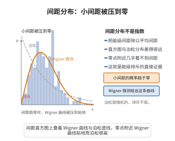

# Wigner猜测（GOE最近邻间距分布）
>
> **一句话大白话**：Wigner surmise 用 $2\times2$ GOE 的精确间距公式近似大维 GOE 的最近邻间距分布；它能很好地刻画能级排斥，但不是大维极限的精确分布。
>
> **小例子**：间距 $s$ 经单位平均间距归一后，$2\times2$ GOE 的精确密度为 $p_{\mathrm W}(s)=\frac{\pi s}{2}e^{-\pi s^2/4}$。对大维 GOE，这条曲线只是近似；真正的大维 bulk 极限由 $\beta=1$ 的 Pfaffian 点过程决定。

## 一、定理介绍

> **前置依赖**：GOE随机矩阵、Pfaffian点过程、sine核与gap概率、最近邻间距统计、能级排斥

Wigner 猜测（Wigner surmise）用下式描述适当归一（平均间距为 $1$）的 GOE 最近邻特征值间距：
$$
p_{\mathrm W}(s)=\frac{\pi s}{2}e^{-\pi s^2/4}.
$$
这个公式来自 $2\times2$ GOE 的计算，并且对该二维模型精确成立。对 $n\to\infty$ 的 GOE bulk 间距，它是极好的近似而非精确极限；精确极限分布由 $\beta=1$ 的 Pfaffian 点过程及其空隙概率决定。二者在 $s\to0$ 时都呈线性排斥，但 Wigner 公式并不给出精确极限密度的全部细节，连首项系数也不能混同。

## 几何直观

图意在说明：Wigner 近似曲线与泊松间距不同，零点附近概率趋零，体现能级排斥；图中的 Wigner 曲线不应被读作大维 GOE 的精确极限曲线。

## 二、原理思路

先在 $2\times2$ GOE 中直接计算特征值差并归一化平均间距，精确得到 $p_{\mathrm W}$。大维 GOE 的 bulk 特征值则形成 $\beta=1$ 的 Pfaffian 点过程，其极限空隙概率由相应的矩阵值 sine 核及 Pfaffian/Fredholm 表达决定，再由空隙概率得到最近邻间距密度。精确极限在小间距处同样呈线性排斥，数值上与 $p_{\mathrm W}$ 很接近，但两条曲线并不相同。

## 三、定理的严格表述

设 $\lambda_1\le\cdots\le\lambda_n$ 为 $n\times n$ GOE 的特征值，在谱的 bulk 中取相邻间距并按局部平均间距归一化。严格区分两个命题：

1. **$2\times2$ 精确公式**：对 $2\times2$ GOE，归一化后的最近邻间距密度恰为
   $$p_{2\times2}(s)=p_{\mathrm W}(s)=\frac{\pi s}{2}e^{-\pi s^2/4}.$$
2. **大维极限**：当 $n\to\infty$ 时，真正的极限密度 $p_{\mathrm{GOE},\infty}(s)$ 由 $\beta=1$ Pfaffian 点过程的 bulk 空隙概率决定。Wigner surmise 给出的是
   $$p_{\mathrm{GOE},\infty}(s)\approx p_{\mathrm W}(s),$$
   而不是等式。精确极限满足小间距线性排斥 $p_{\mathrm{GOE},\infty}(s)\sim Cs$；常数 $C$ 由精确点过程决定，不能用 surmise 的 $\pi/2$ 取代。

## 四、证明过程

$2\times2$ 的情形可通过联合特征值密度直接积分，得到精确的 Wigner 公式。大维极限则需要另一条论证：把 GOE 特征值写成 $\beta=1$ Pfaffian 点过程，取 bulk 标度极限，再由矩阵值核的空隙概率及其导数表示真实间距密度。对该精确表达作小间距展开可证明线性排斥。数值计算表明 Wigner 公式与真实极限非常接近，但这种接近不是恒等式，因此不存在把 surmise 证成大维“精确极限”的结论。

## 五、应用与意义

Wigner 猜测及其兄弟的间距统计是"量子弹跳"（量子混沌 BGS 关联）的核心概念，也是随机矩阵普适性的物理实证：系统的谱在经典混沌时展示 GUE/GOE 排斥，而可积系统是泊松。用于能级统计、无规矩阵在大核数据中的评估。

## 课堂问答

**老师**：Wigner 猜测给出的最近邻间距分布是什么？它和泊松分布的本质差别在哪？

**学生**：结论：归一化平均间距为 $1$ 时，Wigner surmise 给出
$$p_{\mathrm W}(s)=\frac{\pi s}{2}e^{-\pi s^2/4}.$$
它对 $2\times2$ GOE 精确，对大维 GOE 的 bulk 极限则是近似。与泊松分布的本质差别在 $s\to0$：二者都呈**线性排斥**，而泊松间距密度 $e^{-s}$ 在 $0$ 处为 $1$。常见误区是把 surmise 当成大维精确极限，或声称它与真实极限连首项系数都相同；真实极限必须由 $\beta=1$ Pfaffian 点过程计算。

**老师（追问）**：严格版本是怎么处理 GOE 间距的？

**学生**：大维 GOE 的 bulk 极限是 $\beta=1$ 的 Pfaffian 点过程；其空隙概率由矩阵值 sine 核的 Pfaffian/Fredholm 表达给出，再由适当的导数关系得到最近邻间距密度。该表达才定义真正的极限分布，并可推出 $s\to0$ 时的线性排斥。与 GUE 的标量行列式核不同，GOE 需要 Pfaffian 结构；Wigner surmise 只是对最终密度的高精度初等近似。

**老师（拓展）**：这个间距统计的物理意义？

**学生**：它刻画量子混沌系统的能级统计：经典混沌的系统谱呈 GOE/GUE 排斥，可积系统呈泊松。它是随机矩阵普适性最著名的物理实证，并与 BGS 猜想、能级关联紧密相连。

## 相关条目

- 本条使用的基本定义与记号见“分析”。
- [本级定理索引](./index.md)：查看同级的直接前置与后继条目。
- [总定理依赖表](../../index.md#定理分级表)：在完整依赖表中定位本条目。
