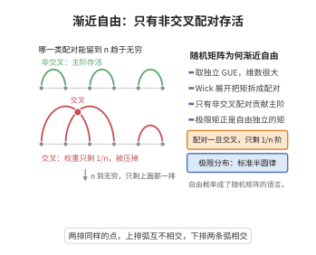

# Voiculescu渐近自由性定理
>
> **一句话大白话**：适当规范化的独立随机矩阵（如独立 GUE）在 $n\to\infty$ 趋于"渐近自由"——它们的联合矩依自由独立的方式分解，就像独立随机变量—自由独立。
>
> **小例子**：独立 GUE（规范化）$A_n,B_n$ 渐近自由：期望 $\varphi_n(M^*M)$ 的联合矩收敛到自由独立对应的矩，例子为 $\mathbb E\,\mathrm{tr}\,\frac1n(A_n^2B_n^2+…)$ 匹配 free 值。

## 一、定理介绍

> **前置依赖**：Wigner矩阵与GUE、Gaussian Wick图展开、非交叉配对、渐近自由定义、自由矩

Voiculescu渐近自由性定理（Voiculescu 1991）断言：若干（适当地规范化：对次对角无偏积矩）独立的高斯 Wigner 矩阵族在 $n\to\infty$ 渐近自由。它解释随机矩阵谱为何遵循自由概率—GUE 特征值统计（即半圆、Marchenko–Pastur 等）—并成为"自由概率 = 渐近理论随机矩阵语言"的奠基。

## 几何直观

图意在说明：矩阵矩展开成配对之和，交叉配对只剩 1/n 阶，n 趋于无穷后只留下非交叉部分，正好是自由独立的定义。

## 二、原理思路

证明通随机矩组合计算：把规范化的 GUE 矩阵族的角度矩依期望对Bernoulli 图（Gaussian Wick）展开，联乘成对(非交叉)配对待加权的图收缩。主阶对应非交叉配对（因 gauge 归一 $\frac1n$ kill 高端），恰为自由独立的核定义。因此联合矩的拓扑反正交极限吻合自由间接矩。

## 三、定理的严格表述

设 $\{A_n^{(1)},\dots,A_n^{(r)}\}$ 为 $n\times n$ 独立 GUE（或 Wigner、标准化/± stable 条件下），配 $C^*$-概率空间 $(\mathbb M_n,\mathbb E\,\mathrm{tr}/n)$。则对任意 *-多项式 $P$，
$$
\lim_{n\to\infty}\langle P(A_n^{(1)},\dots,A_n^{(r)})\rangle=\varphi\big(P(a^{(1)},\dots,a^{(r)})\big),
$$
其中 $a^{(i)}$ 为以标准半圆分布为（单边）分布的**自由独立**非交换随机变量。即 $A_n^{(i)}$ 渐近自由。

## 四、证明过程

用矩的 Wick 展开：(1) GUE 矩可写为 Gaussian 配对的图和；(2) 对 $\frac1n$ 拓扑用放大：仅非交叉、最大（每环无面积）的配对在 $n\to\infty$ 幸存；(3) 幸存项恰好为自由独立矩的展开（all-noncrossing contraction）；(4) 对一般 Wigner（有偏）用边缘驱散参数控制。故各时刻矩收敛。

## 五、应用与意义

此定理把随机矩阵谱统计与自由概率对接，使大随机矩阵的联合谱可用自由累积计算（如独立随机矩阵共存）。它为"自由概率=渐近随机矩阵"，在量子信息（随机酉的差分谱）、通信、经济分析与数值大谱估计中奠定可计算基础。

## 课堂问答

**老师**：随机矩阵怎么会"自由独立"？这条定理到底断言了什么？

**学生**：结论：适当规范化的独立 GUE（或 Wigner）矩阵族随 $n\to\infty$ **渐近自由**。对任意非交换多项式 $P$，有 $\lim_{n\to\infty}\langle P(A_n^{(1)},\dots,A_n^{(r)})\rangle=\varphi(P(a^{(1)},\dots,a^{(r)}))$，其中 $a^{(i)}$ 是自由独立、单边分布为标准半圆的非交换变量。

**老师（追问）**：证明里为什么只有非交叉配对能存活？

**学生**：GUE 的矩可写成 Gaussian Wick 配对图之和，每个图带 $n^{\text{（欧拉示性数）}}$ 型权重。规范化的 $1/n$ 因子会把"有面积/高 genus"的配对压制掉，只有**非交叉且每环无面积**（genus $0$）的图在 $n\to\infty$ 幸存。而自由独立的矩定义正是要求非交叉之外收缩全为 $0$，两边恰好吻合，故拓扑极限等于自由矩。

**老师（拓展）**：如果矩阵不是精确的 GUE，而是一般带偏的 Wigner 矩阵呢？

**学生**：结论仍成立，只要满足矩条件——第二矩归一、混合矩渐近消失。此时 Wick 图论被"追踪混合矩消失"的估计取代，仍得半圆极限并保持渐近自由；但若第二矩不匹配或存在系统性偏好，就需要修正规范化。这正是自由概率作为随机矩阵"渐近普适语言"的底气。 它把随机矩阵谱统计与自由累积计算对接，是"自由概率 = 渐近随机矩阵论"的奠基定理。
