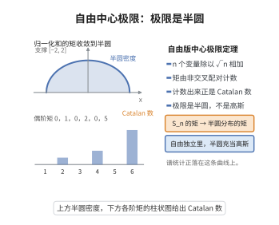

# 自由中心极限定理
>
> **一句话大白话**：自由独立的非交换随机变量的归一化和，在矩意义下收敛到——不是高斯，而是半圆分布（自由概率的高斯）。
>
> **小例子**：若 $\{a_i\}$ 自由独立、$\varphi(a_i)=0$、$\varphi(a_i^2)=1$，则 $S_n=\frac{a_1+\dots+a_n}{\sqrt n}$ 的矩极限给出 $\varphi(S_n^k)\to\begin{cases}\mathrm{Cat}_{k/2},&k\text{偶}\\0,&k\text{奇}\end{cases}$，即半圆分布的矩。

## 一、定理介绍

> **前置依赖**：自由独立、$C^*$-概率空间与自由积、非交叉配对与Catalan数、矩方法、Carleman矩判定

自由中心极限定理（Voiculescu）是自由概率论对应经典 CLT 的定律：对零均值、方差 $1$、矩多项式有界的自由独立随机变量 $\{a_i\}$，其均方和 $S_n=(a_1+\dots+a_n)/\sqrt n$ 在矩意义下收敛到**半圆分布** $s$（密度 $\frac1{2\pi}\sqrt{4-x^2}$）。它把"独立"替换为"自由独立"，把"高斯"替换为"半圆"，是自由概率与随机矩阵融合的引擎。

## 几何直观

图意在说明：归一化和的矩由非交叉配对计数决定，收敛到 Catalan 数，于是极限分布是半圆而非高斯。

## 二、原理思路

基本证明用组合自由代数：把 $\varphi(S_n^k)$ 展开为非交换矩的"自由级联"（自由独立→混合矩 vanish）。其领头（连杆最优）项变成对非交叉配对的计数 $\operatorname{NC}(2d)$，给出 Catalan 数。矩的 bound 由各 $\varphi(a_i^{m})$ 的有界性保证。最后用矩确定唯一性（Carleman 条件对半圆）完成。

## 三、定理的严格表述

设 $(\mathcal A,\varphi)$ 为 $C^*$-概率空间，$\{a_i\}\subset\mathcal A$ 自由独立，满足 $\varphi(a_i)=0$、$\varphi(a_i^2)=1$，且存在 $C>0$ 使对一切 $i\ge1,k\ge1$，$|\varphi(a_i^k)|\le C^k$。记 $S_n=\frac1{\sqrt n}\sum_{i=1}^n a_i$。则对每个 $k\ge1$，
$$
\lim_{n\to\infty}\varphi(S_n^k)=\varphi(s^k)=
\begin{cases}
\mathrm{Cat}_{k/2}:=\frac{1}{k/2+1}\binom{k}{k/2},&k\text{ 偶}\\
0,&k\text{ 奇}
\end{cases}
$$
其中 $s$ 为半圆分布（$d\mu_s=\frac1{2\pi}\sqrt{4-x^2}\mathbf 1_{|x|\le2}dx$）。

## 四、证明过程

用线性泛函与自由积：按自由独立把大的矩 $\varphi(S_n^k)$ 依（广义）自由积展开为代价（noncrossing）分解；理想中的次领头（linking）项以 $n^{-1/2}$ 幂收缩，bounded 项除以 $\sqrt n$ 消失；串联得非交叉配对计数 > Catalan 数。因此各阶矩收敛，且因半圆矩被 Carleman 条件确定唯一，推论分布收敛。

## 五、应用与意义

自由 CLT 是自由概率（与随机矩阵、算符代数）的万有定律：它解释为何大随机矩阵的特征值的归一化和的谱呈半圆、为 GUE/Wigner 谱提供概念基，也是大型随机算子与小张积非交换度的建模工具。

## 课堂问答

**老师**：自由概率里的"中心极限定理"，独立和高斯分别被替换成了什么？

**学生**：结论：自由独立、零均值、方差 $1$ 的变量之和收敛到**半圆分布**，而不是高斯。若 $\{a_i\}$ 自由独立且 $\varphi(a_i)=0,\varphi(a_i^2)=1$，则 $S_n=\frac1{\sqrt n}\sum_{i=1}^n a_i$ 满足 $\varphi(S_n^k)\to\mathrm{Cat}_{k/2}$（$k$ 偶）或 $0$（$k$ 奇）。理由是：混合矩只在不交叉配对下不消失，领头项就是对非交叉配对的计数。

**老师（追问）**：经典 CLT 的高斯矩是 $2^{k/2-1}(k-1)!!$（所有配对计数），自由情形为什么变成 Catalan 数？

**学生**：关键差别在"哪种配对存活"。经典独立里所有成对配对都对极限有贡献，故计数是全部配对；而自由的混合矩只在**非交叉（noncrossing）**配对下逃过 $n^{-1/2}$ 的收缩，计数变为 $\operatorname{NC}(2d)$，即 $\mathrm{Cat}_{d}=\frac{1}{d+1}\binom{2d}{d}$。常见误区是把独立情形的全部配对计数照搬过来——那会得到高斯而非半圆。

**老师（拓展）**：为什么"矩收敛"就能推出"分布收敛"？

**学生**：靠 Carleman 矩判定。半圆分布的矩增长为 $\mathrm{Cat}_{d}\sim 4^d d^{-3/2}$，满足 $\sum_{d\ge1}m_{2d}^{-1/(2d)}=\infty$，故矩唯一确定测度；矩收敛即蕴含弱收敛。更一般地，任何矩被 Catalan 数控制的分布都必是半圆，这正是自由独立"万有极限"的来源。 反过来看，半圆密度 $\frac1{2\pi}\sqrt{4-x^2}$ 支撑在 $[-2,2]$，正对应随机矩阵 Wigner 半圆律，这也是自由概率与随机矩阵融合的引擎。
