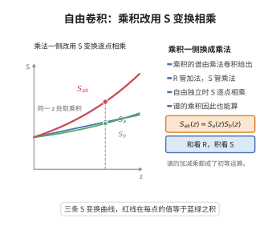

# 自由卷积的乘法公式
>
> **一句话大白话**：自由独立（并满足一定条件）随机变量乘积的自由卷积，可以用其 S-变换/矩图给出简洁公式——不是 $\mathcal R$ 加法，而是 $\mathcal S$ 的乘法形式。
>
> **小例子**：对自由独立且选阶条件下 $a,b$，自由乘法卷积满足 $\mathcal S_{ab}(z)=\mathcal S_a(z)\,\mathcal S_b(z)$（在合适的变量变换下）。

## 一、定理介绍

> **前置依赖**：自由独立、S-变换、自由乘法卷积、非交叉收缩与自由累积量、矩生成函数

自由卷积的乘法公式（Voiculescu；关于乘积的自由卷积算子 $\boxtimes$）给出两个自由独立变量乘积的谱的显式：引入 S-变换，保自由乘法卷积线性化 $\mathcal S_{ab}=\mathcal S_a\mathcal S_b$。本定理是自由概率中把（谱的）乘积也映射到简单乘法的一等结果，是把 $\mathcal R$ 加法（和）与 $\mathcal S$ 乘法（积）统一的两部曲。

## 几何直观

图意在说明：加法看 R 变换的逐项相加，乘法则看 S 变换的逐点相乘，谱的乘积由此可得。

## 二、原理思路

若以矩生成函数 $M_X$ 与 R-关系定义，乘积自由卷积 $a\boxtimes b$ 需要专门的变换。定义 S-变换：对 $X$（$\varphi(X)\ne0$）令 $\mathcal S_X(\langle w\rangle)=…$（由 $M$ 与 $\mathcal R$ 联系），使 $\mathcal S_{ab}=\mathcal S_a\mathcal S_b$。证明归因于自由乘法累积（noncrossing 独立积的收缩）的乘性：$\alpha_{ab}$ 的非交叉分解在自由独立条件下逐层相乘。

## 三、定理的严格表述

设 $a,b$ 为 $(\mathcal A,\varphi)$ 中自由独立元素（适当选阶），$\varphi(a),\varphi(b)\ne0$，其自由乘法卷积记 $a\boxtimes b$（对应谱 $\mu_a\boxtimes\mu_b$）。设 $M_X(z)=\sum_{n\ge0}\varphi(X^n)z^n$ 为矩生成函数，$S_X$ 为 $X$ 的 S-变换：
$$
\mathcal R_X(z)\;\text{与}\;M_X \text{联系},\, S_X(z)=\text{复合给出}（Voiculescu 定义）.
$$
则
$$
\mathcal S_{ab}(z)=\mathcal S_a(z)\,\mathcal S_b(z),
$$
从而谱 $\mu_{ab}=\mu_a\boxtimes\mu_b$ 由该式确定。

## 四、证明过程

第一步以非交叉集合与配对定义自由乘法卷积的属性；第二步证明自由乘法累积对积的乘性：把非交叉的独立积分解为单块，得收缩相乘；第三步将这些乘性以 S-变换重新标定（把 $\mathcal R$-生成与 $M$ 关系反演为 $\mathcal S$），得到乘法公式。适当收敛/可分解条件保证幂级数对所论谱收敛。

## 五、应用与意义

乘积卷积公式用于自由随机变量谱的乘法合成（如自由乘法、随机矩阵乘积、自由回归模型），在自由概率、固定-随机乘积谱、与无线系统（次均值谱）以及 QA）之间的联系皆起关键作用，与 R-加法共同构成自由累积计算的完整框架。

## 课堂问答

**老师**：和用 R 变换线性化，那"积"用什么？形式是什么？

**学生**：结论：用 S-变换，自由独立（且 $\varphi(a),\varphi(b)\ne0$）的乘积满足 $\mathcal S_{ab}(z)=\mathcal S_a(z)\mathcal S_b(z)$，从而谱 $\mu_{ab}=\mu_a\boxtimes\mu_b$ 由该式确定。

**老师（追问）**：乘积为什么不能继续用 R 变换，而要另立一个 S？

**学生**：因为 R 是为"加法自由卷积"量身定做的：它对 $n$-累积量做线性叠加。乘积下累积量的结构由非交叉收缩对"单块独立积"的**乘性**给出，需要重新标定。以矩生成函数 $M_X(z)=\sum_{n\ge0}\varphi(X^n)z^n$ 为桥，S-变换与 R-变换通过复合互相转译，$\mathcal S_{ab}=\mathcal S_a\mathcal S_b$ 就是在乘性侧的正交化。误区：把 $\mathcal R_{ab}=\mathcal R_a\mathcal R_b$ 之类直接套用——乘积没有 R 的线性化。

**老师（拓展）**：它跟 R 加法如何统一？

**学生**：两者是同一套自由累积框架的两面：R 对加法自由卷积 $\boxplus$ 线性化，S 对乘法自由卷积 $\boxtimes$ 乘性化，而 $M_X$ 的复合把它们连起来。乘积卷积谱见于随机矩阵乘积、自由回归与通信中的次均值谱，是自由概率乘性理论的出发点。 一句话记忆：R 管"和"（相加），S 管"积"（相乘）。
