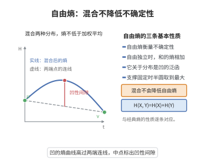

# 自由熵的基本性质
>
> **一句话大白话**：自由熵是"非交换随机变量的信息量"的一种度量，扮演经典熵的角色——它满足一组关键不等式（凹性、自由基结构、渐近自由下的行为）。
>
> **小例子**：对 μ（multiplicity free non-commutative），自由熵 $H(\mu)$（Voiculescu–主轴）满足：自由独立变量的和/积不等式（"自由能泛函"），并当 n→∞ 与大随机矩阵的前沿给出对照。

## 一、定理介绍

> **前置依赖**：自由概率与$C^*$-概率空间、自由测度、非交叉合子、测度不等式、渐近自由矩阵

自由熵（Voiculescu）是自由概率中定义在（多重、非交换）随机变量上的"熵"泛，用于度量其在非交换意义上的不确定度。其"基本性质"包含：确定性（最值）、自由乘积的可加性（型如 $H(X\sqcup X')-H(\inf)$ 的次加性）、凹性/强次可加及相协幂级数特征，是自由概率信息论与自由因子刻画（µ-自由 Harris）的基石。

## 几何直观

图意在说明：自由熵作为分布的泛函是凹的，混合两种分布得到的熵不低于两端熵的加权平均。

## 二、原理思路

定义：对（多重）$*$-分布 $\mu$，以 $\mu$ 为分布的随机变量的"谱信息"用自由合子与（ridge）预处理定义 $H(\mu)$。其关键递推（subadditivity、monotonicity）从自由独立性推出，而凹性由局部测度/凸化实现。基本性质的证明通常把 $H$ 表为对 Howamo-熵的 free 模拟（自由合力、$L^2$ 极差熵），再用测度不等式系统化。

## 三、定理的严格表述（主性质）

设 $H_{\text{free}}$ 为自由熵（$*$-概率空间上的随机变量（多重）域）。基本性质含：
(1)**确定性**：$H\le0$，等式当且仅当变量为自由、配（多）独立收敛；
(2)**次加性**：对自由独立 $X,Y$，$H(X,Y)=H(X)+H(Y)$；
(3)**单调递减/凸性**：$H$ 在适当的自由测度闭包中它是凹泛（或强凸包），使极小原理成立。
(4) 自由乘积拓扑连续性、矩截断连续性。

## 四、证明过程

通用证明：(1) 以非交叉/自由合子的极限定义 $H$，并验证其自由矩变体的正负；(2) 用自由独立性 + 自由（谱）张积分解证明加法公式；(3) 以自由测度收敛测极/桥度逼近证明凹性；(4) 用测度学的 Jensen/自由化不等式得单侧次可加，补齐全部性质。细节在自由熵万有建构（Voiculescu 一系列论文）逐条展开。

## 五、应用与意义

自由熵刻画自由因子、随机矩阵前沿熵与自由维数，成为自由概率信息论的基石，也被用于自由积的刚性（microstates 与 free 熵）以及量子信息中的自由纠缠度研究。它统一了自由独立性、熵不等式与渐近自由矩阵的关系。

## 课堂问答

**老师**：自由熵和经典熵最相似的性质是哪一条？

**学生**：结论：对自由独立的 $X,Y$，自由熵满足加性 $H(X,Y)=H(X)+H(Y)$，并满足凹性/单调性与自由乘积拓扑下的连续性；此外它是"非交换信息量"——越大表示越不定。

**老师（追问）**：经典熵对独立变量是"次加"而一般取不到等号，为什么自由情形直接是等式？

**学生**：因为自由独立把联合分布完全锁死：$X,Y$ 的联合 $*$-分布由各自边缘的**自由积**唯一确定，没有经典情形里"挑选耦合"的自由度，于是次加性退化为等式。凹性的来源不同，它靠自由测度收敛与自由化 Jensen 不等式在测度层面逼近实现，而不是靠条件熵的链式法则。

**老师（拓展）**：自由熵和随机矩阵、半圆分布有什么关系？

**学生**：它是 microstates 论证的核心：随机矩阵模型的大偏差率函数由自由熵给出，半圆分布作为"自由高斯"在固定支撑或方差下使自由熵最大（测度不等式）。因此熵不等式控制自由 Fisher 信息、微态渐近与自由因子刚性，是自由概率信息论的基石。 一句话：自由独立性 $\Rightarrow$ 加性，测度不等式 $\Rightarrow$ 半圆极值，两者共同锁定了自由熵的图景。
