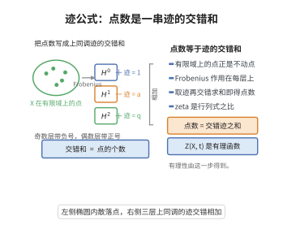

# Lefschetz-Grothendieck 迹公式

> **一句话大白话**：把"映射的不动点数"改造成"有限域上的有理点数"，再用 étale 上同调中 Frobenius 的迹来数点：$\#X(\mathbb{F}_q)$ 等于上同调迹的交错和。
>
> **小例子**：$X=\mathbb{A}^1_{\mathbb{F}_q}$：$H^0_c=0$、$H^2_c=\bar{\mathbb{Q}}_\ell(-1)$，迹为 $0+0+q=q=\#\mathbb{A}^1(\mathbb{F}_q)$ ✓；$X=\mathbb{P}^1$：$1+q=\#\mathbb{P}^1(\mathbb{F}_q)$ ✓。

## 一、定理介绍

> **前置依赖**：étale 上同调与紧支上同调、几何 Frobenius 与算术 Frobenius、Lefschetz-Verdier 不动点公式（对应版本）、Poincaré 对偶与 Künneth 公式、zeta 函数、Weil 猜想

Grothendieck-Lefschetz 迹公式是 étale 上同调理论的核心定理（SGA 4½，Deligne 的 Rapport sur la formule des traces），它把一个代数簇在有限域上的有理点计数表示为几何 Frobenius 作用的迹的交错和。它是 Weil 猜想证明框架的关键技术：由它把 zeta 函数写成上同调特征多项式的交错积，从而用代数几何方法证明 zeta 函数的有理性、函数方程，并由 Deligne（Weil I, II）得到特征值的绝对值界（Riemann 猜想）。

本条目与"椭圆曲线与模形式"层级的 Lefschetz 迹公式形成对照：那里用同调上的线性迹数不动点，这里把同调换成 étale（紧支）上同调、把映射换成 Frobenius 对应，是同一原理在算术世界的化身。

## 几何直观

图意在说明：曲线在有限域上的点数，等于 Frobenius 在每层上同调上作用的迹的交错和。

## 二、原理思路

1. **有理点即不动点**：$x\in X(\mathbb{F}_{q^n})$ 当且仅当表示 $x$ 的闭点在几何 Frobenius 下不变，等价地图像 $\Gamma_{\mathrm{Frob}^n}$ 与对角 $\Delta_{\bar X}$ 在 $\bar X\times\bar X$ 中的相交只含该点。
2. **不动点数 → 上同调迹**：用 Lefschetz-Verdier 不动点公式（对应/相交理论版本）把 $\Gamma_{\mathrm{Frob}^n}$ 与 $\Delta$ 的相交数译为 $\bar X$ 紧支上同调上 Frobenius 作用的迹。
3. **带系数的版本**：对构造性层 $\mathcal{F}$，局部贡献由该点处 Frobenius 在茎 $\mathcal{F}_x$ 上的迹给出，得到一般的迹公式。
4. **推论**：Frobenius 在 $H^i_c$ 上的特征多项式给出 zeta 函数的有理表达，进而由 Deligne 的定理得到特征值大小（这是本公式最重要的应用）。

## 三、定理的严格表述

设 $X$ 为 $\mathbb{F}_q$ 上有限型（分离）概形，$\bar X=X\times_{\mathbb{F}_q}\bar{\mathbb{F}}_q$，$\ell$ 为不整除 $q$ 的素数，$\mathcal{F}$ 为 $\bar X$ 上的构造性 $\bar{\mathbb{Q}}_\ell$-层（更一般地，带 Frobenius 相容作用的 Weil 层；对 $\mathbb{Z}/\ell^n$-层先证再取极限）。

**定理（Grothendieck-Lefschetz 迹公式）**：对每个 $n\ge1$ 有
$$\sum_{x\in X(\mathbb{F}_{q^n})}\mathrm{tr}\Big(\mathrm{Frob}_x^{\,n}\mid\mathcal{F}_x\Big)=\sum_{i\ge0}(-1)^i\,\mathrm{tr}\Big(\mathrm{Frob}_q^{\,n}\mid H^i_c(\bar X,\mathcal{F})\Big),$$
其中 $H^i_c(\bar X,\mathcal{F})$ 为带 Frobenius 作用的紧支 étale 上同调（有限维 $\bar{\mathbb{Q}}_\ell$-向量空间，$i>2\dim X$ 时为零），$\mathrm{Frob}_x$ 为作用在茎 $\mathcal{F}_x$ 上的 Frobenius，$\mathrm{Frob}_q$ 为 $\bar X$ 上的几何 Frobenius（$\phi_q:x\mapsto x^q$ 的逆）。

**推论（zeta 函数的有理性）**：定义 zeta 函数
$$Z(X,t)=\exp\Big(\sum_{n\ge1}\#X(\mathbb{F}_{q^n})\,\frac{t^n}{n}\Big),$$
则（取 $\mathcal{F}=\bar{\mathbb{Q}}_\ell$）
$$Z(X,t)=\prod_{i\ge0}\det\Big(1-t\,\mathrm{Frob}_q\mid H^i_c(\bar X,\bar{\mathbb{Q}}_\ell)\Big)^{(-1)^{i+1}},$$
从而 $Z(X,t)$ 是有理函数，其分母的零点/极点由 $H^i_c$ 的 Frobenius 特征值给出。

**对应形式**：对 $\mathbb{F}_q$ 上的对应 $X\xleftarrow{c_1}Z\xrightarrow{c_2}X$（$\dim Z=\dim X$），同理有
$$\big\langle c_*\ ,\ \Delta\big\rangle=\sum_i(-1)^i\mathrm{tr}\Big(c^*\mid H^i_c(\bar X,\mathcal{F})\Big),$$
其中 $c^*$ 为对应在上同调上诱导的线性映射；固定点层 $\mathrm{Fix}(c)$ 的局部贡献由 $c$ 在切空间上的作用（Lefschetz 局部因子）给出。

## 四、证明过程

**步骤 1：把有理点写成相交数（几何侧）**

设 $\phi=\phi_q$ 为绝对 Frobenius。曲线 $\Gamma_\phi=\{(\phi(x),x)\}\subset\bar X\times\bar X$ 与对角 $\Delta=\{(\xi,\xi)\}$ 的交点恰为 $(\phi(x),x)=(x,x)$ 的解，即 $x\in\bar X(\mathbb{F}_q)$ 的闭点；一般地 $\Gamma_{\phi^n}$ 与 $\Delta$ 的交点对应 $X(\mathbb{F}_{q^n})$。当 $X$ 光滑且交点孤立横截时，相交数恰为不同闭点的个数
$$\#X(\mathbb{F}_{q^n})=\big\langle\Gamma_{\phi^n},\Delta\big\rangle,$$
当交点不横截（如有分歧、正特征）时，相交数（在 Chow/上同调意义下）以重数计入，仍需由步骤 3 的局部迹公式辨认出正确的有理点贡献。

**步骤 2：Lefschetz-Verdier 不动点公式（上同调侧）**

对 $\bar X\times\bar X$ 上的两个闭子概形的交点类，可在上同调中用 cup-product 与 Poincaré 对偶计算：$\langle\Gamma_{\phi^n},\Delta\rangle$ 等于交错和
$$\sum_i(-1)^i\,\mathrm{tr}\Big(\phi^{n*}\circ\Delta^*\mid H^i(\bar X\times\bar X,\mathcal{F}\boxtimes\mathcal{F}^\vee)\Big)$$
在 Künneth 分解下的对应算子。用 Künneth 公式 $H^*(\bar X\times\bar X)=\bigoplus_{i+j=\bullet}H^i(\bar X)\otimes H^j(\bar X)$ 与 $\Delta^*$、$\phi^{n*}$ 在张量因子上的作用，上式化为
$$\sum_i(-1)^i\,\mathrm{tr}\Big(\phi^{n*}\mid H^i(\bar X,\mathcal{F})\Big),$$
（配合紧支版本的 Poincaré 对偶把 $H^i$ 换成 $H^i_c$）。这就是 Lefschetz-Verdier 不动点公式的实质内容：**对应的相交数 = 上同调迹**。

**步骤 3：局部贡献 = 茎上的 Frobenius 迹**

当交点（即闭点 $x\in X(\mathbb{F}_{q^n})$）孤立时，局部相交重数可由局部化的 Poincaré 对偶计算：在 $x$ 的完备局部环上，$\phi^n$ 在 $\bar X\times\bar X$ 上以横截方式与对角相交，局部因子为
$$\mathrm{tr}\Big(\mathrm{Frob}_x^{\,n}\mid\mathcal{F}_x\Big)\cdot\det\big(1-d\phi^n\mid T_x\big)^{-1}\Big/\dots= \mathrm{tr}\big(\mathrm{Frob}_x^{\,n}\mid\mathcal{F}_x\big),$$
其中"切空间上的因子"恰为 $1$：因为 $\phi^n$ 在 $\mathbb{F}_{q^n}$-有理点的切空间上诱导恒等（$d\phi^n=\mathrm{id}$，Frobenius 在 $\mathbb{F}_{q^n}$ 上的微分平凡），故局部因子退化为茎上的迹。把各孤立交点的贡献求和（用步骤 1 的相交数与分解），即得左端 $\sum_x\mathrm{tr}(\mathrm{Frob}_x^n\mid\mathcal{F}_x)$。对非孤立交点用闭子概形的分解与长正合序列（加性）逐一剥离，最终仍得同一形式。

**步骤 4：归约与曲线情形**

迹公式对 $X$（开/闭子概形的分解、有限粘合）与 $\mathcal{F}$（短正合列的加性）都良好，故可由切除（excision）与长正合序列把一般情形归约为：$X$ 光滑仿射、$\mathcal{F}=\bar{\mathbb{Q}}_\ell$（再对构造性层取有限型逼近）。维数下降用 $\mathbb{A}^1$-纤维化 $X\to S$：对每个闭纤维与基分别应用（用 Leray 谱序列 $E_2^{p,q}=H^p_c(S,H^q_c(\text{纤维}))\Rightarrow H^{p+q}_c(X)$ 与迹的交错相消），逐维递推。曲线情形（$\dim X=1$）是本公式的起点，可由 Weil 关于曲线 zeta 函数的定理（1948，用 Riemann-Roch 与 Jacobian/Weil 对偶直接证明）给出：对光滑射影曲线 $C$，
$$\#C(\mathbb{F}_q)=q+1-\mathrm{tr}\big(\mathrm{Frob}\mid H^1_c(\bar C)\big),$$
$H^0_c,H^2_c$ 分别贡献 $1,q$；对带系数 $\mathcal{F}$ 的曲线情形同理（用 Grothendieck-Ogg-Shafarevich 公式与局部 Euler 特征计算）。于是由步骤 1-3 的对应论证与步骤 4 的归约递推，公式对一切有限型 $X$ 成立。

**步骤 5：zeta 函数的推论**

把公式（$\mathcal{F}=\bar{\mathbb{Q}}_\ell$）代入 $Z(X,t)$ 的指数定义：
$$\log Z(X,t)=\sum_{n\ge1}\Big(\sum_i(-1)^i\mathrm{tr}\,\mathrm{Frob}_q^n\mid H^i_c\Big)\frac{t^n}{n}=\sum_i(-1)^i\sum_{n\ge1}\frac{\mathrm{tr}\big((\mathrm{Frob}_q\mid H^i_c)^n\big)}{n}t^n.$$
对线性算子 $A$ 有 $-\log\det(1-tA)=\sum_{n\ge1}\frac{\mathrm{tr}(A^n)}{n}t^n$，故
$$\log Z(X,t)=\sum_i(-1)^i\big(-\log\det(1-t\,\mathrm{Frob}_q\mid H^i_c)\big)=\sum_i(-1)^{i+1}\log\det\big(1-t\,\mathrm{Frob}_q\mid H^i_c\big),$$
指数化即得 $Z(X,t)=\prod_i\det(1-t\,\mathrm{Frob}_q\mid H^i_c)^{(-1)^{i+1}}$。由于 $H^i_c$ 有限维且当 $i>2\dim X$ 时为零，$Z(X,t)$ 是有理函数。定理与推论证毕。

## 五、应用与意义

1. **Weil 猜想的证明框架**：迹公式把 zeta 函数的上同调表达（有理性）、Poincaré 对偶（函数方程，Weil II 中证明）与 Frobenius 特征值的绝对值界（Riemann 猜想，Deligne 的 Weil I/II）联结成一条链条，是 Grothendieck 纲领的核心产物。

2. **模形式与椭圆曲线**：对模曲线 $X_0(N)$（§ 本层级主题）与 Hecke 对应应用迹公式，$H^1_c$ 上 Hecke 对应/Frobenius 的迹给出 Hecke 特征值的算术信息，连接 Eichler-Selberg 迹公式、$\ell$-adic 表示与模形式的 $q$-展开，是模性定理与 Langlands 纲领的技术基础。

3. **推广**：迹公式有对应版本（Lefschetz-Verdier、带 $K$-理论系数的迹公式）、非交换/栈版本（Behrend 的 $\ell$-adic 迹公式用于 Deligne-Lusztig 与计数栈上的点）、导出/迹映射（Grothendieck 的 trace map、拓扑 Hochschild 同调）与现代的"迹公式机器"（Weil 猜想的高维与函数域类比：Lafforgue、Ngô 的基本引理）。它也是模型论/几何稳定性中"计数 = 上同调"范式的原型。

## 课堂问答

**老师**：这条迹公式把"数点"变成了什么？

**学生**：结论：$\sum_{x\in X(\mathbb{F}_{q^n})}\mathrm{tr}(\mathrm{Frob}_x^n\mid\mathcal F_x)=\sum_{i\ge0}(-1)^i\mathrm{tr}(\mathrm{Frob}_q^n\mid H^i_c(\bar X,\mathcal F))$。即有理点计数等于紧支 étale 上同调上 Frobenius 作用的交错迹；取 $\mathcal F=\bar{\mathbb{Q}}_\ell$ 时右端就是 $\#X(\mathbb{F}_{q^n})$。

**老师（追问）**：这一步的几何直觉是什么？

**学生**：$x\in X(\mathbb{F}_{q^n})$ 当且仅当对应闭点被几何 Frobenius 固定，等价于 Frobenius 图 $\Gamma_{\phi^n}$ 与对角 $\Delta$ 在 $\bar X\times\bar X$ 中的交点。再用 Lefschetz–Verdier 不动点公式把"相交数"翻译成"上同调迹"：局部因子恰是茎上的 Frobenius 迹（因为 $d\phi^n=0$）。

**老师（拓展）**：由此怎么得到 Zeta 函数的有理性？

**学生**：代入 $Z(X,t)=\exp\big(\sum_{n\ge1}\#X(\mathbb{F}_{q^n})\frac{t^n}{n}\big)$，用 $-\log\det(1-tA)=\sum_n\frac{\mathrm{tr}(A^n)}{n}t^n$ 得 $Z(X,t)=\prod_{i\ge0}\det(1-t\,\mathrm{Frob}_q\mid H^i_c)^{(-1)^{i+1}}$。因 $H^i_c$ 有限维、$i>2\dim X$ 时为零，故是 $\mathbb{Q}(t)$ 里的有理函数。 这正是 Weil 猜想证明框架的技术核心：有理性来自迹公式，函数方程来自 Poincaré 对偶，特征值界则是 Deligne 的 Weil I/II。
