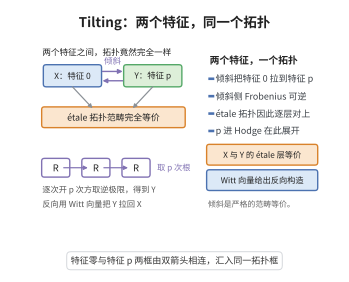

# Perfectoid空间的Tilting对应
>
> **一句话大白话**：Perfectoid（特征 0 的完美化空间）可与一个特征 p 的"倾斜版本"联系，使两者的平展拓扑完全等价——这就是 Tilting 对应（Scholze）。
>
> **小例子**：设 $(R,R^+)$ 为 perfectoid affinoid（特征 0），其倾斜 $R^\flat=\varprojlim_{x\mapsto x^p}R$ 是特征 p perfectoid 环，且 $\mathrm{Spec}(R)$ 与 $\mathrm{Spec}(R^\flat)$ 有范畴等价流（étale 拓扑）$X_{\acute et}\cong X^\flat_{\acute et}$。

## 一、定理介绍

> **前置依赖**：perfectoid环与affinoid空间、倾斜逆极限构造、Witt环结构、平展拓扑、拟凝聚层范畴

Perfectoid 空间的 Tilting 对应（Scholze 2012）断言：给一个 perfectoid（特征 0/混合）affinoid 空间 $X$，存在其**倾斜**（tilt）$X^\flat$——一个特征 p 的 perfectoid 空间——使得由 $X\mapsto X^\flat$ 诱导的函子
$$
\operatorname{Perf}_0\;\xrightarrow{\;(-)^\flat\;}\;\operatorname{Perf}_p,\qquad X_{\acute et}\cong X^\flat_{\acute et}
$$
给出**平展拓扑的等价**，并保持拟凝聚层性与几何性质。这容许把特征 0 的 p-adic 几何问题"翻译"到更易处理的特征 p。

## 几何直观

图意在说明：取逆极限开 p 次方把特征 0 的空间倾斜成特征 p 的空间，两者的 étale 拓扑完全一致。

## 二、原理思路

构造倾斜用 $x$ 的 p-幂根：对完美化环 $R$，定义倾斜映射 $\flat:R^\flat=\varprojlim_{x\mapsto x^p}R$ 配取余类似（Witt）结构；它是"$p^{1/p^\infty}$ 特征"。Tilting 等价的关键是：(i) 平展覆盖与 perfectoid 的性质在 $\flat$ 下"不变"；(ii) 拟凝聚/coh $\mathcal O_X^{+}$ 的范数与倾斜一致。故对平展、拟凝聚、拓扑与笔象皆等价。

## 三、定理的严格表述

设 $X$ 为 perfectoid 空间。定义其倾斜 $X^\flat$（唯一，特征 p 的 perfectoid 空间，使陪环的 $\flat$-约化同构）。则存在一个自然等价
$$
X_{\acute et}\cong X^\flat_{\acute et}
$$
（平展拓扑的范畴等价），且该等价诱导拟凝聚（及 $\mathcal O_X^{+}$-模 ）范畴的对应，并保持完成化、拟凝聚性与 coh。特别地，完美化物/光滑类型的性质由倾斜判定。

## 四、证明过程

Scholze 的路线：定义 $\flat$ 函子在 perfectoid ring/affinoid 上；用 perfectoid 基的 Faltings' almost purity 与"几乎仿射嵌入"证明平展覆盖在 $\flat$ 下保持（几乎拟凝聚）；对一般空间经粘合与整套完成性扩到 perfectoid 空间整体，并将拟凝聚性按其局部模型验证，最终给出拓扑（完成→程）与等价的严格证明。

## 五、应用与意义

Tilting 对应是 perfectoid 几何的支点：容许特征 0 与 p 间自由横切，推导代数基本群、（重量）上同调与高度 1 理论；为 Hodge 理论、p-adic 局部 Langlands 与近似态 mod 结构提供统一算术工具，是近年来数论最重要的技术之一。

## 课堂问答

**老师**：Tilting 对应最核心的等价是什么？

**学生**：结论：$X\mapsto X^\flat$ 给出**平展拓扑的范畴等价** $X_{\acute et}\cong X^\flat_{\acute et}$。即特征 $0$（或混合特征）的 perfectoid affinoid 空间，与其特征 $p$ 的倾斜版本在平展拓扑层面完全一致，并保持拟凝聚层范畴。

**老师（追问）**：倾斜怎么构造？为什么能保持平展信息？

**学生**：先取 p-幂根逆极限 $R^\flat=\varprojlim_{x\mapsto x^p}R$，它自然带特征 $p$ 与 Frobenius，配 Witt 向量结构得到特征 $p$ perfectoid 环。能保持信息的核心是 Faltings 的 almost purity：平展覆盖在 $\flat$ 下"几乎不变"（几乎拟凝聚），故平展拓扑与 $\mathcal O_X^{+}$-模范畴同步对应。

**老师（拓展）**：它有什么实际威力？

**学生**：它让"混特征"的难题被翻译到纯特征 $p$ 一侧处理——代数基本群、（重）上同调、Hodge 理论（$A_{\inf}$、prisms）与 p-adic 局部 Langlands 都可借它统一。是把算术几何问题化到几何更简单一侧的关键技术。 一句话：Tilting 是"特征 $0$ 与特征 $p$ 之间自由横切"的通道。
