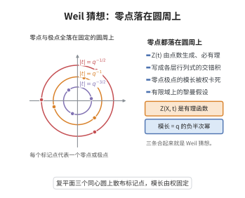

# Weil猜想（Deligne的证明）
>
> **一句话大白话**：有限域上的代数簇，它"数点"的 Zeta 函数是有理函数、满足函数方程与黎曼假设（零点极点模在圆周上）——Deligne 证明了它（1973/74）。
>
> **小例子**：$X/\mathbb{F}_q$ 光滑射影的 Zeta 函数
$$
Z(X,t)=\exp\Big(\sum_{n\ge1}\frac{|X(\mathbb{F}_{q^n})|}{n}t^n\Big)
$$
是有理的：$Z(t)=\prod_i\det(1-Ft\mid H^i)^{(-1)^{i+1}}$，且其零点在$|t|=q^{-(2i+1)/2}$。

## 一、定理介绍

> **前置依赖**：$\ell$-adic étale上同调、Lefschetz-Grothendieck迹公式、Poincaré对偶、Hodge指数定理、Deligne混合权论

Weil猜想（Weil 1949）是关于有限域 $\mathbb{F}_q$ 上光滑射影代数簇 $X$ 的 $\mathbb{F}_{q^n}$-有理点计数与 Zeta 函数的一组深刻断言：**有理性**、**函数方程**、**Riemann 假设**（零点/极点位置）与 **Betti 数**（极点阶与复化流形上同调维数）。Grothendieck 用 étale/ℓ-adic 上同调证明前三项，Deligne（1971–1974, Weil II）用芳香纤维、Lefschetz 铅笔等完整证明了 Riemann 假设部分并推广到非固有情形。

## 几何直观

图意在说明：zeta 函数是有理函数，且零点与极点的模长被上同调的权完全锁死，正是有限域上的黎曼假设。

## 二、原理思路

核心是把"数点"翻译成"上同调上 Frobenius 的迹"：记 $H^i(X_{\bar{\mathbb F}_q},\mathbb Q_\ell)$ 为 ℓ-adic 上同调（带 Frobenius 作用），Lefschetz–Grothendieck 迹公式给出
$$
|X(\mathbb{F}_{q^n})|=\sum_i(-1)^i\mathrm{Tr}(F^n\mid H^i).
$$
于是 $Z(t)=\prod_i\det(1-Ft\mid H^i)^{(-1)^{i+1}}$，有理性与函数方程来自有限维交错代数与 Poincaré 对偶。Riemann 假设 $|\alpha|=q^{i/2}$ 需 Deligne 的混合权论/Weil II 证明。

## 三、定理的严格表述

设 $X$ 为 $\mathbb{F}_q$ 上 $d$-维光滑射影簇，$Z(X,t)$ 为其 Zeta 函数。则
1. **有理性**：$Z(X,t)=\prod_{i=0}^{2d}\det(1-Ft\mid H^i)^{(-1)^{i+1}}\in\mathbb{Q}(t)$；
2. **函数方程**：$Z(X,1/(q^dt))=\pm\,q^{d\chi/2}t^{\chi}Z(X,t)$（$\chi$ Euler 示性）；
3. **Riemann 假设**：$F$ 在 $H^i$ 上的特征值 $\alpha$ 满足 $|\iota(\alpha)|=q^{i/2}$ 对 $\mathbb Q_\ell$-代数 $\mathbb Q(\alpha)\hookrightarrow\mathbb C$ 的每个嵌入 $\iota$；等价位零点在 $|t|=q^{-(2i+1)/2}$；
4. **Betti 数**：$\dim_{\mathbb Q_\ell}H^i=\dim_{\mathbb Q}H^i(X(\mathbb C),\mathbb Q)$。

## 四、证明过程

Grothendieck–M.Artin 用定义好的 ℓ-adic cohomology 证明有理/函数方程与 Betti（比较同构）。Riemann 假设分为：对曲线 $d=1$ 用 Hodge 指数定理/自配；一般用 Deligne 的**Weil I** 归纳（对纤维簇与 Lefschetz 铅笔）与 **Weil II**（加权上同调的权论）：证明 $F$ 特征值代数整数、L-函数半纯，以及对每 $i$ 的纯权等式。用 $\ell$ 无关性比较各样素。

## 五、应用与意义

Weil 猜想是二十世纪代几何/数论里程碑：确立 Zeta 函数与上同调的联系、推动 étale 拓扑与 ℓ-adic 方法，其技术（混合权、Weil II）渗透模形式、p-adic 理论并催生 Langlands 与算术几何现代全貌。

## 课堂问答

**老师**：Weil 猜想包含哪几部分？分别由谁证明？

**学生**：结论：共四项——有理性、函数方程、Riemann 假设、Betti 数。前三项由 Grothendieck（与 Artin）用 $\ell$-adic étale 上同调证明；Riemann 假设部分由 Deligne（1973–74，Weil I / Weil II）证明，并推广到非固有情形。

**老师（追问）**：Riemann 假设的等价位怎么写出？

**学生**：Frobenius $F$ 在 $H^i(X_{\bar{\mathbb F}_q},\mathbb{Q}_\ell)$ 上的特征值 $\alpha$ 满足 $|\iota(\alpha)|=q^{i/2}$（对每个嵌入 $\iota$），等价位 Zeta 函数的零点/极点在 $|t|=q^{-(2i+1)/2}$。桥梁是迹公式 $|X(\mathbb{F}_{q^n})|=\sum_i(-1)^i\mathrm{Tr}(F^n\mid H^i)$ 与 $Z(t)=\prod_i\det(1-Ft\mid H^i)^{(-1)^{i+1}}$。

**老师（拓展）**：Deligne 的关键招数是什么？

**学生**：**混合权论**（Weil II）：追踪 Frobenius 作用的"权"滤波，用 Lefschetz 铅笔把一般簇归约到曲线/曲面，再结合 Hodge 指数定理与良约化证明特征值纯度；由此推出 $\ell$-无关性与 Betti 数比较，从而完整证得 Riemann 假设。 一句话：迹公式给有理性，Poincaré 对偶给函数方程，Deligne 的权论给 Riemann 假设。
