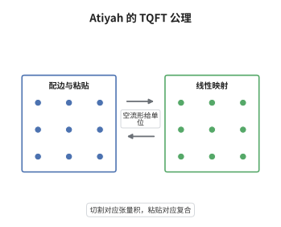

# Atiyah 的 TQFT 公理

> **状态：TQFT 的公理化定义与理论框架，不是已证定理。** 这些条款规定什么对象称为 TQFT；只有从公理进一步推出的粘合结论、分类结果等才称为定理。

> **一句话大白话**：把流形当输入、向量空间当输出，切开对应张量积、粘回去对应复合，于是一个拓扑问题被翻译成了一道线性代数题。
>
> **小例子**：一维 TQFT 只要给一个有限维空间 $V=Z(\text{点})$：区间必须给恒等映射，圆周给 $Z(S^1)=\operatorname{tr}(\mathrm{id}_V)=\dim V$；取 $V=\mathbb C^2$ 就得 $Z(S^1)=2$。

## 介绍

拓扑量子场论的公理化定义由 Atiyah 在 1988 年提出，它把 Witten 关于 Chern-Simons 路径积分的想法剥离掉分析细节，只留下"切割与粘贴"的函子性。定义的对象是协边范畴 $\mathrm{Cob}_d$：对象是 $d-1$ 维闭流形，态射是 $d$ 维协边。$d$ 维 TQFT 就是从 $\mathrm{Cob}_d$ 到有限维复向量空间范畴的对称幺半函子。这条公理把"计算路径积分"换成了"给每个流形指定一个线性映射"，从而让拓扑不变量可以在纯代数层面被验证。它也是后来所有 TQFT 分类定理（二维的 Frobenius 代数、三维的模张量范畴）的共同出发点。

## 几何直观

图意在说明：左边的"沿边界把两块协边粘起来"在右侧被翻译成"把两个线性映射复合"；下方两块互不相连的协边则对应张量积，最左端的空流形对应复数域这根"单位轴"。

## 分析

**前置依赖**：范畴论、协边、张量积；补充：有限维向量空间的对偶、微分同胚群的作用。

**数学内涵**：
- 输入范畴：对象是 $d-1$ 维闭定向流形，态射是 $d$ 维紧定向协边 $M:\Sigma_0\to\Sigma_1$，满足 $\partial M=\bar\Sigma_0\sqcup\Sigma_1$，态射模去固定边界上的微分同胚。
- 函子性：$Z$ 把对象送到有限维复向量空间、把态射送到线性映射，且 $Z(M_2\circ M_1)=Z(M_2)\circ Z(M_1)$，这里 $\circ$ 就是沿公共边界粘合。
- 幺半性：不交并给出对称幺半结构，$Z(\Sigma_1\sqcup\Sigma_2)=Z(\Sigma_1)\otimes Z(\Sigma_2)$，而空流形是单位，故 $Z(\emptyset)=\mathbb C$。
- 对合公理：$\bar M$ 是把 $M$ 的定向反转得到的协边，$Z(\bar M)=Z(M)^{*}$，即取对偶空间并把线性映射转置。
- 归一化：闭 $d$ 维流形边界为空，$Z(M)\in Z(\emptyset)=\mathbb C$ 只是一个数，并约定 $Z(\emptyset^d)=1$，这样乘法性才与单位相容。
- 常见误区：$Z(\Sigma)$ 必须有限维，否则 $\operatorname{tr}(\mathrm{id})$ 无意义；另外公理只保证"粘合"，并不保证同伦不变的额外性质，那是具体理论的定理而非公理。

**结构**：
1. 先把 $(d-1)$ 维流形与 $d$ 维协边组织成范畴，验证沿公共边界粘合满足结合律与单位律。
2. 再装上对称幺半结构：不交并当张量积，空流形当单位，交换对称由重排的微分同胚给出。
3. 最后把每条公理对应到一种拓扑操作：函子性对应粘合，幺半性对应"互不相连的系统互不影响"，对合性对应反向边界上的对偶配对。

## 思考过程

Atiyah 面对的问题是：Witten 的路径积分写下来容易，但要证明它给出拓扑不变量却无从下手，因为测度本身没有定义。Segal 在二维共形场论里已经示范过一条出路——不定义积分，只声明"分割曲面得到的算子是复合的"，把场论变成函子。Atiyah 把这个想法推到任意维，关键的技术障碍是：流形和协边本身太大，必须模去微分同胚才能让"复合"严格结合。另一处容易被忽略的是对合公理：反向协边不能由其余公理推出，但少了它就无法把"两个边界粘起来"解释成配对，整个粘合计算会垮掉。公理定型之后，分类问题就变成"找出所有这样的函子"，二维情形由 Frobenius 代数解决，三维情形则要动用模张量范畴。

## 由公理导出的结论（不是公理的证明）

**函子性结论**：设 $Z:\mathrm{Cob}_d\to\mathrm{Vect}_{\mathbb C}$ 满足上述公理，且闭 $d$ 维流形 $M$ 沿闭 $(d-1)$ 维流形 $\Sigma$ 切成协边 $M_1:\emptyset\to\Sigma$ 与 $M_2:\Sigma\to\emptyset$。则在 $\mathrm{Cob}_d$ 中 $M=M_2\circ M_1$，从而
$$Z(M)=Z(M_2)\circ Z(M_1).$$

由 $Z(\emptyset)=\mathbb C$，映射 $Z(M_1)$ 等同于一个向量 $v=Z(M_1)(1)\in Z(\Sigma)$，映射 $Z(M_2)$ 等同于一个线性泛函 $\alpha\in Z(\Sigma)^*$，故 $Z(M)=\alpha(v)\in\mathbb C$。若同一协边采用另一种分解，函子性仍给出同一态射 $Z(M)$ 的像，所以数值一致。这是直接应用公理得到的结论，不是对 Atiyah 公理本身的证明，也不需要声称任意两种分解只相差一个微分同胚。

## 课堂问答

**老师**：这条公理里哪一条是"真正干活"的？如果删掉 $Z(\emptyset)=\mathbb C$，会坏在哪里？

**学生**：这些条款整体是定义而非待证定理。干活的是函子性，它把粘合变成复合；但对合公理同样不可省。至于 $Z(\emptyset)=\mathbb C$，它保证闭流形的取值落在数上：闭 $d$ 维流形是 $\emptyset\to\emptyset$ 的态射，其像必须是 $\mathbb C$ 的自同态，也就是一个数乘。删掉它，$Z(M)$ 就不再是标量，$Z(S^d)$ 这类最基本的例子都算不出来。

**老师（追问）**：为什么 $Z(\Sigma)$ 一定要有限维？无限维会出什么问题？

**学生**：核心不只是“迹可能发散”。协边中的圆柱与弯曲圆柱给出 evaluation、coevaluation 及 zigzag 关系，使 $Z(\Sigma)$ 成为具有非退化配对的有限维对偶空间；在普通向量空间范畴中，coevaluation 的构造本质上也要求有限维。若允许无限维，就必须更换或细化目标幺半范畴，并追加对偶性、迹类等条件，这已超出经典 Atiyah 公理的范围。

**老师（拓展）**：如果想让"每个点上的取值"也有意义，公理该怎么改？

**学生**：那就要走扩展 TQFT 的路：把 $\mathrm{Cob}_d$ 换成 $(\infty,d)$-范畴，把点、区间、圆盘都当作低维态射，于是 $Z$ 变成一个 $(\infty,d)$-函子。这时 $Z(\text{点})$ 携带 $\mathbb E_d$-代数结构，顶层流形的取值由它决定，经典 Atiyah 公理只是遗忘掉低维数据后的影子。

## 相关条目

- 本条使用的基本定义与记号见“分析”。
- [本级定理索引](./index.md)：查看同级的直接前置与后继条目。
- [总定理依赖表](../../index.md#定理分级表)：在完整依赖表中定位本条目。
