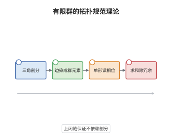

# Dijkgraaf-Witten 理论

> **一句话大白话**：用有限群 $G$ 的"平坦规范场"给流形计数，每一条丛按一个 $U(1)$ 相位加权，再除掉规范冗余，就得到不依赖剖分的拓扑不变量。
>
> **小例子**：取 $G=\mathbb Z/2$、维数 $d=2$、$\alpha=1$。环面上 $G$-丛的同构类有 $|G|=2$ 个，故 $Z(T^2)=2$；球面单连通，只有平凡丛，故 $Z(S^2)=1$。

## 介绍

Dijkgraaf-Witten 理论是拓扑规范场论最简单的完全可解模型：把连续规范场换成有限群 $G$ 的丛，把路径积分换成有限求和。它的输入只有两个数据——有限群 $G$ 与一个上同调类 $\alpha\in H^d(BG;U(1))$，其中 $BG$ 是 $G$ 的分类空间。理论的配分函数是对"带联络的 $G$-丛"求和，每个丛的权重由 $\alpha$ 在基本类上的取值给出。这个模型之所以重要，是因为它把 TQFT 的每一条公理都变成了可以手算的有限组合问题，同时它的边界理论恰好给出扭曲量子双重，成为模张量范畴的标准库存。三维情形还与 Chern-Simons 理论在"$G$ 有限"这一极限下对应，是检验量子不变量的试金石。

## 几何直观

图意在说明：三角剖分给出离散的"时空"，边染色就是离散联络 $A$，每个 $d$-单形用 $\alpha$ 的拉回读出一个模长为 $1$ 的相位；把所有染色方式的相位加起来再除以顶点处的规范冗余，就得到与剖分无关的数。

## 分析

**前置依赖**：群上同调、TQFT 公理；补充：单纯复形与 Pachner 移动、有限群的表示。

**数学内涵**：
- 数据：有限群 $G$ 与 $\alpha\in H^d(BG;U(1))$。对有限群，$H^d(BG;U(1))$ 与 $H_{d+1}(G;\mathbb Z)$ 的 Pontryagin 对偶同构，所以这类"相位"是有限多且可算的。
- 求和：给定三角剖分 $M_\bullet$，对每条边赋 $g_e\in G$，得到一个 $1$-上链 $A$；沿每个 $d$-单形把 $\alpha$ 拉回并相乘，得到相位 $\alpha([A])\in U(1)$。配分函数是
$$
Z(M)=\frac{1}{|G|^{|V_0|}}\sum_{A}\alpha([A]),
$$
求和跑遍所有边染色，$|V_0|$ 是顶点数。
- 归一化：分母不是装饰。每个顶点处可以做一次整体左乘 $h\in G$ 而不改变同构类，故每个连通分量有 $|G|$ 的冗余，除以 $|G|^{|V_0|}$ 才能把"带联络的丛"的求和折成规范等价类上的加权求和。
- 边界：带边流形的边染色在边界上给出 $(d-1)$-单纯形上的 $G$-值数据，$Z(\partial M)$ 就是以这些边界数据为基的向量空间，闭流形的数则是配对。
- 常见误区：求和对象是边染色而非丛的同构类，二者相差就是那个 $|G|^{|V_0|}$；另外 $d=2$ 时 $\alpha$ 是 $2$-上链，理论给出被 $\alpha$ 扭曲的群代数，而不是普通群代数。

**结构**：
1. 选取三角剖分，把 $G$-丛连同联络离散成每条边上的群元素，得到有限求和的对象。
2. 在每个 $d$-单形上用 $\alpha$ 的拉回读出相位，把整块流形的相位写成乘积。
3. 对所有染色求和并除以顶点规范冗余，得到候选的 $Z(M)$。
4. 用 Pachner 移动验证它与剖分无关，再逐条核对乘法性、粘合性与对合性。

## 思考过程

Dijkgraaf 与 Witten 1990 年想要一个能精确算出的三维拓扑规范理论，用来检验 Chern-Simons 的普遍断言。连续路径积分算不动，他们干脆把规范群换成有限群：这时规范场没有连续自由度，只剩下"绕每个圈取哪个群元素"的离散选择，路径积分退化成有限和。真正的障碍在于如何让答案不依赖剖分：解决办法是要求权重来自分类空间的上同调类，因为上闭链条件恰好保证相邻剖分的贡献相消。另一个细节是分母：若不除掉顶点处的冗余，同一丛会被重复计数 $|G|^{|V_0|}$ 次。做完这两步，剩余的公理验证就只是"求和可以拆开"这件平凡事，这也是这个模型常被当作 TQFT 教学第一例的原因。

## 证明过程

**定理**：设 $G$ 有限、$\alpha\in H^d(BG;U(1))$，$M$ 为闭定向 $d$ 维三角剖分流形。则上式定义的 $Z(M)$ 与剖分及染色代表无关，并满足 $Z(M_1\sqcup M_2)=Z(M_1)Z(M_2)$、$Z(\bar M)=\overline{Z(M)}$，从而给出一个 $d$ 维 TQFT。

**证明**：

### 1. 上闭链保证剖分无关

把 $\alpha$ 看成 $BG$ 上的 $d$-上链，其拉回在 $M$ 的每个 $d$-单形上取 $U(1)$ 值。任意两个剖分可由 Pachner 移动连接，而移动的每一步都在一个 $(d+1)$-单形内部完成。在该单形的两种剖分上，边染色的相位乘积沿边界一致，因为 $\alpha$ 是上闭链：

$$
\delta\alpha=1\quad\Longrightarrow\quad\prod_{\text{边界 }d\text{-单形}}\alpha([A])=1 .
$$

于是两种剖分的求和逐项相等，$Z(M)$ 只依赖流形的微分同胚类。

### 2. 乘法性

不交并 $M_1\sqcup M_2$ 的边染色恰是一对染色，相位相乘、顶点数相加，求和拆成两个独立求和的乘积：

$$
Z(M_1\sqcup M_2)=\frac{1}{|G|^{|V_0^1|+|V_0^2|}}\sum_{A_1,A_2}\alpha([A_1])\alpha([A_2])=Z(M_1)\,Z(M_2).
$$

这与 $Z(\emptyset)=1\in\mathbb C$ 一起给出幺半结构。

### 3. 粘合与对合

沿闭 $(d-1)$ 维流形 $\Sigma$ 粘合时，$\Sigma$ 上的染色被两侧共享，固定边界染色后两侧求和互相独立：

$$
Z(M_1\cup_\Sigma M_2)=\sum_{A|_\Sigma}Z(M_1;A|_\Sigma)\,Z(M_2;A|_\Sigma),
$$

这正是 $Z(\Sigma)$ 上的配对。反向流形 $\bar M$ 的定向反转使每个单形的定向反转，相位取共轭，故 $Z(\bar M)=\overline{Z(M)}=Z(M)^{*}$。三条公理齐备，$Z$ 是 $d$ 维 TQFT。$\square$

## 课堂问答

**老师**：为什么不直接数 $G$-丛的同构类，而要绕一圈去对边染色求和？

**学生**：因为丛的同构类个数虽然有限，却没有天然的权重，也无法处理带边情形。边染色相当于给丛配一个联络，它把"绕圈取哪个群元素"变成可乘的量，$\alpha$ 才能逐单形赋值。求和对染色做，再除以 $|G|^{|V_0|}$，结果正好等于同构类上的加权求和，但计算过程是可乘的，粘合时才拆得开。

**老师（追问）**：如果 $\alpha$ 只是上链而不是上闭链，会在哪一步失败？

**学生**：失败在剖分无关那一步。Pachner 移动要求在一个 $(d+1)$-单形的两种剖分上相位乘积相同，而这正是 $\delta\alpha=1$。若 $\delta\alpha\neq1$，两种剖分给出不同的数，$Z(M)$ 就不再是流形不变量，只是一个依赖剖分的量。

**老师（拓展）**：三维时这个理论与 Chern-Simons 是什么关系？

**学生**：三维取 $G$ 有限、$\alpha\in H^3(BG;U(1))$，就是 Chern-Simons 理论在规范群离散化后的版本；其边界理论给出 $\alpha$-扭曲的量子双重 $D^\alpha(G)$ 的表示范畴，这是一个模张量范畴，可以反过来用 Reshetikhin-Turaev 构造重建三维 TQFT。若把 $G$ 换成连续紧群，求和变成路径积分，就回到 Witten 的原始框架。
