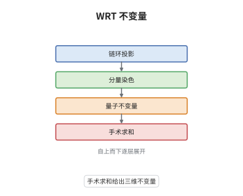

# Witten-Reshetikhin-Turaev 不变量

> **一句话大白话**：先用手术把一个三维流形写成"球面沿链环挖补"的结果，再用 $U_q(\mathfrak{sl}_2)$ 在根单位处的量子不变量对链环逐项求和，得到的数就是 WRT 不变量。
>
> **小例子**：取 $k=1$、$G=SU(2)$，则 $q=e^{2\pi i/3}$，可积表示只有 $j=0,\tfrac12$ 两个，融合规则是 $\mathbb Z/2$；此时 $Z_k(S^3)=1$，球面沿一个染色的平凡纽结手术时求和只剩两项。

## 介绍

Witten 在 1989 年用 Chern-Simons 路径积分给出三维流形的不变量，但积分没有严格定义。Reshetikhin 与 Turaev 在 1991 年给出了纯代数的替代：取 $q$ 为 $2(k+2)$ 次本原根单位，量子群 $U_q(\mathfrak{sl}_2)$ 的可积表示构成一个模张量范畴，用它给带框链环染色并计算量子不变量，再用 Dehn 手术公式把链环的不变量组装成流形的不变量。这个构造与 Witten 的路径积分在 $SU(2)$ 情形下吻合，因此被称为 WRT 不变量。它的重要性有三层：给出三维拓扑的第一个可计算不变量族，给出模张量范畴到三维 TQFT 的构造范式，并为 Chern-Simons 微扰展开提供了求和侧的对偶对象。

## 几何直观

图意在说明：最底层只是一张带框的链环投影；第二层给每个分量染色，即指定一个可积表示；第三层用 R 矩阵与量子迹算出这个染色链环的量子不变量；最顶层的求和把链环换成三维流形，$S$ 矩阵正是这次替换的换基系数。

## 分析

**前置依赖**：Reshetikhin-Turaev 构造、量子群；补充：Dehn 手术与 Kirby 移动、模张量范畴的 $S$ 矩阵与量子维数。

**数学内涵**：
- 参数：对 $\mathfrak{sl}_2$（对偶 Coxeter 数 $h^\vee=2$）取 $q=e^{2\pi i/(k+2)}$，可积表示为 $V_j$，$j=0,\tfrac12,\dots,\tfrac k2$，共 $k+1$ 个。
- $S$ 矩阵与量子维数：模张量范畴的换基矩阵为
$$
S_{ij}=\sqrt{\frac{2}{k+2}}\,\sin\frac{\pi(2i+1)(2j+1)}{k+2},\qquad [2j+1]=\frac{\sin\frac{\pi(2j+1)}{k+2}}{\sin\frac{\pi}{k+2}} .
$$
- 手术表示：设 $M=S^3_L$ 是沿带框链环 $L=L_1\cup\cdots\cup L_n$ 的手术，分量染色为 $j_1,\dots,j_n$，则
$$
Z_k(M)=\sum_{j_1,\dots,j_n}\Big(\prod_{i=1}^{n}S_{0j_i}\Big)\,J_{L}(j_1,\dots,j_n),
$$
其中 $J_L$ 是由 $R$ 矩阵与量子迹给出的染色链环不变量，归一化取 $Z_k(S^3)=1$。
- Kirby 移动：同一流形有无穷多种手术表示，彼此相差 Kirby 移动（加一个 $\pm1$ 框架的平凡纽结、以及 handle slide）。$S$ 矩阵的模性——$S^2$ 作用为电荷共轭、$(ST)^3$ 作用为标量——保证 $Z_k$ 在移动下不变。
- 公理：$Z_k(M_1\#M_2)=Z_k(M_1)Z_k(M_2)$、$Z_k(\bar M)=\overline{Z_k(M)}$，粘合性由对中间分量的求和给出，于是 $Z_k$ 延拓为三维 TQFT。
- 常见误区：$q$ 必须是根单位，否则表示范畴非半单、$S$ 不可逆；此外不变量依赖框架，需把流形取为 $2$-框架化或对 $b_\pm$ 乘相位修正。

**结构**：
1. 在根单位处确认可积表示只有有限多个且张成半单模张量范畴，$S$ 矩阵可逆。
2. 用 $R$ 矩阵与量子迹给染色带框链环赋值，得到 $J_L$。
3. 把手术表示代入求和公式，用 $S$ 矩阵的模性验证它在 Kirby 移动下不变。
4. 验证乘法性、对合性与粘合性，把不变量升级为 TQFT。

## 思考过程

Witten 的不变量一旦提出，最大的疑问是它到底是不是流形不变量：路径积分写法里没有任何东西保证手术表示无关。Reshetikhin 与 Turaev 的策略是先在组合层面定义量，再证明它与表示无关——这正是 Kirby 定理的用武之地：所有手术表示由 Kirby 移动连接，只要证明量在移动下不变即可。困难有两处。第一，量子群在 $q$ 为一般值时表示范畴不是半单的，$S$ 矩阵退化；只有取根单位，可积表示才构成有限半单范畴，这就是为什么 $k$ 必须是整数、$q$ 必须是 $2(k+2)$ 次根。第二，染色链环的赋值本身带框架异常，沿分量改变框架会乘一个相位，必须把相位吸收进 $S_{0j}$ 与归一化因子中。这两点处理完，"手术求和 + Kirby 不变"就给出一个完全严格的构造，而它与路径积分的一致性则由大 $k$ 渐近展开来验证。

## 证明过程

**定理**：设 $k\ge1$、$q=e^{2\pi i/(k+2)}$。手术公式定义的 $Z_k$ 是闭定向三维流形的不变量，满足 $Z_k(S^3)=1$、$Z_k(M_1\#M_2)=Z_k(M_1)Z_k(M_2)$、$Z_k(\bar M)=\overline{Z_k(M)}$，并延拓为 TQFT $Z_k:\mathrm{Cob}_3\to\mathrm{Vect}_{\mathbb C}$。

**证明**：

### 1. 根单位处的半单性

当 $q$ 为 $2(k+2)$ 次本原根单位时，$U_q(\mathfrak{sl}_2)$ 的可积表示 $V_0,\dots,V_k$ 对张量积封闭，且每个张量积完全可约，故它们张成一个半单模张量范畴。其 $S$ 矩阵由量子维数与辫矩阵给出，满足

$$
S_{ij}=\sqrt{\frac{2}{k+2}}\sin\frac{\pi(2i+1)(2j+1)}{k+2},\qquad S^2=C,\quad (ST)^3=\Theta ,
$$

其中 $C$ 是电荷共轭置换、$\Theta$ 是标量。$S$ 可逆正是"模"这一字的含义。

### 2. 手术公式与框架修正

把 $M$ 写成 $S^3$ 沿带框链环 $L$ 的手术，给每个分量染色 $j_i$，用 $R$ 矩阵的辫作用与量子迹算出 $J_L$，再按 $S_{0j_i}$ 加权求和即得上式。改变某分量的框架 $f\mapsto f+1$ 使该分量乘以拓扑自旋 $\theta_{j}=e^{2\pi i h_j}$，而 $S_{0j}$ 中的相位恰与之配对，故求和结果不依赖框架的代表选取；整体框架数 $b_\pm$ 的修正只贡献一个标量因子。

### 3. Kirby 移动与公理

任意两种手术表示由 Kirby 移动连接。加一个 $\pm1$ 框架的平凡纽结等价于在求和里插入 $\sum_j S_{0j}^2\theta_j^{\pm1}$，由 $S$ 的模性该和为 $1$，故不变量不变；handle slide 则由 $S$ 矩阵满足的融合恒等式保证。至于公理：连通和对应链环的不交并，$J$ 与求和都相乘，得 $Z_k(M_1\#M_2)=Z_k(M_1)Z_k(M_2)$；反向流形使所有相位取共轭，得 $Z_k(\bar M)=\overline{Z_k(M)}$；带边流形上对边界染色的求和给出向量空间，粘合即对中间染色求和，与复合相容。三条公理齐备，$Z_k$ 是三维 TQFT。$\square$

## 课堂问答

**老师**：为什么一定要 $q$ 是根单位？取 $q$ 为一般复数会失去什么？

**学生**：会失去半单性与有限性。一般 $q$ 时 $U_q(\mathfrak{sl}_2)$ 的表示范畴有无穷多个单对象，张量积不半单，$S$ 矩阵无法定义或不可逆，手术求和变成无穷和而不收敛。取 $q=e^{2\pi i/(k+2)}$ 后，$V_j$ 在 $2j+1>k+1$ 时同构于更低的自旋，单对象只剩 $k+1$ 个，模公理才成立。

**老师（追问）**：手术公式里 $S_{0j}$ 这个权是从哪来的，为什么不是别的系数？

**学生**：它来自"用 $S$ 矩阵换基"。沿一个分量做手术，相当于把这个分量从"平凡纽结基"换到"经线基"，而模张量范畴里这两组基的换基矩阵正是 $S$。$S_{0j}$ 是平凡对象那一行，物理上就是该任意子的量子维数除以总量子维数，所以权不是任意选的，而是由范畴的模结构唯一确定。

**老师（拓展）**：WRT 不变量是否能完全分类三维流形？

**学生**：不能。它对连通和与反转有良好性质，但存在大量彼此不同胚的流形有相同的 $SU(2)$ WRT 不变量；把 $G$ 换成更大的群或所有 $k$ 一起看（即量子 $SL_2$ 的整个族）能分辨更多，但仍不是完全不变量。这也说明 WRT 捕捉的是流形的"量子"信息，与基本群、Casson 不变量等经典信息互补，而不是替代。
