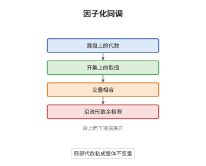

# 因子化同调

> **一句话大白话**：只要在一个小圆盘上给出一套代数结构，就能沿任何流形把这些圆盘"积分"成一个大对象，得到的量只依赖流形的同伦型与标架。
>
> **小例子**：$n=1$ 时圆盘代数就是结合代数 $A$，而 $\int_{S^1}A$ 是 $A$ 的 Hochschild 同调；取 $A=\mathbb C$ 得 $\mathrm{HH}_0=\mathrm{HH}_1=\mathbb C$，故 $S^1$ 上的积分给出两个 $\mathbb C$。

## 介绍

因子化同调是 Ayala 与 Francis 在 2012 年前后系统建立的框架，它把"在流形上积分一个代数"这件事从一维推广到任意维。输入的是一层局部数据：一个 $\mathrm{Disk}_n$-代数，也就是把每个小圆盘 $\mathbb R^n$ 送到某个对象、把圆盘之间的不交并嵌入送到乘法与高阶相容数据的对称幺半函子。输出则是沿整个流形取同伦余极限得到的对象 $\int_M A$。它的价值在于把 TQFT 从"函子"升级为"流形层"：函子只能处理单个流形，层则允许在开覆盖上逐块计算再粘合，并且能处理带奇点、带边界的对象。拓扑手性代数、特征类、以及高维 TQFT 的分类问题都在这个语言下得到统一表述。

## 几何直观

图意在说明：最底层只规定了圆盘这一种"标准零件"上的代数；往上每层把取值延拓到任意开集，交叠处用高阶相干数据粘住；最顶层的整体对象就是这些局部数据沿流形的同伦余极限，也就是因子化同调 $\int_M A$。

## 分析

**前置依赖**：$\infty$-范畴、层论、operad；补充：$\mathbb E_n$-代数、同伦余极限与余拉回。

**数学内涵**：
- 圆盘范畴：$\mathrm{Disk}_n$ 的对象是有限个 $\mathbb R^n$ 的不交并，态射是不相交的嵌入，它是对称幺半 $\infty$-范畴。
- 圆盘代数：$\mathrm{Disk}_n$-代数是一个对称幺半函子 $A:\mathrm{Disk}_n\to\mathcal C$，其中 $\mathcal C$ 是小余极限完备的对称幺半 $\infty$-范畴。由 May 识别定理，它与 $\mathbb E_n$-代数等价，故 $n=1$ 就是结合代数，$n=\infty$ 就是交换代数。
- 积分：沿 $n$-框架化流形 $M$ 的因子化同调定义为
$$
\int_M A:=\operatorname*{colim}_{\mathrm{Disk}_n/M}A ,
$$
即把所有嵌入 $\bigsqcup\mathbb R^n\hookrightarrow M$ 上的取值取同伦余极限。
- 基本计算：$\int_{\mathbb R^n}A\simeq A$；$n=1$ 时 $\int_{S^1}A\simeq\mathrm{HH}(A)$ 是 Hochschild 同调；$n=\infty$ 时 $\int_M A$ 只依赖 $M$ 的同伦型，$\int_{S^n}A$ 给出 $A$ 的 $n$ 次循环同调。
- 标架：一般需要在 $n$-框架化流形上定义；去掉标架就要让 $A$ 带 $\mathrm{SO}(n)$ 作用，否则积分会出现异常，这与 TQFT 的 framing anomaly 是同一件事。
- 常见误区：积分不是把局部取值简单相乘，而是取同伦余极限，携带全部高阶相干数据；把 $\int_M A$ 当成普通层的一节会丢掉这些信息。

**结构**：
1. 先在圆盘范畴上定义代数，把"局部零件上的运算"变成函子数据。
2. 再对流形作"覆盖"，用所有嵌入圆盘的开集构成索引范畴 $\mathrm{Disk}_n/M$。
3. 对这个索引范畴取同伦余极限，得到整体对象；用余拉回刻画它沿开覆盖的粘合行为。
4. 在一维与低维情形把抽象定义算成经典的 Hochschild 同调与循环同调，检验定义的正确性。

## 思考过程

早先人们已经知道两个类似的东西：一是 Beilinson 与 Drinfeld 为仿射 Kac-Moody 代数定义的"手性同调"，它在一维曲线上积分顶点代数；二是 Lurie 的配边假设，用 $\mathbb E_n$-代数分类扩展 TQFT。Ayala 与 Francis 的问题是：这两件事是不是同一个机制在不同维数下的表现？障碍在于一维的构造严重依赖曲线的复结构与顶点算子的解析性，无法直接搬到高维。关键想法是彻底扔掉解析结构，只保留"圆盘怎么嵌入"这一拓扑信息，并把所有取值放在 $\infty$-范畴里取同伦余极限。这样一维的计算自动退化为 Hochschild 同调，而高维则得到全新的不变量。必须用 $\infty$-范畴而不是普通范畴，是因为粘合只在同伦意义下成立，强行要求等式会得到错误答案。

## 证明过程

**定理**：设 $A$ 为 $\mathrm{Disk}_n$-代数，$M$ 为 $n$-框架化流形，$M=U\cup V$ 为两个开集的覆盖。则存在典范等价

$$
\int_{U\cup V}A\;\simeq\;\int_U A\ \otimes_{\int_{U\cap V}A}\ \int_V A ,
$$

即因子化同调沿开覆盖满足张量-余张量（excision）性质，且 $\int_{\mathbb R^n}A\simeq A$。

**证明**：

### 1. 用嵌入把流形写成余极限

令 $\mathrm{Disk}_n/M$ 为对象是嵌入 $\bigsqcup_i\mathbb R^n\hookrightarrow M$、态射是交换图的所有这样的嵌入构成的范畴。任何点都落在某个嵌入圆盘内，故 $M$ 是这个索引范畴上"标准圆盘"的余极限：

$$
M\simeq\operatorname*{colim}_{(\phi:\,\bigsqcup\mathbb R^n\hookrightarrow M)}\ \bigsqcup\mathbb R^n .
$$

### 2. 函子保余极限

$A$ 是保持余极限的对称幺半函子，于是把上式送到 $\mathcal C$ 里仍得余极限。取 $M=U\cup V$ 时，索引范畴被 $U$、$V$、$U\cap V$ 三块覆盖，余极限化为余拉回，而 $\mathcal C$ 中的余拉回沿"自由"方向正是张量积：

$$
\int_{U\cup V}A\simeq\operatorname*{colim}\Big(\int_U A\ \longleftarrow\ \int_{U\cap V}A\ \longrightarrow\ \int_V A\Big).
$$

### 3. 化归为张量积并检验低维情形

在表现良好的对称幺半 $\infty$-范畴中，上述余拉回等价于导出张量积 $\int_U A\otimes_{\int_{U\cap V}A}\int_V A$，得到所述等价。取 $n=1$、$M=S^1$ 由两个区间覆盖，两端交叠为两个点，$A\otimes_{A\otimes A^{\mathrm{op}}}A$ 正是 Hochschild 同调，与经典定义吻合，说明抽象构造确实还原了已知对象。$\square$

## 课堂问答

**老师**：为什么要用同伦余极限，而不是普通的余极限或直接取张量积？

**学生**：因为粘合只在同伦意义下成立，而且索引范畴 $\mathrm{Disk}_n/M$ 本身带高阶态射。取普通余极限会把高阶相干数据压平，得到的是错误的、过于粗糙的对象；取同伦余极限才保留了"不同嵌入之间的同伦"这层信息。低维检验说明了这一点：只有同伦余极限才能算出正确的 Hochschild 同调。

**老师（追问）**：$n$-框架化这个条件在证明的哪一步用到？

**学生**：用在把 $\mathrm{Disk}_n$ 的作用搬到任意流形上。$\mathrm{Disk}_n$ 的态射是 $\mathbb R^n$ 的不相交嵌入，只有带标架的流形才能把切空间等同于 $\mathbb R^n$，从而谈论"圆盘嵌进去"。去掉标架后旋转群的作用不再平凡，必须给 $A$ 配上 $\mathrm{SO}(n)$ 的等变结构，否则积分依赖标架的同伦类，不是流形不变量。

**老师（拓展）**：因子化同调与 TQFT 的函子定义相比，强在哪里？

**学生**：函子定义只能对单个流形赋值，遇到流形被切开后各块的相容性只能靠公理硬性要求；因子化同调是流形层，开覆盖上的粘合是定理而不是公理，还能处理带奇点、带边界、甚至带分层结构的对象。当 $A$ 是 $\mathbb E_n$-代数时，函子 $M\mapsto\int_M A$ 恰好给出一个完全扩展 TQFT，所以它是比 Atiyah 公理更细的语言，而不是替代品。
