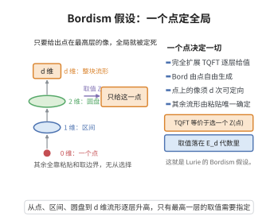

# 扩展TQFT与∞-范畴（Lurie的Bordism假设）
>
> **一句话大白话**：一个完全扩展的（框架化）TQFT 只需说出它在"点"上的值，其全部值就被决定——这就是 Lurie 的 Bordism 假设，它把 TQFT 提升到 $(\infty,d)$-范畴。
>
> **小例子**：对 $d$-框架化 TQFT $Z:\operatorname{Bord}_d^{\mathrm{fr}}\to\mathcal C$，等价于 $\Omega^{fr}\mathcal C$ 的对象——即 $\mathcal C$ 的 $d$-可定向（框架化 iterated loop）的 $d$-对象。

## 一、定理介绍

> **前置依赖**：$(\infty,d)$-范畴、框架化cobordism范畴、迭代loop空间与可定向对象、$\mathbb{E}_d$-代数、高范畴传延

扩展 TQFT 与 Lurie 的 Bordism 假设（Lurie 2009）给出"扩展TQFT 的值由点在适当高范畴中的像决定"的精确形式：设 $\mathcal C$ 为 $(\infty,d)$-范畴，则对称幺半 $(\infty,d)$-范畴 $\operatorname{Bord}_d^{\mathrm{fr}}$ 的完全扩展 TQFT 的范畴等价于由 $\mathcal C$ 的 $d$-次框架化反复 loop 空间（即"可定向 $d$-对象"）对象组成的位置。本质：Bordmich 范畴是框架化紧流形的自由 $(\infty,d)$-范畴。

## 几何直观

图意在说明：配边范畴由点自由生成，完全扩展 TQFT 的全部取值都由点在最高范畴中的像决定。

## 二、原理思路

Bordism 假设把"贴拼流形"视为 $(\infty,d)$-范畴的普遍构造：$\operatorname{Bord}_d^{\mathrm{fr}}$ 由（框架化）流形的切割生成，其对象为带框架点（$0$-流形）、态射为 $1$-cobordism……$d$-态射为 $d$-cobordism。取值 $Z:{\rm Bord}\to\mathcal C$ 由在"点"处的值 $Z(*)$ 决定，因为任何流形可分解为把这些"点"的取向按架子帧格起来。

## 三、定理的严格表述

设 $\mathcal C$ 为 $(\infty,d)$-范畴（配对称幺半算子），$\operatorname{Bord}_d^{\mathrm{fr}}$ 为 d 维框架化 cobordism 的对称幺半 $(\infty,d)$-范畴。则（Lurie）存在等价
$$
\operatorname{Fun}^{\otimes}(\operatorname{Bord}_d^{\mathrm{fr}},\mathcal C)\;\cong\;\Omega^{\mathrm{fr}}\mathcal C,
$$
其中 $\Omega^{\mathrm{fr}}\mathcal C$ 是 $d$-IootBack 框架化 loop 空间"的 $(\infty,d)$-范畴（即 $\mathcal C$ 的满含可定向（framed）对象对象层次），使 $Z\mapsto Z(*)$ 为等价。

## 四、证明过程

Lurie 证明思路：把 $\operatorname{Bord}_d^{\mathrm{fr}}$ 视作 $(SimH^G)_\infty$ 的骨架图，用截面给映射建立范畴优化；关键用"折叠-组合"：任意带框架流形可分解为把点的陪（framed points）粘合（$\{(B^d),\mathrm{cannopies}\}$），因此 TQFT 由点值确定；随后用传延/等价与 $\Omega^{\mathrm{fr}}$ 的一致性结构逐阶验证。

## 五、应用与意义

Bordism 假设是扩展 TQFT、导出的辅-特定对象理论（Alg/$\mathbb E_\infty$）的立足点：它把 TQFT 与可定向对象、$\mathbb E_d$-代数与高范畴退化联系，广泛用于更高辫结构、Bor数码链传延以及数学物理的全息/TFT 现代架构。

## 课堂问答

**老师**：什么是"完全扩展 TQFT"？为什么 Lurie 的 Bordism 假设说它由点在某个对象上的值决定？

**学生**：结论：完全扩展 TQFT 是 $(\infty,d)$-范畴间的对称幺半函子，它由点处的值决定，存在等价

$$
\operatorname{Fun}^{\otimes}(\operatorname{Bord}_d^{\mathrm{fr}},\mathcal C)\;\cong\;\Omega^{\mathrm{fr}}\mathcal C .
$$

右端是 $\mathcal C$ 中"$d$ 次框架化 loop 空间"的对象，也就是 $\mathbb E_d$-代数。

**老师（追问）**：为什么只需点值就够了？"扩展"二字到底扩展了什么？

**学生**：因为在 $\operatorname{Bord}_d^{\mathrm{fr}}$ 中一切由点生成：$0$-态射是带框架的点、$1$-态射是 $1$-cobordism，一直到 $d$-态射是 $d$-cobordism，任何框架化流形都能分解成把这些点粘合起来，函子性迫使整个 $Z$ 由 $Z(*)$ 唯一确定。"扩展"指把赋值从 $d$ 维流形逐层降到 $k$ 维子流形（$k=0,1,\dots,d$），低维赋值自动携带高维信息。常见误区：把它当成"又一条公理"，其实它是 $\operatorname{Bord}_d^{\mathrm{fr}}$ 作为自由 $(\infty,d)$-范畴的泛性质。

**老师（拓展）**：这个假设与经典 Atiyah 公理、以及 $\mathbb E_d$-代数有什么联系？

**学生**：取 $\mathcal C$ 为普通范畴、只看顶层态射，就回到 Atiyah–Segal 公理；而 $\Omega^{\mathrm{fr}}\mathcal C$ 恰是 $\mathbb E_d$-代数，所以 Bordism 假设把"分类 TQFT"等价地翻译成"求 $\mathbb E_d$-代数"，让量子场论的分类问题与大代数拓扑中的操作同伦接轨。
