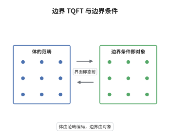

# 边界 TQFT 与拓扑边界条件

> **一句话大白话**：带边的场论在边界上留下的不是数而是一整个范畴，边界条件是这个范畴里的对象，边界上的线算子就是对象之间的态射。
>
> **小例子**：三维 $SU(2)$ Chern-Simons 理论在 level $k$ 的边界是 WZW 模型，边界条件对应 $U_q(\mathfrak{sl}_2)$ 的可积表示；取 $k=1$ 时只有 $j=0,\tfrac12$ 两个可积表示，融合规则就是 $\mathbb Z/2$ 的群律。

## 介绍

一个 $d$ 维 TQFT 若允许流形带边界，那么"边界上的数据"本身必须构成一个 $(d-1)$ 维理论。把这件事说清楚的标准方式是：$d$ 维 TQFT 的边界理论是一个 $(d-1)$ 维扩展 TQFT，它在一点上的取值 $\mathcal C=Z(\text{点})$ 是一个张量范畴；对 $d=3$ 它进一步是模张量范畴。闭 $(d-1)$ 维流形 $\Sigma$ 上的一个边界条件 $B$ 给出一个向量 $Z_B(\Sigma)\in Z(\Sigma)$，而两条边界条件之间的界面算子落在 $\mathrm{Hom}_{\mathcal C}(B,B')$ 里。这种"体由范畴编码、边界由对象编码"的结构被称为体-边对应，它是任意子物理、拓扑序与共形场论的共同数学骨架。

## 几何直观

图意在说明：左边画一个三维体 $M$ 与它的边界曲面 $\Sigma$，右边的圆点表示 $\mathcal C$ 的对象（边界条件），带箭头的线段表示态射（界面算子）；中间的箭头表示两条信息互相决定——体的不变量由范畴给出，边界条件由该范畴的对象给出。

## 分析

**前置依赖**：TQFT 公理、模张量范畴；补充：扩展 TQFT 与可分离代数、辫子范畴的量子迹。

**数学内涵**：
- 编码：$d$ 维 TQFT 的边界理论是 $(d-1)$ 维 TQFT，取值落在张量范畴里；$d=3$ 时 $\mathcal C$ 是模张量范畴，具备辫、刚性、有限多个单对象与可逆的 $S$ 矩阵。
- 边界条件：一个拓扑边界条件 $B$ 给每个闭 $(d-1)$ 维流形 $\Sigma$ 指定 $Z_B(\Sigma)\in Z(\Sigma)$，且对 $\Sigma$ 的协边相容；等价的说法是 $B$ 是 $\mathcal C$ 的一个对象。
- 态射：两条边界条件 $B,B'$ 之间的界面（一条 $(d-2)$ 维缺陷）由 $\mathrm{Hom}_{\mathcal C}(B,B')$ 描述；多个缺陷沿 $\Sigma$ 相交时，运算由 $\mathcal C$ 的张量积与辫结构给出。
- 体-边对应：体中的任意子（Wilson 线）对应 $\mathcal C$ 的单对象，体的 Hilbert 空间由模张量范畴的迹给出
$$
Z(S^{d-1})=\bigoplus_{i}\mathrm{End}(V_i),
$$
它在 $d=3$ 时就是 Verlinde 代数，维数等于单对象个数。
- 常见误区：边界条件并不总是 $\mathcal C$ 的对象。当边界上要"规范化"一个子范畴时，边界条件由 $\mathcal C$ 的可分离代数或 $\mathcal C$-模范畴给出；只有不做规范化时才退化为对象。另外边界理论不是体理论的简单限制，它需要额外的选择数据。

**结构**：
1. 把 TQFT 限制到带边协边，观察 $Z$ 在边界上给出的是向量空间而非数。
2. 把边界当作独立的 $(d-1)$ 维对象，证明其取值满足张量范畴公理，得到 $\mathcal C$。
3. 用圆柱与配对的几何解释定义 $\mathcal C$ 的幺半结构、刚性与辫结构。
4. 把边界条件的粘合翻译成 $\mathcal C$ 中的复合与内 Hom，得到体-边对应。

## 思考过程

在 Witten 与 Reshetikhin-Turaev 的工作里，三维不变量的边界行为一开始只是计算技巧：把流形切开，边界上留下一个向量空间，两边配对。但很快发现，这个"边界上的东西"必须被当作一等公民，否则无法解释为什么边界上的 Wilson 线满足 Verlinde 融合规则。关键的转折来自 Moore 与 Seiberg、以及 Witten 关于拓扑序的工作：他们指出体的任意子类型与边界上允许的缺陷是同一套数据，只是看法不同。困难在于把这种"同一套数据"写成定理：需要给边界条件一个不依赖具体流形分解的定义，而扩展 TQFT 恰好提供了这个语言——把点上的取值从向量空间升级为范畴。一旦完成这一步，体的模性就变成边界范畴 $S$ 矩阵可逆这一条代数条件，物理上的"拓扑序"也随之变成一个可以分类的代数对象。

## 证明过程

**定理**：设 $Z$ 为 $d$ 维 TQFT，$\mathcal C=Z(\text{点})$ 为其边界理论给出的张量范畴（$d=3$ 时是模张量范畴）。则闭 $(d-1)$ 维流形上的拓扑边界条件与 $\mathcal C$ 的对象一一对应，且沿公共边界 $\Sigma$ 粘合两个边界条件给出 $\mathcal C$ 中的内 Hom。

**证明**：

### 1. 边界数据构成范畴

把 $Z$ 限制到"带一个边界分支"的协边，得到从 $(d-1)$ 维协边范畴到范畴的函子，其对象（点）的像是 $\mathcal C$，态射（$(d-1)$ 维协边）的像是函子。函子性给出复合的结合律，这就是 $\mathcal C$ 的范畴结构。

### 2. 幺半、刚性与辫

圆柱 $\Sigma\times[0,1]$ 被 $Z$ 送到 $\mathrm{id}_{Z(\Sigma)}$，说明 $\mathcal C$ 的单位对象存在；不交并使 $\mathcal C$ 成为张量范畴。反向协边给出对偶，故 $\mathcal C$ 刚性。在 $d=3$ 时，把 $\Sigma\times[0,1]$ 中的两条缺陷交换，得到辫结构；$S^1\times[0,1]$ 边界上的两种手术给出 $S$ 矩阵，其可逆性就是体的模性：

$$
S_{ij}=\frac{1}{\mathcal D}\sum_{k}N_{ij}^{k}\,\theta_k\,d_k ,
$$

其中 $d_k$ 是量子维数、$\theta_k$ 是拓扑自旋、$\mathcal D$ 是总量子维数。

### 3. 边界条件与粘合

一个边界条件给每个 $\Sigma$ 指定 $Z(\Sigma)$ 中一个向量，且与协边相容，这等价于给 $\mathcal C$ 指定一个对象：对象给出它在各 $\Sigma$ 上的"态"。把两块体沿 $\Sigma$ 粘合，就是在 $\Sigma$ 上作配对，即取 $\mathcal C$ 中的内 Hom：

$$
Z(M_1\cup_\Sigma M_2;B,B')=\mathrm{Hom}_{\mathcal C}(B,B').
$$

于是边界条件的分类问题被完全翻译成范畴论问题，体-边对应成立。$\square$

## 课堂问答

**老师**：为什么边界上得到的是范畴而不是向量空间？维数是怎么降下来的？

**学生**：因为边界本身有维数，而且可以再被切开。闭 $(d-1)$ 维流形 $\Sigma$ 若再切成两半，$\Sigma$ 上的向量空间就必须能对这次切割作分解，这正是"范畴的对象带态射"的行为。于是 $Z$ 在点（零维）上的取值必须是范畴，$\Sigma$ 上的取值是这个范畴的某个 Hom 空间，维数自然下降一层。

**老师（追问）**：$S$ 矩阵可逆这条代数条件，在几何上对应什么？

**学生**：对应"体是良定义的"。$S$ 矩阵的几何来源是 $S^1\times[0,1]$ 边界上两种手术（沿经线与沿纬线），可逆性等价于 $S^2$ 作用为电荷共轭、$(ST)^3$ 作用为标量，从而使不同手术表示给出同一个三维不变量。若 $S$ 退化，只能得到"预模"范畴，体理论在不变量层面出现简并，无法区分不同的任意子。

**老师（拓展）**：如果边界上允许"规范化"一部分任意子，边界条件的分类会怎么变？

**学生**：这时边界条件不再对应 $\mathcal C$ 的对象，而对应 $\mathcal C$ 中的可分离代数 $A$ 或 $\mathcal C$-模范畴。直观上，规范化相当于在边界上凝聚了一组任意子，边界自由度被重新组织；数学上 $\mathcal C$-模范畴仍是张量范畴，但一般不再半单，Verlinde 公式也要换成基于代数对象的版本。这就是拓扑序相变与边界凝聚的范畴论表述。
