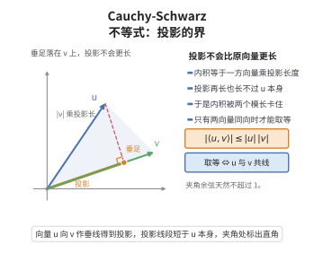

# Cauchy-Schwarz 不等式

> **一句话大白话**：两个向量的内积，绝不会超过它们各自长度的乘积；夹角余弦的绝对值永远不超过 $1$。
>
> **小例子**：在 $\mathbb R^2$ 中取 $\mathbf x=(1,2),\mathbf y=(2,3)$，则 $(\mathbf x\cdot\mathbf y)^2=8^2=64\le(1^2+2^2)(2^2+3^2)=5\cdot13=65$。

## 介绍

Cauchy-Schwarz 不等式（柯西–施瓦茨不等式）断言：在内积空间中，任意两向量内积的绝对值不超过它们范数的乘积。它是内积空间理论的基石，等价于"夹角余弦的绝对值不超过 $1$"，也是证明三角不等式、从而让范数真正成为"长度"的关键一步。

该不等式由柯西（Cauchy）于 1821 年在有限维情形、布尼亚科夫斯基（Bunyakovsky）于 1859 年、施瓦茨（Schwarz）于 1885 年在积分情形分别给出，故也常称 Cauchy–Bunyakovsky–Schwarz 不等式。它的积分形式 $\left|\int fg\right|\le\left(\int f^2\right)^{1/2}\left(\int g^2\right)^{1/2}$ 是泛函分析中 Hölder 不等式的特例。

它与极化恒等式、投影与正交分解、谱定理等共同构成内积空间几何的核心内容，被广泛用于概率（协方差上界）、统计（Fisher 信息不等式）与机器学习（泛化界）等领域。

## 几何直观

图意在说明：内积等于一个方向的模长乘以另一向量在它上面的投影长度，投影不可能比原向量更长。

## 分析

**前置依赖**：内积空间（内积公理）、范数 $\|\mathbf x\|=\sqrt{\langle\mathbf x,\mathbf x\rangle}$、二次函数非负的判别式

**定理内容**：设 $V$ 是实内积空间，$\langle\cdot,\cdot\rangle$ 为其内积，$\|\mathbf x\|=\sqrt{\langle\mathbf x,\mathbf x\rangle}$。则对任意 $\mathbf x,\mathbf y\in V$，

$$
|\langle\mathbf x,\mathbf y\rangle|\le\|\mathbf x\|\,\|\mathbf y\|
$$

等号成立当且仅当 $\mathbf x,\mathbf y$ 线性相关（对复内积空间，结论对 $|\langle\mathbf x,\mathbf y\rangle|$ 同样成立）。

**数学内涵**：
- 该不等式保证 $\cos\theta=\frac{\langle\mathbf x,\mathbf y\rangle}{\|\mathbf x\|\|\mathbf y\|}$ 有定义且 $|\cos\theta|\le1$，从而夹角概念合法。
- 由它可推出三角不等式 $\|\mathbf x+\mathbf y\|\le\|\mathbf x\|+\|\mathbf y\|$，使 $V$ 成为赋范空间。

## 思考过程

考虑含参向量 $\mathbf x+t\mathbf y$（$t\in\mathbb R$）。它的范数平方总非负：

$$
0\le\|\mathbf x+t\mathbf y\|^2=\|\mathbf x\|^2+2t\langle\mathbf x,\mathbf y\rangle+t^2\|\mathbf y\|^2
$$

右端是关于 $t$ 的二次多项式，且对所有实数 $t$ 不取负值，因此它的判别式不大于 $0$。判别式给出 $\langle\mathbf x,\mathbf y\rangle^2\le\|\mathbf x\|^2\|\mathbf y\|^2$，开方即得结论。

等号情形也一目了然：判别式为 $0$ 意味着这个二次式有重根 $t_0$，即 $\|\mathbf x+t_0\mathbf y\|^2=0$，于是 $\mathbf x=-t_0\mathbf y$，两向量线性相关。对复空间，只需把 $\mathbf x+t\mathbf y$ 中的 $t$ 取为恰当的复数（例如 $t=-\langle\mathbf x,\mathbf y\rangle/\|\mathbf y\|^2$）再取模平方。

## 证明过程

**步骤 1：平凡情形。** 若 $\mathbf y=\mathbf 0$，则 $\langle\mathbf x,\mathbf y\rangle=0$，不等式两边均为 $0$，成立且 $\mathbf x,\mathbf y$ 线性相关。故以下设 $\mathbf y\neq\mathbf 0$。

**步骤 2：实内积空间的证明。** 对任意 $t\in\mathbb R$，由内积的正定性，

$$
p(t)=\|\mathbf x+t\mathbf y\|^2=\|\mathbf x\|^2+2t\langle\mathbf x,\mathbf y\rangle+t^2\|\mathbf y\|^2\ge0
$$

这是首项系数 $\|\mathbf y\|^2>0$ 的二次多项式。它在整个 $\mathbb R$ 上非负，故其判别式非正：

$$
\big(2\langle\mathbf x,\mathbf y\rangle\big)^2-4\|\mathbf y\|^2\|\mathbf x\|^2\le0
$$

即 $\langle\mathbf x,\mathbf y\rangle^2\le\|\mathbf x\|^2\|\mathbf y\|^2$，两边开方得 $|\langle\mathbf x,\mathbf y\rangle|\le\|\mathbf x\|\|\mathbf y\|$。

**步骤 3：等号条件。** 等号成立当且仅当判别式为 $0$，当且仅当存在 $t_0$ 使 $p(t_0)=0$，即 $\mathbf x+t_0\mathbf y=\mathbf 0$。此时 $\mathbf x,\mathbf y$ 线性相关。反之若线性相关且 $\mathbf y\neq\mathbf 0$，设 $\mathbf x=\lambda\mathbf y$，则 $|\langle\mathbf x,\mathbf y\rangle|=|\lambda|\|\mathbf y\|^2=\|\mathbf x\|\|\mathbf y\|$，等号成立。

**步骤 4：复内积空间。** 设内积对第一变量线性、满足 $\langle\mathbf y,\mathbf x\rangle=\overline{\langle\mathbf x,\mathbf y\rangle}$。取

$$
t=-\frac{\langle\mathbf x,\mathbf y\rangle}{\|\mathbf y\|^2}\in\mathbb C
$$

则

$$
0\le\|\mathbf x+t\mathbf y\|^2=\|\mathbf x\|^2+2\operatorname{Re}\big(\bar t\langle\mathbf x,\mathbf y\rangle\big)+|t|^2\|\mathbf y\|^2=\|\mathbf x\|^2-\frac{|\langle\mathbf x,\mathbf y\rangle|^2}{\|\mathbf y\|^2}
$$

移项得 $|\langle\mathbf x,\mathbf y\rangle|^2\le\|\mathbf x\|^2\|\mathbf y\|^2$，开方即得结论。

**步骤 5：推论（三角不等式）。** 

$$
\|\mathbf x+\mathbf y\|^2=\|\mathbf x\|^2+2\operatorname{Re}\langle\mathbf x,\mathbf y\rangle+\|\mathbf y\|^2\le\|\mathbf x\|^2+2\|\mathbf x\|\|\mathbf y\|+\|\mathbf y\|^2=\big(\|\mathbf x\|+\|\mathbf y\|\big)^2
$$

取平方根得 $\|\mathbf x+\mathbf y\|\le\|\mathbf x\|+\|\mathbf y\|$。$\square$

## 课堂问答

**老师**：两个向量内积的大小，凭什么一定被它们各自长度卡住？这不等式最干脆的证明是什么？

**学生**：结论先行——$|\langle\mathbf x,\mathbf y\rangle|\le\|\mathbf x\|\,\|\mathbf y\|$，等号当且仅当两者线性相关。证明只用一个恒非负的二次式：$0\le\|\mathbf x+t\mathbf y\|^2=\|\mathbf x\|^2+2t\langle\mathbf x,\mathbf y\rangle+t^2\|\mathbf y\|^2$。

**老师（追问）**：这个二次式恒非负，为什么就等价于判别式不超过零？等号情形又对应什么？

**学生**：首项系数 $\|\mathbf y\|^2>0$，处处非负迫使判别式 $\Delta=(2\langle\mathbf x,\mathbf y\rangle)^2-4\|\mathbf y\|^2\|\mathbf x\|^2\le0$，开方即得。等号即 $\Delta=0$，此时二次式有重根 $t_0$，$\|\mathbf x+t_0\mathbf y\|=0$，故 $\mathbf x=-t_0\mathbf y$ 线性相关。

**老师（拓展）**：把 $t$ 取成复数，实内积的证法还够用吗？

**学生**：不够，要令 $t=-\langle\mathbf x,\mathbf y\rangle/\|\mathbf y\|^2$，代入得 $0\le\|\mathbf x\|^2-|\langle\mathbf x,\mathbf y\rangle|^2/\|\mathbf y\|^2$。常见误区是忘了复情形内积对第一变量线性、$\langle\mathbf y,\mathbf x\rangle=\overline{\langle\mathbf x,\mathbf y\rangle}$，照搬实展开会丢虚部。它还是三角不等式 $\|\mathbf x+\mathbf y\|\le\|\mathbf x\|+\|\mathbf y\|$ 的源头。

## 相关条目

- [Gram-Schmidt 正交化](./Gram-Schmidt正交化.md)：依赖内积与投影，Cauchy-Schwarz 不等式保证投影系数良定义。
- [谱定理](./谱定理.md)：内积空间上的算子理论，Cauchy-Schwarz 不等式是许多估计的起点。
