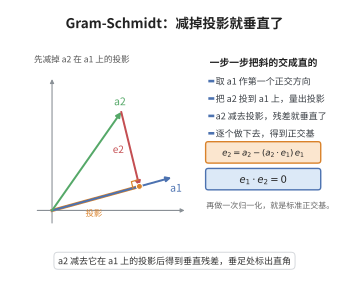

# Gram-Schmidt 正交化

> **一句话大白话**：把一批"歪歪斜斜"的待证线性无关向量，逐个减去在已做方向上的影子，掰成互相垂直、长度恰为 1 的标准正交基——像把栅栏一根根扶正摆齐。
>
> **小例子**：$\mathbf{v}_1=(1,0)$,$\mathbf{v}_2=(1,1)$ 经正交化得 $\mathbf{u}_1=(1,0)$,$\mathbf{u}_2=(0,1)$。

## 介绍

Gram-Schmidt 正交化方法由丹麦数学家约尔根·佩德森·格拉姆（Jørgen Pedersen Gram）和德国数学家埃尔哈德·施密特（Erhard Schmidt）提出，是内积空间中将线性无关组化为标准正交组的基本方法。该方法是构造正交基的标准工具，在数值线性代数、信号处理、量子力学等领域有重要应用。

## 几何直观

图意在说明：把新向量减去它在已有正交方向上的投影，剩下的残差就与这些方向全部垂直。

## 分析

**前置依赖**：内积空间、线性无关、正交投影、数学归纳法原理

**定理内容**：设 $\{\mathbf{v}_1,\mathbf{v}_2,\ldots,\mathbf{v}_n\}$ 是内积空间 $V$ 中的一组线性无关向量，则存在一组标准正交向量 $\{\mathbf{u}_1,\mathbf{u}_2,\ldots,\mathbf{u}_n\}$，使得对每个 $k$，$\operatorname{span}\{\mathbf{v}_1,\ldots,\mathbf{v}_k\}=\operatorname{span}\{\mathbf{u}_1,\ldots,\mathbf{u}_k\}$。

**构造方法**：
$$\begin{aligned}
\mathbf{w}_1 &= \mathbf{v}_1, &
\mathbf{u}_1 &= \frac{\mathbf{w}_1}{\|\mathbf{w}_1\|} \\
\mathbf{w}_2 &= \mathbf{v}_2-\langle\mathbf{v}_2,\mathbf{u}_1\rangle\mathbf{u}_1, &
\mathbf{u}_2 &= \frac{\mathbf{w}_2}{\|\mathbf{w}_2\|} \\
&\vdots & &\vdots \\
\mathbf{w}_k &= \mathbf{v}_k-\sum_{j=1}^{k-1}\langle\mathbf{v}_k,\mathbf{u}_j\rangle\mathbf{u}_j, &
\mathbf{u}_k &= \frac{\mathbf{w}_k}{\|\mathbf{w}_k\|}
\end{aligned}$$

**前置知识**：
- 投影公式：$\operatorname{proj}_{\mathbf{u}}(\mathbf{v})=\frac{\langle\mathbf{v},\mathbf{u}\rangle}{\langle\mathbf{u},\mathbf{u}\rangle}\mathbf{u}$

**数学内涵**：
Gram-Schmidt 正交化的核心思想是：从第 $k$ 个向量 $\mathbf{v}_k$ 中减去它在已得到的前 $k-1$ 个正交方向上的投影，从而得到与前面所有向量正交的分量 $\mathbf{w}_k$，再归一化得到 $\mathbf{u}_k$。

## 思考过程

设已构造了标准正交向量 $\mathbf{u}_1,\ldots,\mathbf{u}_{k-1}$，它们张成的空间与 $\mathbf{v}_1,\ldots,\mathbf{v}_{k-1}$ 张成的空间相同。

考虑 $\mathbf{v}_k$ 在 $\operatorname{span}\{\mathbf{u}_1,\ldots,\mathbf{u}_{k-1}\}$ 上的正交投影：
$$\operatorname{proj}_{\operatorname{span}\{\mathbf{u}_1,\ldots,\mathbf{u}_{k-1}\}}(\mathbf{v}_k)=\sum_{j=1}^{k-1}\langle\mathbf{v}_k,\mathbf{u}_j\rangle\mathbf{u}_j$$

则 $\mathbf{w}_k=\mathbf{v}_k-\sum_{j=1}^{k-1}\langle\mathbf{v}_k,\mathbf{u}_j\rangle\mathbf{u}_j$ 垂直于所有 $\mathbf{u}_j$（$j<k$）。由于 $\{\mathbf{v}_1,\ldots,\mathbf{v}_k\}$ 线性无关，$\mathbf{w}_k\neq 0$，归一化即得 $\mathbf{u}_k$。

## 证明过程

**证明**：

对 $k$ 进行归纳。

**归纳基础**：$k=1$。令 $\mathbf{w}_1=\mathbf{v}_1$，由线性无关性知 $\mathbf{w}_1\neq 0$。令 $\mathbf{u}_1=\frac{\mathbf{w}_1}{\|\mathbf{w}_1\|}$，则 $\|\mathbf{u}_1\|=1$，且 $\operatorname{span}\{\mathbf{v}_1\}=\operatorname{span}\{\mathbf{u}_1\}$。

**归纳假设**：假设已构造了标准正交向量 $\mathbf{u}_1,\ldots,\mathbf{u}_{k-1}$，使得 $\operatorname{span}\{\mathbf{v}_1,\ldots,\mathbf{v}_{k-1}\}=\operatorname{span}\{\mathbf{u}_1,\ldots,\mathbf{u}_{k-1}\}$。

**归纳步骤**：构造 $\mathbf{u}_k$。

令
$$\mathbf{w}_k=\mathbf{v}_k-\sum_{j=1}^{k-1}\langle\mathbf{v}_k,\mathbf{u}_j\rangle\mathbf{u}_j$$

**验证正交性**：对任意 $i<k$，
$$\langle\mathbf{w}_k,\mathbf{u}_i\rangle=\langle\mathbf{v}_k,\mathbf{u}_i\rangle-\sum_{j=1}^{k-1}\langle\mathbf{v}_k,\mathbf{u}_j\rangle\langle\mathbf{u}_j,\mathbf{u}_i\rangle=\langle\mathbf{v}_k,\mathbf{u}_i\rangle-\langle\mathbf{v}_k,\mathbf{u}_i\rangle=0$$
因为 $\langle\mathbf{u}_j,\mathbf{u}_i\rangle=\delta_{ij}$。

**验证非零**：若 $\mathbf{w}_k=0$，则 $\mathbf{v}_k=\sum_{j=1}^{k-1}\langle\mathbf{v}_k,\mathbf{u}_j\rangle\mathbf{u}_j\in\operatorname{span}\{\mathbf{u}_1,\ldots,\mathbf{u}_{k-1}\}=\operatorname{span}\{\mathbf{v}_1,\ldots,\mathbf{v}_{k-1}\}$，与 $\{\mathbf{v}_1,\ldots,\mathbf{v}_k\}$ 线性无关矛盾。故 $\mathbf{w}_k\neq 0$。

令 $\mathbf{u}_k=\frac{\mathbf{w}_k}{\|\mathbf{w}_k\|}$，则 $\|\mathbf{u}_k\|=1$，且 $\operatorname{span}\{\mathbf{v}_1,\ldots,\mathbf{v}_k\}=\operatorname{span}\{\mathbf{u}_1,\ldots,\mathbf{u}_k\}$。

由归纳法，结论对所有 $k$ 成立。

$\square$

## 课堂问答

**老师**：给我一组线性无关向量，怎么系统地变成两两垂直、长度为一的标准正交组，而且还保持张成空间不变？

**学生**：结论：逐个"减去在已有方向上的投影再归一化"。设 $W_{k-1}=\operatorname{span}\{\mathbf u_1,\dots,\mathbf u_{k-1}\}$，取 $\mathbf w_k=\mathbf v_k-\sum_{j=1}^{k-1}\langle\mathbf v_k,\mathbf u_j\rangle\mathbf u_j$，再令 $\mathbf u_k=\mathbf w_k/\|\mathbf w_k\|$。

**老师（追问）**：你怎么保证 $\mathbf w_k$ 一定不为零？如果它真的为零会怎样？

**学生**：若 $\mathbf w_k=0$，则 $\mathbf v_k=\sum_{j<k}\langle\mathbf v_k,\mathbf u_j\rangle\mathbf u_j\in W_{k-1}=\operatorname{span}\{\mathbf v_1,\dots,\mathbf v_{k-1}\}$，与 $\{\mathbf v_1,\dots,\mathbf v_k\}$ 线性无关矛盾，故 $\mathbf w_k\ne0$。

**老师（拓展）**：正交性凭什么成立？这个方法在数值上真的可靠吗？

**学生**：对 $i<k$，$\langle\mathbf w_k,\mathbf u_i\rangle=\langle\mathbf v_k,\mathbf u_i\rangle-\sum_{j<k}\langle\mathbf v_k,\mathbf u_j\rangle\langle\mathbf u_j,\mathbf u_i\rangle=0$，靠的就是 $\langle\mathbf u_j,\mathbf u_i\rangle=\delta_{ij}$。常见误区是以为它数值稳定——经典 Gram-Schmidt 在向量近乎相关时会严重损失正交性，实践中要用改进版并做再正交化。
