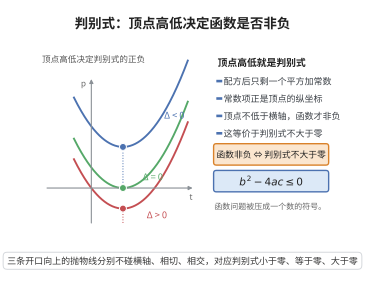

# 二次函数非负的判别式

> **一句话大白话**：一个开口向上的二次函数如果处处不取负值，那它的图像要么压根碰不到横轴、要么只擦着横轴一下——这正是"判别式不超过零"。
>
> **小例子**：$p(t)=t^2-2t+3$ 的判别式 $\Delta=(-2)^2-4\cdot1\cdot3=-8<0$，而 $p(t)=(t-1)^2+2>0$ 对一切 $t$ 成立；$p(t)=t^2-2t+1$ 的 $\Delta=0$，只在 $t=1$ 处取到 $0$。

## 介绍

二次函数非负的判别式（discriminant criterion for a nonnegative quadratic）是初等代数中最常用的判定准则之一：对首项系数为正的实二次多项式

$$
p(t)=at^2+bt+c,\qquad a>0,
$$

"$p(t)\ge0$ 对一切实数 $t$ 成立"与"判别式 $\Delta=b^2-4ac\le0$"完全等价。

这条准则的思想来自配方法（completed square），在巴比伦、希腊与中国古代的二次方程求解中已有雏形；"判别式"这一名词与符号 $\Delta$ 由 19 世纪代数学家正式确立，并被推广到三次、四次方程与二次型理论。它的价值在于把"一个含参数的函数是否处处非负"这一函数型问题，化归为"一个数是否非正"这一算术问题。

它是 Cauchy–Schwarz 不等式、投影公式、最小二乘的存在性、凸二次优化的最优性条件等诸多结论的证明起点：只要能把某个表达式写成"首项系数为正的二次式"，就能立刻得到关于判别式的不等式。

## 几何直观

图意在说明：开口向上时函数是否处处非负，只看顶点在横轴上方还是下方，这正是判别式的符号。

## 分析

**前置依赖**：二次方程求根公式、韦达定理、多项式恒等定理

**定理内容**：设 $a,b,c\in\mathbb R$ 且 $a>0$，$\Delta=b^2-4ac$。则

$$
\forall t\in\mathbb R:\ at^2+bt+c\ge0\quad\Longleftrightarrow\quad \Delta\le0 .
$$

进一步，当 $\Delta<0$ 时不等式严格成立（$p(t)>0$ 对一切 $t$）；当 $\Delta=0$ 时等号恰在一个点 $t_0=-\dfrac{b}{2a}$ 处成立，且该点为 $p$ 的最小值点。

**数学内涵**：

- 几何上，$a>0$ 意味着抛物线开口向上，"处处非负"意味着抛物线与横轴至多相切，不可能穿过。
- 代数上，把 $p$ 配方成 $a\left(t+\dfrac{b}{2a}\right)^2-\dfrac{\Delta}{4a}$，非负性等价于常数项 $-\dfrac{\Delta}{4a}$ 非负，而 $a>0$ 故等价于 $\Delta\le0$。
- 该准则可作"对偶使用"：若已知某个二次式 $p(t)\ge0$ 恒成立，则其判别式自动满足 $\Delta\le0$，由此可提取一个不等式（Cauchy–Schwarz 不等式正是这样得到的）。

## 思考过程

配方法是理解这条准则的关键。把 $p(t)$ 写成"完全平方 + 常数"的形式：

$$
p(t)=a\left(t+\frac{b}{2a}\right)^2+\frac{4ac-b^2}{4a}=a\left(t+\frac{b}{2a}\right)^2-\frac{\Delta}{4a}.
$$

平方项 $a\left(t+\frac{b}{2a}\right)^2$ 最小取 $0$（在 $t=-\frac{b}{2a}$ 处），因此

$$
\min_{t\in\mathbb R}p(t)=-\frac{\Delta}{4a}.
$$

于是"最小值非负"$\iff$"$-\frac{\Delta}{4a}\ge0$"$\iff$"$\Delta\le0$"（用 $a>0$）。因为该最小值确实在某点取到（$t=-\frac{b}{2a}$ 是实数），所以当 $\Delta=0$ 时等号是可达的，而当 $\Delta<0$ 时最小值严格大于 $0$。

另一条思路是用求根公式：$p$ 的非负性等价于"没有实根，或只有一个（重）实根"。由求根公式 $t_{1,2}=\dfrac{-b\pm\sqrt{\Delta}}{2a}$，$\Delta<0$ 时无实根，$\Delta=0$ 时两根重合，$\Delta>0$ 时两个相异实根，此时 $p$ 在两根之间取负值。配合韦达定理还可以读出两根的和与积，从而判断 $p$ 的符号分布。

## 证明过程

**步骤 1：配方恒等式。** 由多项式恒等定理，对一切实数 $t$ 有

$$
at^2+bt+c=a\left(t+\frac{b}{2a}\right)^2+\frac{4ac-b^2}{4a}.
$$

因为右侧展开后与左侧同次项系数相同，故这是恒等式而非方程。

**步骤 2：充分性（$\Delta\le0\Rightarrow p\ge0$）。** 设 $\Delta=b^2-4ac\le0$，则 $4ac-b^2=-\Delta\ge0$，而 $a>0$ 故

$$
p(t)=a\left(t+\frac{b}{2a}\right)^2+\frac{4ac-b^2}{4a}\ \ge\ 0+\frac{-\Delta}{4a}\ \ge\ 0 .
$$

若进一步 $\Delta<0$，则 $\dfrac{-\Delta}{4a}>0$，于是 $p(t)>0$ 对一切 $t$ 成立。

**步骤 3：必要性（$p\ge0\Rightarrow\Delta\le0$）。** 设 $p(t)\ge0$ 对一切实数 $t$。取特殊的 $t_0=-\dfrac{b}{2a}\in\mathbb R$，则平方项为 $0$，于是

$$
0\le p(t_0)=\frac{4ac-b^2}{4a}=\frac{-\Delta}{4a}.
$$

由 $a>0$ 得 $-\Delta\ge0$，即 $\Delta\le0$。

**步骤 4：等号情形。** 设 $\Delta=0$。此时

$$
p(t)=a\left(t+\frac{b}{2a}\right)^2,
$$

于是 $p(t)=0\iff t=-\dfrac{b}{2a}$，等号恰在一个点取到；且该点是 $p$ 的最小值点，最小值 $0$。反之，若等号在某点 $t_0$ 成立且 $p\ge0$ 恒成立，则 $t_0$ 是 $p$ 的最小值点，由步骤 3 的表达式得 $-\Delta/(4a)=p(t_0)=0$，故 $\Delta=0$。$\square$

**推论（判别式形式的 Cauchy–Schwarz 型不等式）。** 若 $a>0$ 且 $at^2+bt+c\ge0$ 对一切 $t$ 成立，则 $b^2\le4ac$。这正是 Cauchy–Schwarz 不等式证明中"把内积平方控制成范数平方之积"的算术内核。

## 课堂问答

**老师**：一个含参数的二次函数想处处非负，你凭什么只查一个数 $\Delta$ 就够了？

**学生**：结论先行——对 $a>0$ 的 $p(t)=at^2+bt+c$，$\forall t\ p(t)\ge0\iff\Delta=b^2-4ac\le0$。证据是配方 $p(t)=a(t+\frac{b}{2a})^2-\frac{\Delta}{4a}$，最小值恰为 $-\frac{\Delta}{4a}$。

**老师（追问）**：为什么非负性恰好等价于最小值非负？等号什么时候取到？

**学生**：平方项 $\ge0$ 且当 $t=-\frac{b}{2a}$ 时取 $0$，故最小值真的被取到。$\Delta<0$ 时最小值严格为正，$p(t)>0$；$\Delta=0$ 时最小值恰为 $0$，等号只在 $t=-\frac{b}{2a}$ 一点成立。

**老师（拓展）**：这条准则除了判符号，还能反过来用吗？

**学生**：能，这正是 Cauchy-Schwarz 的来源：若已知某二次式恒非负，则 $\Delta\le0$，从中提取不等式 $b^2\le4ac$。常见误区是漏掉 $a>0$——开口向下时"恒非负"至多恒等于零，判别式判据不再成立。

## 相关条目

- [二次方程求根公式](../第02级-初等代数/二次方程求根公式.md)：给出 $\Delta$ 的符号与实根个数、个数的对应关系。
- [韦达定理](../第02级-初等代数/韦达定理.md)：刻画两根之和与积，与判别式共同决定二次式的符号分布。
- [Cauchy-Schwarz 不等式](./Cauchy-Schwarz不等式.md)：其证明把 $\\|\mathbf x+t\mathbf y\\|^2$ 看成关于 $t$ 的非负二次式，直接调用本准则。
- [投影公式](./投影公式.md)：最佳逼近的正交性条件同样由"非负二次式判别式非正"导出。
