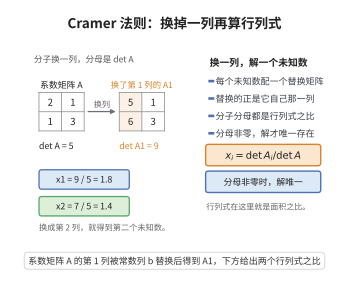

# 克莱姆法则

> **一句话大白话**：方程组 $A\mathbf{x}=\mathbf{b}$ 的第 $i$ 个未知数，就是把第 $i$ 列换成"右边那个 $\mathbf{b}$"后算出的行列式除以原行列式，$x_i=\frac{\det(A_i)}{\det(A)}$。
>
> **小例子**：$\begin{cases}2x+y=5\\x-y=1\end{cases}$ 中 $x=\dfrac{\begin{vmatrix}5&1\\1&-1\end{vmatrix}}{\begin{vmatrix}2&1\\1&-1\end{vmatrix}}=\dfrac{-6}{-3}=2$。

## 介绍

克莱姆法则（Cramer's Rule）由瑞士数学家加布里埃尔·克莱姆（Gabriel Cramer）在1750年提出，是求解线性方程组的一种方法。该法则利用行列式给出线性方程组解的直接表达式，在线性代数理论和某些特殊应用中有重要价值。虽然对于大规模数值计算效率不高，但克莱姆法则在理论推导中具有重要作用。

## 几何直观

图意在说明：每个未知数等于替换了对应列之后的行列式与系数行列式之比。

## 分析

**前置依赖**：行列式的性质（多重线性性、交错性）、可逆矩阵、行列式展开定理、矩阵求逆

**定理内容**：设 $A$ 是 $n\times n$ 可逆矩阵，$\mathbf{b}\in\mathbb{R}^n$，则线性方程组 $A\mathbf{x}=\mathbf{b}$ 的唯一解为
$$x_i = \frac{\det(A_i)}{\det(A)},\quad i=1,2,\ldots,n$$
其中 $A_i$ 是将 $A$ 的第 $i$ 列替换为 $\mathbf{b}$ 所得的矩阵。

**前置知识**：
- 行列式的性质（多重线性性、交错性）

**数学内涵**：
克莱姆法则的几何意义是：解 $x_i$ 等于用 $\mathbf{b}$ 替换第 $i$ 列后的体积与原始体积之比。这反映了 Cramer 法则与行列式体积解释的内在联系。该法则表明，解是系数的有理函数，这在理论分析中非常有用。

## 思考过程

设 $A=[\mathbf{a}_1,\mathbf{a}_2,\ldots,\mathbf{a}_n]$，其中 $\mathbf{a}_j$ 是 $A$ 的第 $j$ 列。则方程组 $A\mathbf{x}=\mathbf{b}$ 可写为：
$$\sum_{j=1}^n x_j\mathbf{a}_j = \mathbf{b}$$

考虑行列式 $\det(A_i)=\det[\mathbf{a}_1,\ldots,\mathbf{a}_{i-1},\mathbf{b},\mathbf{a}_{i+1},\ldots,\mathbf{a}_n]$。

将 $\mathbf{b}=\sum_{j=1}^n x_j\mathbf{a}_j$ 代入，由行列式的多重线性性：
$$\det(A_i)=\sum_{j=1}^n x_j\det[\mathbf{a}_1,\ldots,\mathbf{a}_{i-1},\mathbf{a}_j,\mathbf{a}_{i+1},\ldots,\mathbf{a}_n]$$

当 $j\neq i$ 时，行列式中有两列相同，值为零；当 $j=i$ 时，行列式等于 $\det(A)$。因此 $\det(A_i)=x_i\det(A)$，即 $x_i=\det(A_i)/\det(A)$。

## 证明过程

**证明**：

设 $A=[\mathbf{a}_1,\mathbf{a}_2,\ldots,\mathbf{a}_n]$，其中 $\mathbf{a}_j$ 是 $A$ 的第 $j$ 列。记 $A_i$ 为将 $A$ 的第 $i$ 列替换为 $\mathbf{b}$ 所得的矩阵。

由 $A\mathbf{x}=\mathbf{b}$，得 $\sum_{j=1}^n x_j\mathbf{a}_j=\mathbf{b}$。

计算 $\det(A_i)$：
$$\det(A_i)=\det[\mathbf{a}_1,\ldots,\mathbf{a}_{i-1},\mathbf{b},\mathbf{a}_{i+1},\ldots,\mathbf{a}_n]$$

将 $\mathbf{b}=\sum_{j=1}^n x_j\mathbf{a}_j$ 代入，由行列式的多重线性性（对第 $i$ 列）：
$$\det(A_i)=\sum_{j=1}^n x_j\det[\mathbf{a}_1,\ldots,\mathbf{a}_{i-1},\mathbf{a}_j,\mathbf{a}_{i+1},\ldots,\mathbf{a}_n]$$

当 $j\neq i$ 时，矩阵 $\det[\mathbf{a}_1,\ldots,\mathbf{a}_{i-1},\mathbf{a}_j,\mathbf{a}_{i+1},\ldots,\mathbf{a}_n]$ 的第 $i$ 列与第 $j$ 列相同，由行列式的交错性，其值为零。

当 $j=i$ 时，$\det[\mathbf{a}_1,\ldots,\mathbf{a}_{i-1},\mathbf{a}_i,\mathbf{a}_{i+1},\ldots,\mathbf{a}_n]=\det(A)$。

因此 $\det(A_i)=x_i\det(A)$。

由于 $A$ 可逆，$\det(A)\neq 0$，故 $x_i=\dfrac{\det(A_i)}{\det(A)}$。

$\square$

## 课堂问答

**老师**：$A\mathbf x=\mathbf b$ 的第 $i$ 个解，凭什么就是"把第 $i$ 列换成 $\mathbf b$"后的行列式之比？

**学生**：结论：$x_i=\det(A_i)/\det(A)$，其中 $A_i$ 是把 $A$ 的第 $i$ 列换成 $\mathbf b$ 的矩阵。依据是 $\det(A_i)=\det[\mathbf a_1,\dots,\mathbf a_{i-1},\mathbf b,\mathbf a_{i+1},\dots,\mathbf a_n]$，再代入 $\mathbf b=\sum_j x_j\mathbf a_j$。

**老师（追问）**：展开这个行列式后，为什么只剩 $j=i$ 那一项？

**学生**：由多重线性性，$\det(A_i)=\sum_j x_j\det[\dots,\mathbf a_j,\dots]$；当 $j\ne i$ 时第 $i$ 列与第 $j$ 列相同，由交错性该行列式为 $0$，只有 $j=i$ 项留下，正是 $x_i\det(A)$，故 $x_i=\det(A_i)/\det(A)$。

**老师（拓展）**：几何上 $x_i$ 是什么？拿它算大规模方程组划算吗？

**学生**：$x_i$ 是"以 $\mathbf b$ 换入第 $i$ 列后的有向体积"与原体积之比，所以必须先 $\det(A)\ne0$ 才有唯一解。常见误区是拿它做数值计算——需要算 $n+1$ 个 $n$ 阶行列式，复杂度远高于消元法，克莱姆法则主要是理论工具。
