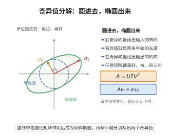

# 奇异值分解

> **一句话大白话**：任何矩阵都能拆成"旋转–拉伸–再旋转"三步：$A=U\Sigma V^T$，中间那个对角阵里的奇异值就是各方向的放大倍数——像把任意变形拆成标准动作。
>
> **小例子**：$A=\begin{bmatrix}3&0\\0&1\end{bmatrix}$ 已是 $U=I,\Sigma=A,V=I$ 的 SVD，奇异值为 $3,1$。

## 介绍

奇异值分解（Singular Value Decomposition, SVD）是线性代数中最重要的矩阵分解之一，由多位数学家独立发展完善。该定理断言任意矩阵都可分解为三个矩阵的乘积，其中包含正交矩阵和对角矩阵。SVD 在数据降维、推荐系统、图像压缩、自然语言处理、信号处理等众多领域有广泛应用。

## 几何直观

图意在说明：任何矩阵都把单位圆映成椭圆，两条半轴的长度就是奇异值，方向由左右奇异向量给出。

## 分析

**前置依赖**：谱定理（实对称矩阵可正交对角化）、特征值与特征向量、对称矩阵与正交矩阵

**定理内容**：设 $A$ 是 $m\times n$ 实矩阵（秩为 $r$），则存在正交矩阵 $U$（$m\times m$）、正交矩阵 $V$（$n\times n$）和对角矩阵 $\Sigma$（$m\times n$），使得
$$A = U\Sigma V^T$$

其中 $\Sigma$ 的对角线元素 $\sigma_1\ge\sigma_2\ge\cdots\ge\sigma_r>0$，其余为零，$\sigma_i$ 称为 $A$ 的奇异值。

**等价形式**：
$$A = \sum_{i=1}^r \sigma_i \mathbf{u}_i\mathbf{v}_i^T$$
其中 $\mathbf{u}_i$ 是 $U$ 的第 $i$ 列，$\mathbf{v}_i$ 是 $V$ 的第 $i$ 列。

**前置知识**：
- 谱定理：实对称矩阵可正交对角化

**数学内涵**：
SVD 的核心思想是：任意线性变换可以分解为三个基本操作的复合——旋转（$V^T$）、缩放（$\Sigma$）、旋转（$U$）。奇异值 $\sigma_i$ 衡量了变换在各方向上的放大倍数。

## 思考过程

考虑 $n\times n$ 实对称矩阵 $A^TA$。由谱定理，$A^TA$ 可正交对角化：
$$A^TA = V\Lambda V^T$$
其中 $V$ 是正交矩阵，$\Lambda=\operatorname{diag}(\lambda_1,\ldots,\lambda_n)$，$\lambda_i\ge 0$ 是 $A^TA$ 的特征值。

定义奇异值 $\sigma_i=\sqrt{\lambda_i}$，并按降序排列。令 $\Sigma$ 为 $m\times n$ 对角矩阵，对角线为 $\sigma_i$。

对 $i=1,\ldots,r$，定义 $\mathbf{u}_i=\frac{1}{\sigma_i}A\mathbf{v}_i$，可以证明 $\{\mathbf{u}_i\}$ 是标准正交的。将其扩充为 $\mathbb{R}^m$ 的一组标准正交基，即得 $U$。

## 证明过程

**证明**：

**第一步：分析 $A^TA$。**

$A^TA$ 是 $n\times n$ 实对称半正定矩阵。由谱定理，存在正交矩阵 $V=[\mathbf{v}_1,\ldots,\mathbf{v}_n]$ 和对角矩阵 $\Lambda=\operatorname{diag}(\lambda_1,\ldots,\lambda_n)$，使得
$$A^TA = V\Lambda V^T$$
其中 $\lambda_1\ge\cdots\ge\lambda_r>0$，$\lambda_{r+1}=\cdots=\lambda_n=0$，$r=\operatorname{rank}(A)$。

定义奇异值 $\sigma_i=\sqrt{\lambda_i}$，$i=1,\ldots,r$。

**第二步：构造 $U$ 的前 $r$ 列。**

对 $i=1,\ldots,r$，令 $\mathbf{u}_i=\frac{1}{\sigma_i}A\mathbf{v}_i$。验证 $\{\mathbf{u}_1,\ldots,\mathbf{u}_r\}$ 是标准正交的：
$$\langle\mathbf{u}_i,\mathbf{u}_j\rangle=\frac{1}{\sigma_i\sigma_j}\langle A\mathbf{v}_i,A\mathbf{v}_j\rangle=\frac{1}{\sigma_i\sigma_j}\langle\mathbf{v}_i,A^TA\mathbf{v}_j\rangle=\frac{1}{\sigma_i\sigma_j}\langle\mathbf{v}_i,\lambda_j\mathbf{v}_j\rangle=\frac{\lambda_j}{\sigma_i\sigma_j}\delta_{ij}=\delta_{ij}$$

**第三步：扩充为 $\mathbb{R}^m$ 的标准正交基。**

将 $\{\mathbf{u}_1,\ldots,\mathbf{u}_r\}$ 扩充为 $\mathbb{R}^m$ 的一组标准正交基 $\{\mathbf{u}_1,\ldots,\mathbf{u}_m\}$，令 $U=[\mathbf{u}_1,\ldots,\mathbf{u}_m]$。

**第四步：验证 $A=U\Sigma V^T$。**

对任意 $j=1,\ldots,n$，
$$U\Sigma V^T\mathbf{v}_j = U\Sigma \mathbf{e}_j = \begin{cases}U(\sigma_j\mathbf{e}_j)=\sigma_j\mathbf{u}_j=A\mathbf{v}_j, & j\le r\\ U(0)=0=A\mathbf{v}_j, & j>r\end{cases}$$

由于 $\{\mathbf{v}_j\}$ 是 $\mathbb{R}^n$ 的一组基，$U\Sigma V^T$ 与 $A$ 在所有基向量上作用相同，故 $A=U\Sigma V^T$。

$\square$

## 课堂问答

**老师**：任意矩阵都能写成"旋转—拉伸—旋转" $A=U\Sigma V^T$，凭据是什么？

**学生**：结论：$A=U\Sigma V^T$，奇异值 $\sigma_i=\sqrt{\lambda_i}$ 来自 $A^TA$ 的非负特征值。依据是对对称半正定矩阵 $A^TA$ 用谱定理得 $A^TA=V\Lambda V^T$，取 $V$ 为右奇异向量矩阵。

**老师（追问）**：$U$ 的前 $r$ 列是怎么造出来的？它们为什么两两正交？

**学生**：令 $\mathbf u_i=\frac{1}{\sigma_i}A\mathbf v_i$。验证：$\langle\mathbf u_i,\mathbf u_j\rangle=\frac{1}{\sigma_i\sigma_j}\langle A\mathbf v_i,A\mathbf v_j\rangle=\frac{1}{\sigma_i\sigma_j}\langle\mathbf v_i,A^TA\mathbf v_j\rangle=\frac{\lambda_j}{\sigma_i\sigma_j}\delta_{ij}=\delta_{ij}$，只用 $A^TA\mathbf v_j=\lambda_j\mathbf v_j$ 与 $\sigma_j^2=\lambda_j$。

**老师（拓展）**：秩 $r$ 之后的部分怎么处理？这对降维意味着什么？

**学生**：$\lambda_{r+1}=\dots=\lambda_n=0$ 对应 $\sigma=0$，只需把前 $r$ 个 $\mathbf u_i$ 扩充成 $\mathbb R^m$ 的标准正交基即可补全 $U$。常见误区是以为 $A$ 必须方阵或满秩——SVD 对任意 $m\times n$ 矩阵成立。保留大奇异值、截掉小的就得到最优低秩逼近，这正是 PCA 与图像压缩的根基。
