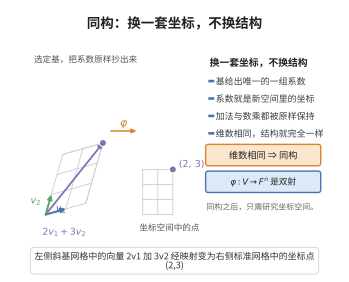

# 有限维向量空间同构

> **一句话大白话**：任何 $n$ 维向量空间选好一组基后，就和一个"坐标盒子" $\mathbb{F}^n$ 长得一模一样——维数决定一切，其余只是换套坐标。
>
> **小例子**：二维平面中的向量 $2\mathbf{v}_1+3\mathbf{v}_2$ 可看成坐标 $(2,3)\in\mathbb{R}^2$，本质就是 $n=2$ 的坐标空间。

## 介绍

有限维向量空间同构定理是线性代数中的基本结论，表明数域 $\mathbb{F}$ 上所有 $n$ 维向量空间都同构于 $\mathbb{F}^n$。该定理揭示了有限维向量空间的本质结构：一旦选定基，向量空间就可以用坐标向量表示，线性变换可以用矩阵表示。这是线性代数中"坐标化"思想的理论基础。

## 几何直观

图意在说明：选定一组基后，每个向量都对应唯一一组系数，向量空间于是与坐标空间完全同构。

## 分析

**前置依赖**：向量空间、基、维数、线性映射、线性同构与双射

**定理内容**：设 $V$ 是数域 $\mathbb{F}$ 上的 $n$ 维向量空间，则 $V$ 与 $\mathbb{F}^n$ 同构。即存在双射线性映射 $\varphi:V\to\mathbb{F}^n$。

**具体构造**：取 $V$ 的一组基 $\{\mathbf{v}_1,\ldots,\mathbf{v}_n\}$，定义
$$\varphi(\sum_{i=1}^n a_i\mathbf{v}_i) = (a_1,\ldots,a_n)\in\mathbb{F}^n$$

**前置知识**：
- 基的构造与性质

**数学内涵**：
该定理表明，有限维向量空间的结构完全由维数决定。任何 $n$ 维 $\mathbb{F}$-向量空间都与 $\mathbb{F}^n$ 有完全相同的线性结构。这意味着，我们只需研究 $\mathbb{F}^n$ 就可了解所有有限维向量空间的线性性质。

## 思考过程

取 $V$ 的一组基 $\mathcal{B}=\{\mathbf{v}_1,\ldots,\mathbf{v}_n\}$。对任意 $\mathbf{x}\in V$，存在唯一的一组系数 $(a_1,\ldots,a_n)$，使得 $\mathbf{x}=\sum_{i=1}^n a_i\mathbf{v}_i$（由基的定义）。定义 $\varphi(\mathbf{x})=(a_1,\ldots,a_n)$。

$\varphi$ 是线性的：若 $\mathbf{x}=\sum a_i\mathbf{v}_i$，$\mathbf{y}=\sum b_i\mathbf{v}_i$，则 $\mathbf{x}+\mathbf{y}=\sum(a_i+b_i)\mathbf{v}_i$，$\varphi(\mathbf{x}+\mathbf{y})=(a_i+b_i)=\varphi(\mathbf{x})+\varphi(\mathbf{y})$。类似可证 $\varphi(c\mathbf{x})=c\varphi(\mathbf{x})$。

$\varphi$ 是双射：若 $\varphi(\mathbf{x})=0$，则所有系数为零，$\mathbf{x}=0$，故单射。对任意 $(a_1,\ldots,a_n)\in\mathbb{F}^n$，$\mathbf{x}=\sum a_i\mathbf{v}_i$ 满足 $\varphi(\mathbf{x})=(a_1,\ldots,a_n)$，故满射。

## 证明过程

**证明**：

**第一步：构造映射。**

取 $V$ 的一组基 $\mathcal{B}=\{\mathbf{v}_1,\ldots,\mathbf{v}_n\}$。对任意 $\mathbf{x}\in V$，存在唯一的一组标量 $a_1,\ldots,a_n\in\mathbb{F}$，使得
$$\mathbf{x}=a_1\mathbf{v}_1+\cdots+a_n\mathbf{v}_n$$

定义映射 $\varphi:V\to\mathbb{F}^n$ 为 $\varphi(\mathbf{x})=(a_1,\ldots,a_n)$。

**第二步：证明 $\varphi$ 是线性映射。**

对任意 $\mathbf{x}=a_1\mathbf{v}_1+\cdots+a_n\mathbf{v}_n$，$\mathbf{y}=b_1\mathbf{v}_1+\cdots+b_n\mathbf{v}_n\in V$ 和 $c\in\mathbb{F}$，
$$\mathbf{x}+\mathbf{y}=(a_1+b_1)\mathbf{v}_1+\cdots+(a_n+b_n)\mathbf{v}_n$$
$$\varphi(\mathbf{x}+\mathbf{y})=(a_1+b_1,\ldots,a_n+b_n)=(a_1,\ldots,a_n)+(b_1,\ldots,b_n)=\varphi(\mathbf{x})+\varphi(\mathbf{y})$$
$$c\mathbf{x}=ca_1\mathbf{v}_1+\cdots+ca_n\mathbf{v}_n$$
$$\varphi(c\mathbf{x})=(ca_1,\ldots,ca_n)=c(a_1,\ldots,a_n)=c\varphi(\mathbf{x})$$

故 $\varphi$ 是线性映射。

**第三步：证明 $\varphi$ 是双射。**

- **单射**：若 $\varphi(\mathbf{x})=0$，则 $(a_1,\ldots,a_n)=0$，即所有 $a_i=0$，故 $\mathbf{x}=0$。因此 $\ker\varphi=\{0\}$，$\varphi$ 为单射。

- **满射**：对任意 $(a_1,\ldots,a_n)\in\mathbb{F}^n$，令 $\mathbf{x}=a_1\mathbf{v}_1+\cdots+a_n\mathbf{v}_n\in V$，则 $\varphi(\mathbf{x})=(a_1,\ldots,a_n)$。故 $\varphi$ 为满射。

因此 $\varphi$ 是双射线性映射，即 $V\cong\mathbb{F}^n$。

$\square$

## 课堂问答

**老师**：为什么说所有 $n$ 维向量空间，本质上只是"换了套坐标"的 $\mathbb F^n$？

**学生**：结论：任何 $n$ 维 $\mathbb F$-空间都满足 $V\cong\mathbb F^n$。取一组基 $\{\mathbf v_1,\dots,\mathbf v_n\}$，定义 $\varphi(\sum_{i}a_i\mathbf v_i)=(a_1,\dots,a_n)$ 即可。

**老师（追问）**：这个 $\varphi$ 为什么一定是双射？

**学生**：单射：$\varphi(\mathbf x)=0$ 意味着所有系数 $a_i=0$，即 $\mathbf x=0$，故 $\ker\varphi=\{0\}$。满射：任意 $(a_1,\dots,a_n)$ 都由 $\mathbf x=\sum_i a_i\mathbf v_i$ 取到。合起来是双射，且直接验证 $\varphi(\mathbf x+\mathbf y)=\varphi(\mathbf x)+\varphi(\mathbf y)$、$\varphi(c\mathbf x)=c\varphi(\mathbf x)$ 显其线性。

**老师（拓展）**：这里"选一组基"是否必需？常见误区在哪？

**学生**：必需——$\varphi$ 的定义完全依赖基下的坐标分解，换个基 $\varphi$ 就变，所以这是"依赖基的同构"，与 $V\cong V^{**}$ 那种不选基就认得的典范同构不是一回事。常见误区是以为同构只有一种：坐标化把抽象线性运算翻译成分量运算，这才是线性变换能用矩阵表示的根据。
