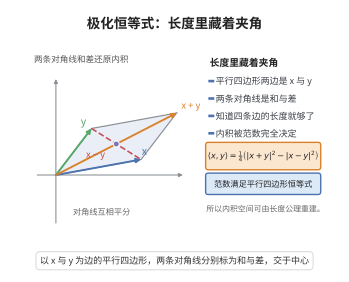

# 极化恒等式

> **一句话大白话**：内积其实被长度"完全决定"了——把两个向量的长度以及和、差的长度按一个固定配方组合起来，就能还原它们的内积。
>
> **小例子**：在 $\mathbb R^2$ 中 $\mathbf x=(1,0),\mathbf y=(0,1)$，则 $\frac14(\|\mathbf x+\mathbf y\|^2-\|\mathbf x-\mathbf y\|^2)=\frac14(2-2)=0=\langle\mathbf x,\mathbf y\rangle$。

## 介绍

极化恒等式把内积表示为范数的组合：在实内积空间中

$$
\langle\mathbf x,\mathbf y\rangle=\frac14\Big(\|\mathbf x+\mathbf y\|^2-\|\mathbf x-\mathbf y\|^2\Big)
$$

在复内积空间中还要加上涉及 $\mathbf x\pm i\mathbf y$ 的两项。它说明内积与范数并非两个独立的概念：只要知道范数，内积就被唯一确定。

这一定理在希尔伯特空间理论、算子代数与量子力学中有基础地位。例如，判断一个赋范空间是否为内积空间（即范数是否来自内积）的标准，就是看范数是否满足平行四边形恒等式；一旦满足，便用极化恒等式定义内积。算子的自伴性、数值域等概念也常通过极化恒等式与二次型相联系。

## 几何直观

图意在说明：知道了和与差的长度就能反解内积，所以内积并非独立概念，它被范数完全决定。

## 分析

内积公理（对第一变量线性、共轭对称、正定）、范数 $\|\mathbf z\|^2=\langle\mathbf z,\mathbf z\rangle$、极化恒等式

**定理内容**：

实内积空间：

$$
\langle\mathbf x,\mathbf y\rangle=\frac14\Big(\|\mathbf x+\mathbf y\|^2-\|\mathbf x-\mathbf y\|^2\Big)
$$

复内积空间（内积对第一变量线性）：

$$
\langle\mathbf x,\mathbf y\rangle=\frac14\Big(\|\mathbf x+\mathbf y\|^2-\|\mathbf x-\mathbf y\|^2+i\|\mathbf x+i\mathbf y\|^2-i\|\mathbf x-i\mathbf y\|^2\Big)
$$

**数学内涵**：
- 恒等式表明"长度决定了内积"，内积空间的几何完全由范数承载。
- 它与平行四边形恒等式 $\|\mathbf x+\mathbf y\|^2+\|\mathbf x-\mathbf y\|^2=2\|\mathbf x\|^2+2\|\mathbf y\|^2$ 互为表里。

## 思考过程

实情形只需把右端逐项展开。由 $\|\mathbf x\pm\mathbf y\|^2=\|\mathbf x\|^2\pm2\langle\mathbf x,\mathbf y\rangle+\|\mathbf y\|^2$，两式相减，$\|\mathbf x\|^2$ 与 $\|\mathbf y\|^2$ 抵消，剩下 $4\langle\mathbf x,\mathbf y\rangle$，除以 $4$ 即得。

复情形复杂之处在于内积共轭线性：$\|\mathbf x+i\mathbf y\|^2=\|\mathbf x\|^2+i\langle\mathbf y,\mathbf x\rangle-i\langle\mathbf x,\mathbf y\rangle+\|\mathbf y\|^2$ 中含虚部。把四项按 $+,-,i\cdot,-i\cdot$ 的系数线性组合，恰好把实部与虚部一起提取出来，正是 $\langle\mathbf x,\mathbf y\rangle$。

## 证明过程

**步骤 1：实情形展开。** 由内积的双线性，

$$
\|\mathbf x+\mathbf y\|^2=\langle\mathbf x+\mathbf x,\dots\rangle=\|\mathbf x\|^2+2\langle\mathbf x,\mathbf y\rangle+\|\mathbf y\|^2
$$

$$
\|\mathbf x-\mathbf y\|^2=\langle\mathbf x-\mathbf y,\mathbf x-\mathbf y\rangle=\|\mathbf x\|^2-2\langle\mathbf x,\mathbf y\rangle+\|\mathbf y\|^2
$$

两式相减：

$$
\|\mathbf x+\mathbf y\|^2-\|\mathbf x-\mathbf y\|^2=4\langle\mathbf x,\mathbf y\rangle
$$

故 $\langle\mathbf x,\mathbf y\rangle=\frac14(\|\mathbf x+\mathbf y\|^2-\|\mathbf x-\mathbf y\|^2)$。

**步骤 2：复情形展开。** 设内积对第一变量线性、$\langle\mathbf y,\mathbf x\rangle=\overline{\langle\mathbf x,\mathbf y\rangle}$。对任意复数 $\lambda$，

$$
\|\mathbf x+\lambda\mathbf y\|^2=\|\mathbf x\|^2+\lambda\langle\mathbf y,\mathbf x\rangle+\bar\lambda\langle\mathbf x,\mathbf y\rangle+|\lambda|^2\|\mathbf y\|^2
$$

取 $\lambda=1,-1,i,-i$ 分别得

$$
\|\mathbf x+\mathbf y\|^2=\|\mathbf x\|^2+2\operatorname{Re}\langle\mathbf x,\mathbf y\rangle+\|\mathbf y\|^2
$$

$$
\|\mathbf x-\mathbf y\|^2=\|\mathbf x\|^2-2\operatorname{Re}\langle\mathbf x,\mathbf y\rangle+\|\mathbf y\|^2
$$

$$
\|\mathbf x+i\mathbf y\|^2=\|\mathbf x\|^2+2\operatorname{Re}\!\big(\!\bar i\langle\mathbf x,\mathbf y\rangle\big)+\|\mathbf y\|^2=\|\mathbf x\|^2+2\operatorname{Im}\langle\mathbf x,\mathbf y\rangle+\|\mathbf y\|^2
$$

$$
\|\mathbf x-i\mathbf y\|^2=\|\mathbf x\|^2-2\operatorname{Im}\langle\mathbf x,\mathbf y\rangle+\|\mathbf y\|^2
$$

**步骤 3：组合。** 将四式按系数 $1,-1,i,-i$ 相加：

$$
\|\mathbf x+\mathbf y\|^2-\|\mathbf x-\mathbf y\|^2+i\|\mathbf x+i\mathbf y\|^2-i\|\mathbf x-i\mathbf y\|^2=4\operatorname{Re}\langle\mathbf x,\mathbf y\rangle+4i\operatorname{Im}\langle\mathbf x,\mathbf y\rangle=4\langle\mathbf x,\mathbf y\rangle
$$

除以 $4$ 即得复极化恒等式。$\square$

**推论**：若两个向量空间上的范数相同，则由极化恒等式定义的内积也相同。

## 课堂问答

**老师**：内积和长度，是两套彼此独立的信息吗？

**学生**：结论：不是，长度已经唯一决定内积。实空间 $\langle\mathbf x,\mathbf y\rangle=\frac14(\|\mathbf x+\mathbf y\|^2-\|\mathbf x-\mathbf y\|^2)$，复空间还要补上 $\mathbf x\pm i\mathbf y$ 的两项。

**老师（追问）**：实情形为什么直接展开就完了？

**学生**：由 $\|\mathbf x\pm\mathbf y\|^2=\|\mathbf x\|^2\pm2\langle\mathbf x,\mathbf y\rangle+\|\mathbf y\|^2$，两式相减，$\|\mathbf x\|^2$ 与 $\|\mathbf y\|^2$ 抵消，剩 $4\langle\mathbf x,\mathbf y\rangle$，除以 $4$ 即得。

**老师（拓展）**：复情形麻烦在哪？这条恒等式还有什么用途？

**学生**：麻烦在内积共轭线性，$\|\mathbf x+i\mathbf y\|^2$ 会带出虚部，必须把四项按 $1,-1,i,-i$ 组合才能同时提出实部和虚部。常见误区是照抄实公式，那会丢掉 $\operatorname{Im}\langle\mathbf x,\mathbf y\rangle$。它还与平行四边形恒等式互为表里——范数满足该恒等式，才能反过来由极化恒等式定义出内积。

## 相关条目

- [Cauchy-Schwarz不等式](./Cauchy-Schwarz不等式.md)：由内积导出长度比较的基本不等式。
- [谱定理](./谱定理.md)：自伴算子与二次型的研究中频繁使用极化恒等式。
