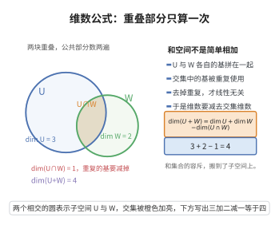

# 维数公式

> **一句话大白话**：两个子空间"合并"起来的维数，等于它俩维数之和减去重叠部分的维数——像两个拼图合在一起，公共块被数了两遍要去重。
>
> **小例子**：在三维空间中两条过原点的直线，若 $U+W$ 是平面则 $\dim(U+W)=1+1-0=2$（交只有原点时）。

## 介绍

维数公式（Dimension Formula）是线性代数中子空间的基本性质，给出了两个子空间的和与交的维数关系。该公式是研究子空间结构的基本工具，在理解线性方程组解空间的结构、基的构造等方面有重要应用。

## 几何直观

图意在说明：两个子空间各自的基拼起来会重复计算交集，所以和空间的维数要减去交集的维数。

## 分析

**前置依赖**：子空间、基、维数、线性无关、基扩张定理

**定理内容**：设 $U$ 和 $W$ 是有限维向量空间 $V$ 的子空间，则
$$\dim(U+W) = \dim U + \dim W - \dim(U\cap W)$$

**前置知识**：
- 基的定义：向量空间的基是线性无关的生成集

**数学内涵**：
维数公式的直观理解是：$U$ 和 $W$ 的并集（严格说是和空间）的维数等于各自维数之和减去交集的维数。这是因为在求和时，交集中的元素被重复计算了。类似于容斥原理：$|A\cup B|=|A|+|B|-|A\cap B|$。

## 思考过程

设 $\dim(U\cap W)=k$，取 $U\cap W$ 的一组基 $\{\mathbf{v}_1,\ldots,\mathbf{v}_k\}$。将其扩充为 $U$ 的一组基 $\{\mathbf{v}_1,\ldots,\mathbf{v}_k,\mathbf{u}_{k+1},\ldots,\mathbf{u}_m\}$，其中 $m=\dim U$。同时将其扩充为 $W$ 的一组基 $\{\mathbf{v}_1,\ldots,\mathbf{v}_k,\mathbf{w}_{k+1},\ldots,\mathbf{w}_n\}$，其中 $n=\dim W$。

可以证明 $\{\mathbf{v}_1,\ldots,\mathbf{v}_k,\mathbf{u}_{k+1},\ldots,\mathbf{u}_m,\mathbf{w}_{k+1},\ldots,\mathbf{w}_n\}$ 是 $U+W$ 的一组基，从而 $\dim(U+W)=m+n-k$。

## 证明过程

**证明**：

设 $\dim(U\cap W)=k$，取 $U\cap W$ 的一组基 $\mathcal{B}=\{\mathbf{v}_1,\ldots,\mathbf{v}_k\}$。

**第一步：扩充基。**

将 $\mathcal{B}$ 扩充为 $U$ 的一组基：
$$\mathcal{B}_U=\{\mathbf{v}_1,\ldots,\mathbf{v}_k,\mathbf{u}_{k+1},\ldots,\mathbf{u}_m\},\quad m=\dim U$$

将 $\mathcal{B}$ 扩充为 $W$ 的一组基：
$$\mathcal{B}_W=\{\mathbf{v}_1,\ldots,\mathbf{v}_k,\mathbf{w}_{k+1},\ldots,\mathbf{w}_n\},\quad n=\dim W$$

**第二步：证明 $\mathcal{S}=\{\mathbf{v}_1,\ldots,\mathbf{v}_k,\mathbf{u}_{k+1},\ldots,\mathbf{u}_m,\mathbf{w}_{k+1},\ldots,\mathbf{w}_n\}$ 生成 $U+W$。**

对任意 $\mathbf{x}\in U+W$，存在 $\mathbf{u}\in U$，$\mathbf{w}\in W$，使得 $\mathbf{x}=\mathbf{u}+\mathbf{w}$。$\mathbf{u}$ 可由 $\mathcal{B}_U$ 线性表示，$\mathbf{w}$ 可由 $\mathcal{B}_W$ 线性表示，故 $\mathbf{x}$ 可由 $\mathcal{S}$ 线性表示。

**第三步：证明 $\mathcal{S}$ 线性无关。**

设
$$\sum_{i=1}^k\alpha_i\mathbf{v}_i+\sum_{i=k+1}^m\beta_i\mathbf{u}_i+\sum_{i=k+1}^n\gamma_i\mathbf{w}_i=0$$

则
$$\sum_{i=1}^k\alpha_i\mathbf{v}_i+\sum_{i=k+1}^m\beta_i\mathbf{u}_i=-\sum_{i=k+1}^n\gamma_i\mathbf{w}_i$$

左边属于 $U$，右边属于 $W$，故两边都属于 $U\cap W$。因此右边可由 $\mathcal{B}$ 线性表示：
$$-\sum_{i=k+1}^n\gamma_i\mathbf{w}_i=\sum_{i=1}^k\delta_i\mathbf{v}_i$$
即
$$\sum_{i=1}^k\delta_i\mathbf{v}_i+\sum_{i=k+1}^n\gamma_i\mathbf{w}_i=0$$

由于 $\mathcal{B}_W$ 线性无关，所有系数为零：$\delta_i=0$，$\gamma_i=0$。代入原式得：
$$\sum_{i=1}^k\alpha_i\mathbf{v}_i+\sum_{i=k+1}^m\beta_i\mathbf{u}_i=0$$

由 $\mathcal{B}_U$ 线性无关，$\alpha_i=0$，$\beta_i=0$。故 $\mathcal{S}$ 线性无关。

**第四步：计算维数。**

$\mathcal{S}$ 是 $U+W$ 的一组基，其向量个数为 $k+(m-k)+(n-k)=m+n-k$。因此
$$\dim(U+W)=m+n-k=\dim U+\dim W-\dim(U\cap W)$$

$\square$

## 课堂问答

**老师**：两个子空间相加，维数为什么不直接相加，而要减掉一个交？

**学生**：结论：$\dim(U+W)=\dim U+\dim W-\dim(U\cap W)$。因为交集里的方向被 $U$ 和 $W$ 各数了一遍，重复计入，正如容斥原理 $|A\cup B|=|A|+|B|-|A\cap B|$。

**老师（追问）**：怎么把"数了两遍"这件事落到基上？

**学生**：取 $U\cap W$ 的基 $\{\mathbf v_1,\dots,\mathbf v_k\}$，分别扩充成 $U$ 的基 $\{\mathbf v_1,\dots,\mathbf v_k,\mathbf u_{k+1},\dots,\mathbf u_m\}$ 与 $W$ 的基 $\{\mathbf v_1,\dots,\mathbf v_k,\mathbf w_{k+1},\dots,\mathbf w_n\}$，再把两组的"新增向量"拼成 $\{\mathbf v_i,\mathbf u_j,\mathbf w_l\}$，它正是 $U+W$ 的基，共 $k+(m-k)+(n-k)=m+n-k$ 个向量。

**老师（拓展）**：证明里最容易漏掉哪一步？

**学生**：最关键的是证拼接组线性无关：从 $\sum_i\alpha_i\mathbf v_i+\sum_j\beta_j\mathbf u_j=-\sum_l\gamma_l\mathbf w_l$ 看出两边同属 $U\cap W$，再用两组基的无关性逼出全部系数为零。常见误区是只证"能张成"就以为完事——线性无关才是维数能相减的根据。
