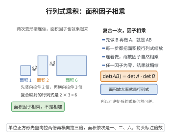

# 行列式乘积定理

> **一句话大白话**：两个矩阵相乘好比连续做两次"体积缩放"，缩放倍率相乘：$\det(AB)=\det(A)\det(B)$。
>
> **小例子**：$A,B$ 分别为缩放 $2$ 倍和 $3$ 倍，则 $AB$ 缩放 $6$ 倍，即 $\det(AB)=6=2\times3$。

## 介绍

行列式乘积定理（Determinant Product Theorem）是行列式理论中的基本定理，断言矩阵乘积的行列式等于各自行列式的乘积。该定理是行列式性质的核心，在矩阵理论、线性变换的度量、坐标变换等方面有重要应用。

## 几何直观

图意在说明：复合映射对面积的缩放是两步缩放因子的乘积，所以行列式满足乘法关系。

## 分析

**前置依赖**：行列式的多重线性性与交错性、行列式的唯一性、可逆矩阵、初等矩阵

**定理内容**：设 $A,B$ 是 $n\times n$ 矩阵，则
$$\det(AB) = \det(A)\det(B)$$

**前置知识**：
- 行列式的多重线性性质

**数学内涵**：
行列式乘积定理的几何意义是：线性变换的复合所引起的体积缩放因子等于各自变换的体积缩放因子之积。这反映了行列式作为"体积缩放因子"的乘法性质。

## 思考过程

**证明思路**：固定 $A$，将 $f(B)=\det(AB)$ 视为 $B$ 的列向量的函数。可以验证 $f$ 是多重线性交错函数，且 $f(I)=\det(A)$。由行列式的唯一性，$f(B)=\det(A)\det(B)$。

**另一种证明**：当 $A$ 可逆时，$A$ 可表示为初等矩阵的乘积，由初等变换对行列式的影响可证。当 $A$ 不可逆时，两边均为零。

## 证明过程

**证明**：

**方法一：利用行列式的唯一性。**

固定 $A$，定义函数 $f:(\mathbb{R}^n)^n\to\mathbb{R}$ 为
$$f(\mathbf{b}_1,\ldots,\mathbf{b}_n)=\det(A[\mathbf{b}_1,\ldots,\mathbf{b}_n])=\det(AB)$$
其中 $B=[\mathbf{b}_1,\ldots,\mathbf{b}_n]$。

**验证 $f$ 的多重线性性**：由于 $\det$ 对列是多重线性的，且 $A$ 是线性变换，$A\mathbf{b}_j$ 对 $\mathbf{b}_j$ 是线性的，因此 $f$ 对每个 $\mathbf{b}_j$ 是线性的。

**验证 $f$ 的交错性**：若 $\mathbf{b}_i=\mathbf{b}_j$（$i\neq j$），则 $A\mathbf{b}_i=A\mathbf{b}_j$，故 $\det(AB)=0$，即 $f(\mathbf{b}_1,\ldots,\mathbf{b}_n)=0$。

因此 $f$ 是 $n$ 重交替多重线性形式。由行列式的唯一性，存在常数 $c$，使得
$$f(\mathbf{b}_1,\ldots,\mathbf{b}_n)=c\cdot\det(B)$$

取 $B=I$，则 $f(\mathbf{e}_1,\ldots,\mathbf{e}_n)=\det(AI)=\det(A)=c\cdot\det(I)=c$，故 $c=\det(A)$。

因此 $\det(AB)=\det(A)\det(B)$。

**方法二：利用初等矩阵。**

若 $A$ 可逆，则 $A$ 可表示为初等矩阵的乘积：$A=E_1E_2\cdots E_k$。则
$$\det(AB)=\det(E_1\cdots E_k B)=\det(E_1)\det(E_2\cdots E_k B)=\cdots=\det(E_1)\cdots\det(E_k)\det(B)=\det(A)\det(B)$$

若 $A$ 不可逆，则 $\det(A)=0$，且 $AB$ 也不可逆，故 $\det(AB)=0$，等式成立。

$\square$

## 课堂问答

**老师**：凭什么 $\det(AB)=\det(A)\det(B)$？两个变换叠加，体积倍率为什么正好相乘？

**学生**：结论：$\det(AB)=\det(A)\det(B)$。干净证法：固定 $A$，把 $f(B)=\det(AB)$ 看成 $B$ 的列函数，验证它多重线性、交错，再定出比例常数即可。

**老师（追问）**：为什么一个多重线性交错函数就一定正比于 $\det$？

**学生**：由行列式的唯一性：$n$ 重交替多重线性形式构成的空间是一维的，任何这样的 $f$ 都满足 $f(B)=c\det(B)$。取 $B=I$ 定出 $c=f(I)=\det(AI)=\det(A)$，于是 $\det(AB)=\det(A)\det(B)$。

**老师（拓展）**：还有别的证法吗？$\det$ 的几何意义是什么？

**学生**：还可用初等矩阵：可逆时 $A=E_1\cdots E_k$，逐次剥出因子 $\det(E_i)$；不可逆时 $\det A=0$ 且 $AB$ 也不可逆，两边同为零。几何上 $\det$ 就是体积缩放因子，复合变换的缩放因子当然相乘。常见误区是把它误当线性——注意等式右边是乘积，不是对元素的线性组合。
