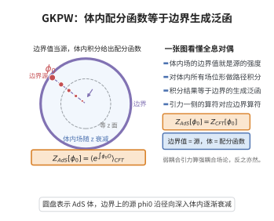

# AdS_CFT对应的GKPW公式
>
> **一句话大白话**：AdS 引力配分函数与边界 CFT 生成泛函相等——AdS 里场的边界值看成 CFT 中算子的源。
>
> **小例子**：对标量场、边界条件下
$$
\Big\langle \exp\Big(\int_{\partial AdS}\phi_0\mathcal O\Big)\Big\rangle_{\mathrm{CFT}}=Z_{\mathrm{AdS}}[\phi_0]=\int_{\phi|_{\partial}=\phi_0}\mathcal D\phi\,e^{-S_{\mathrm{AdS}}[\phi]},
$$
即 GKPW 公式。

## 一、定理介绍

> **前置依赖**：AdS时空几何、共形场论(CFT)、全息对偶的物理图像、路径积分配分函数、Witten图与生成泛函

AdS/CFT 对应的 GKPW 公式（Gubser–Klebanov–Polyakov 1998；Witten 1998）给出反de Sitter 空间中量子引力与边界共形场论对偶的精确数学表述：$d+1$ 维 AdS 中场的边界值 $\phi_0$ 作为 $d$ 维 CFT 算子 $\mathcal O$ 的源，且 CFT 生成泛函等于 AdS 配分函数。它是"全息原理"的算符形式。

## 几何直观

图意在说明：边界的场值充当 CFT 算子的源，体内对全部场位形做路径积分，其配分函数恰等于边界的生成泛函。

## 二、原理思路

对偶链（Maldacena）提示 $\operatorname{String\,on\,AdS_{d+1}\times X}\Leftrightarrow \mathrm{CFT}_d$。把 CFT 生成泛函（对 braket 插 vbl）与 AdS 配分（有边界条件 $\phi_0$）等值：AdS 场 $\phi(z,x)\sim z^{d-\Delta}\phi_0(x)+z^\Delta\phi_1(x)$ 决定共形维数 $\Delta=\frac d2+\sqrt{\frac{d^2}{4}+m^2R^2}$；在半经典极限 $Z\simeq e^{-S_{\mathrm{on-shell}}}$ 给出 CFT 关联函数的 Witten 树计算。

## 三、定理的严格表述

设 $\operatorname{AdS}_{d+1}$ 具 Poincaré 坐标 $ds^2=\frac{R^2}{z^2}(dz^2+\eta_{\mu\nu}dx^\mu dx^\nu)$，边界 $\partial$（$z=0$）。对标量场 $\phi$（质量 $m$）与边界值 $\phi_0$：
$$
\Big\langle \exp\Big(\int\phi_0\,\mathcal O\Big)\Big\rangle_{\mathrm{CFT}}\;=\;Z_{\mathrm{AdS}}[\phi_0].
$$
$\mathcal O$ 共形维数 $\Delta=\frac d2+\sqrt{\frac{d^2}{4}+m^2R^2}$；半经典近似得 $\langle \mathcal O\mathcal O\rangle\simeq C_\Delta/|x-y|^{2\Delta}$。

## 四、证明过程

先求标量场在 AdS 的解与边界渐近（$z^{d-\Delta}\phi_0+z^\Delta\phi_1$）；把作用量化为边界态（on-shell）；援引弦-几何陈设的对偶（Maldacena 1997）获得等值；以鞍点近似 $Z_{\mathrm{AdS}}\approx e^{-S_{\mathrm{on-shell}}}$ 计算两点/多点关联函数（Witten 图）以验证 CFT 形式（幂律 + 谱匹配、等距群 $SO(d,2)$）。

## 五、应用与意义

GKPW 使 AdS/CFT 成为可计算全息框架：提供弦论态到 CFT 关联的显式对应，支撑热力学/黑洞、重态修正与纠缠熵研究，并用解析工具（Witten diagram）连同相变方程直达强耦合规范理论。它是现代全息/共形场论必遵的核心。

## 课堂问答

**老师**：GKPW 公式到底断言了 CFT 的什么量与 AdS 的什么量相等？

**学生**：结论：CFT 的生成泛函等于带边界条件的 AdS 配分函数。把 AdS 场 $\phi$ 的边界值 $\phi_0$ 当作对偶 CFT 算子 $\mathcal O$ 的源：

$$
\Big\langle \exp\Big(\int_{\partial}\phi_0\,\mathcal O\Big)\Big\rangle_{\mathrm{CFT}}=Z_{\mathrm{AdS}}[\phi_0]=\int_{\phi|_{\partial}=\phi_0}\mathcal D\phi\,e^{-S_{\mathrm{AdS}}[\phi]} .
$$

**老师（追问）**：边界值怎么会"变成"源？共形维数 $\Delta$ 又是怎么定出来的？

**学生**：看近边渐近展开 $\phi(z,x)\sim z^{d-\Delta}\phi_0(x)+z^\Delta\phi_1(x)$，其中 $\phi_0$ 是不衰减的边界数据、充当源的系数；要求解在 AdS 内部正则，就逼出

$$
\Delta=\frac d2+\sqrt{\frac{d^2}{4}+m^2R^2},
$$

它正是 $\mathcal O$ 的共形维数。常见误区：把 $\phi_0$ 当成可以随意取的"物理边界条件"——它必须落在允许的渐近类内，且 $\phi_0$ 对应源、$\phi_1$ 对应期望值，两者是两种量子化。

**老师（拓展）**：为什么这个公式让 AdS/CFT 变得"可算"？

**学生**：因为半经典下 $Z_{\mathrm{AdS}}\simeq e^{-S_{\mathrm{on-shell}}}$，只要在 AdS 里解经典运动方程，就能用 Witten 图算出 CFT 的关联函数，从而把强耦合 CFT 的计算换成弱耦合引力的树图计算，这正是全息对偶作为计算工具的威力。
