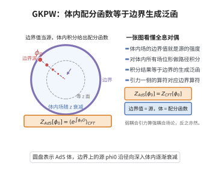

# AdS_CFT对应的GKPW公式

> **状态：AdS/CFT 对偶猜想中的核心关系与计算框架，不是一般情形下的已证数学定理。** 特定模型中有大量证据及部分严格结果，但不能把对偶本身当作已证明前提。

>
> **一句话大白话**：在 AdS/CFT 对偶成立的前提下，AdS 引力配分函数与边界 CFT 生成泛函相等——AdS 里场的边界值看成 CFT 中算子的源。
>
> **小例子**：对标量场、边界条件下
$$
\Big\langle \exp\Big(\int_{\partial AdS}\phi_0\mathcal O\Big)\Big\rangle_{\mathrm{CFT}}=Z_{\mathrm{AdS}}[\phi_0]=\int_{\phi|_{\partial}=\phi_0}\mathcal D\phi\,e^{-S_{\mathrm{AdS}}[\phi]},
$$
即 GKPW 公式。

## 一、对偶猜想介绍

> **前置依赖**：AdS时空几何、共形场论(CFT)、全息对偶的物理图像、路径积分配分函数、Witten图与生成泛函

AdS/CFT 对应的 GKPW 公式（Gubser–Klebanov–Polyakov 1998；Witten 1998）给出反 de Sitter 空间中量子引力与边界共形场论对偶的生成泛函字典：在**假设相应 AdS/CFT 对偶成立**时，$d+1$ 维 AdS 中场的边界值 $\phi_0$ 作为 $d$ 维 CFT 算子 $\mathcal O$ 的源，且 CFT 生成泛函等同于带相应边界条件的 AdS 配分函数。这是“全息原理”的算符形式和对偶猜想的一部分，其一般形式并未被数学证明。

## 几何直观

图意在说明对偶字典所断言的关系：边界的场值充当 CFT 算子的源，体内对全部场位形做路径积分，其配分函数等同于边界的生成泛函。这是对偶前提下的表述，不是图示所能证明的结论。

## 二、原理思路

Maldacena 对偶提示 $\operatorname{String\,on\,AdS_{d+1}\times X}\Leftrightarrow \mathrm{CFT}_d$；GKPW 字典在这一对偶前提下，把 CFT 生成泛函与具有边界条件 $\phi_0$ 的 AdS 配分函数联系起来。AdS 场 $\phi(z,x)\sim z^{d-\Delta}\phi_0(x)+z^\Delta\phi_1(x)$ 的渐近形式决定共形维数 $\Delta=\frac d2+\sqrt{\frac{d^2}{4}+m^2R^2}$；在半经典极限 $Z\simeq e^{-S_{\mathrm{on-shell}}}$ 下，可用 Witten 树图计算相应的 CFT 关联函数。

## 三、对偶关系的表述（非已证定理）

设 $\operatorname{AdS}_{d+1}$ 具 Poincaré 坐标 $ds^2=\frac{R^2}{z^2}(dz^2+\eta_{\mu\nu}dx^\mu dx^\nu)$，边界 $\partial$（$z=0$）。对标量场 $\phi$（质量 $m$）与边界值 $\phi_0$：
$$
\Big\langle \exp\Big(\int\phi_0\,\mathcal O\Big)\Big\rangle_{\mathrm{CFT}}\;=\;Z_{\mathrm{AdS}}[\phi_0].
$$
$\mathcal O$ 共形维数 $\Delta=\frac d2+\sqrt{\frac{d^2}{4}+m^2R^2}$；半经典近似得 $\langle \mathcal O\mathcal O\rangle\simeq C_\Delta/|x-y|^{2\Delta}$。

## 四、检验与计算思路（非一般证明）

先求标量场在 AdS 的解与边界渐近（$z^{d-\Delta}\phi_0+z^\Delta\phi_1$），再把作用量写成 on-shell 边界项，并以鞍点近似 $Z_{\mathrm{AdS}}\approx e^{-S_{\mathrm{on-shell}}}$ 计算两点或多点关联函数（Witten 图）。幂律、谱匹配和等距群 $SO(d,2)$ 的匹配为对偶提供一致性检验。**援引 Maldacena 对偶来获得等式是使用猜想前提，而不是证明该猜想**；半经典计算也不构成一般量子等式的数学证明。

## 五、应用与意义

GKPW 使 AdS/CFT 成为可计算的全息框架：在对偶成立及其半经典极限等前提下，提供弦论态到 CFT 关联的显式字典，支撑热力学、黑洞、量子修正与纠缠熵研究，并用 Witten 图研究强耦合规范理论。它是现代全息研究的核心工作框架，而不是可以无条件引用的已证定理。

## 课堂问答

**老师**：GKPW 公式到底断言了 CFT 的什么量与 AdS 的什么量相等？

**学生**：结论：在 AdS/CFT 对偶猜想成立的前提下，CFT 的生成泛函等同于带边界条件的 AdS 配分函数。把 AdS 场 $\phi$ 的边界值 $\phi_0$ 当作对偶 CFT 算子 $\mathcal O$ 的源：

$$
\Big\langle \exp\Big(\int_{\partial}\phi_0\,\mathcal O\Big)\Big\rangle_{\mathrm{CFT}}=Z_{\mathrm{AdS}}[\phi_0]=\int_{\phi|_{\partial}=\phi_0}\mathcal D\phi\,e^{-S_{\mathrm{AdS}}[\phi]} .
$$

**老师（追问）**：边界值怎么会"变成"源？共形维数 $\Delta$ 又是怎么定出来的？

**学生**：看近边渐近展开 $\phi(z,x)\sim z^{d-\Delta}\phi_0(x)+z^\Delta\phi_1(x)$，其中 $\phi_0$ 是不衰减的边界数据、充当源的系数；要求解在 AdS 内部正则，就逼出

$$
\Delta=\frac d2+\sqrt{\frac{d^2}{4}+m^2R^2},
$$

它正是 $\mathcal O$ 的共形维数。常见误区：把 $\phi_0$ 当成可以随意取的“物理边界条件”——它必须落在允许的渐近类内。在标准量子化中 $\phi_0$ 对应源、$\phi_1$ 对应期望值；在允许的质量范围内还可能有 alternative quantization，需另行指定边界条件。

**老师（拓展）**：为什么这个公式让 AdS/CFT 变得"可算"？

**学生**：在对偶及半经典近似成立的前提下，$Z_{\mathrm{AdS}}\simeq e^{-S_{\mathrm{on-shell}}}$，于是可通过 AdS 经典运动方程和 Witten 图计算相应的 CFT 关联函数，把强耦合 CFT 的问题换成弱耦合引力的计算。这正是全息对偶作为计算工具的威力；计算结果的一致性提供证据，但不是对偶猜想的一般证明。

## 相关条目

- 本条使用的基本定义与记号见“分析”。
- [本级定理索引](./index.md)：查看同级的直接前置与后继条目。
- [总定理依赖表](../../index.md#定理分级表)：在完整依赖表中定位本条目。
