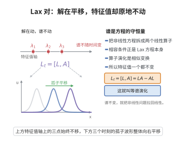

# Lax对与Lax方程

> **一句话大白话**：把一个非线性方程"偷偷改写成两个线性方程"[L,\psi]、A\psi 的相容条件，写成算子等式就是 $L_t=[L,A]$；一旦能做到，$L$ 的特征值随时间不动，方程就拥有一大堆守恒量、变得可解。
>
> **小例子**：KdV 方程 $u_t-6uu_x+u_{xxx}=0$ 的 Lax 对是 $L=-\partial_x^2+u$、$A=4\partial_x^3-6u\partial_x-3u_x$，直接算得 $L_t=[L,A]$ 右端的算子部分全部抵消、只剩乘法算子 $6uu_x-u_{xxx}$，恰好就是 $u_t$。

## 一、定理介绍

> **前置依赖**：Schrödinger方程、无界自伴算子的谱定理、矩阵的迹、守恒律方程基本理论

Lax 对（Lax pair, P. Lax 1968）是"把非线性演化方程线性化"的基本装置。称一对依赖于解 $u(x,t)$ 的线性算子 $(L,A)$ 为方程
$$
u_t=K[u]
$$
的 Lax 对，若该方程等价于 **Lax 方程**
$$
L_t=[L,A]:=LA-AL .
$$
其力量在于两点：一是**等谱性**（isospectrality）——$L$ 的谱（特征值、散射数据）在时间演化下保持不变，只按简单的线性规律旋转；二是**守恒律**——由谱不变量立刻得到无穷多个运动积分。二者合起来使方程可经反散射变换（IST）精确求解，是 KdV、NLS、sine-Gordon 等"完全可积系统"的共同机制。

## 几何直观

图意在说明：把演化写成两个线性算子的交换子后，L 的特征值成为运动不变量，非线性方程因此获得无穷多守恒量。

## 二、原理思路

直观上，$L_t=[L,A]$ 是"$L$ 在做无穷小相似变换"：形式上 $L(t)=g(t)L(0)g(t)^{-1}$，两边求导得 $L_t=[g_tg^{-1},L]$，取 $A=-g_tg^{-1}$ 即得 Lax 方程。相似变换不改变谱，故谱守恒。

技术上有三条主线：
1. **相容性**：把 $L\psi=\lambda\psi$ 与 $\psi_t=A\psi$ 联立，要求 $(L\psi)_t=\partial_t(L\psi)$ 同一，这一步的相容条件就是 $L_t=[L,A]$；
2. **等谱**：相容性推出 $\lambda_t=0$，即特征值（及更一般的散射数据）是运动积分；
3. **守恒量**：算子 $L^k$ 的迹与 $L$ 的谱只差一个常数依赖，由 $\mathrm{tr}([X,Y])=0$ 得 $\mathrm{tr}(L^k)$ 守恒，展开即得守恒密度。

## 三、定理的严格表述

**定义**：设 $L,A$ 为依赖于 $u(\cdot,t)$ 的线性算子（微分算子或矩阵）。称方程 $u_t=K[u]$ 具有 Lax 对 $(L,A)$，若它在适当函数空间上等价于
$$
L_t=[L,A].
$$

**定理1（等谱性）**：设 $u(t)$ 满足 $L_t=[L,A]$，$\psi(t)$ 满足 $L\psi=\lambda\psi$ 与 $\psi_t=A\psi$。则 $\lambda$ 不依赖 $t$：
$$
\partial_t\lambda=0 .
$$
若 $L$ 为自伴算子且特征值单重，则 $L(t)$ 的每个特征值都是运动积分。

**定理2（守恒律）**：设 $L(t)$ 为迹类算子（或矩阵）且 $L_t=[L,A]$，$A$ 有界，则对一切 $k\ge1$，
$$
I_k=\mathrm{tr}\big(L^{k}\big)\ \text{守恒},\qquad \frac{d}{dt}\mathrm{tr}\big(L^{k}\big)=0 .
$$
对 $L=-\partial_x^2+u$，$I_k$ 给出守恒密度，如 $\int u$、$\int u^2$、$\int(2u^3+u_x^2)$。

**定理3（KdV 的 Lax 表示）**：取 $L=-\partial_x^2+u$，$A=4\partial_x^3-6u\partial_x-3u_x$，则
$$
L_t=[L,A]\iff u_t=6uu_x-u_{xxx}\iff u_t-6uu_x+u_{xxx}=0 .
$$

## 四、证明过程

**步骤1：相容性推出 $L_t=[L,A]$。** 设 $\psi$ 同时满足 $L\psi=\lambda\psi$ 与 $\psi_t=A\psi$。对第一式关于 $t$ 求导并用第二式：
$$
L_t\psi+L\psi_t=\lambda_t\psi+\lambda\psi_t
\ \Longrightarrow\ L_t\psi+L A\psi=\lambda_t\psi+\lambda A\psi .
$$
若同时要求 $L$ 与 $A$ 相容（即 $\partial_t(L\psi)=(L\psi)_t$ 对一切解成立），则有 $L_t=[L,A]$，代回上式右端得 $L_t\psi+LA\psi=\lambda A\psi+[L,A]\psi+LA\psi=\lambda A\psi$，比较即 $\lambda_t\psi=0$。

**步骤2：等谱性。** 步骤1 已得 $\lambda_t\psi=0$。对非零特征函数 $\psi$（可归一化 $\|\psi\|=1$）有 $\lambda_t=0$。由于 $\lambda$ 是随时间连续的离散谱点，$L(t)$ 的谱作为集合不变；单重性使每个特征值作为连续分支唯一延拓，故各自守恒。这与无界自伴算子谱定理相容：$L$ 自伴时谱为实、且相似/等谱演化保持谱集。

**步骤3：守恒律。** 记 $L_t=[L,A]$。对乘积求导并循环使用 $\mathrm{tr}(XY)=\mathrm{tr}(YX)$：
$$
\frac{d}{dt}\mathrm{tr}\big(L^{k}\big)=k\,\mathrm{tr}\big(L^{k-1}L_t\big)=k\,\mathrm{tr}\big(L^{k-1}(LA-AL)\big)=k\big[\mathrm{tr}(L^{k}A)-\mathrm{tr}(AL^{k})\big]=0 .
$$
故 $I_k=\mathrm{tr}(L^k)$ 全是运动积分；把它们用 $u$ 及其导数显式化（对微分算子 $L$ 用预解式 $(L-z)^{-1}$ 在 $z\to\infty$ 的 $z^{-1/2}$ 展开，逐项取迹）即得 KdV 的经典守恒密度。

**步骤4：KdV 的显式验证。** 取 $L=-\partial^2+u$、$A=4\partial^3-6u\partial-3u_x$（$\partial=\partial_x$，$u$ 为乘法算子）。计算 $[L,A]=LA-AL$。$\partial^5$ 项因 $4\partial^5-4\partial^5=0$ 相消；利用 $\partial u=u'+u\partial$ 逐项整理：
$$
\partial^3\text{ 项}: -au+au=0\ (a=6),\qquad
\partial^2\text{ 项}: -2au'-12u'=0\ (a=6),\qquad
\partial\text{ 项}: -au''-2bu''-12u''=0\ (b=3),
$$
而剩下的零阶项为
$$
[L,A]=-u'''+6uu'=6uu_x-u_{xxx}=u_t ,
$$
正是 KdV。故 $L_t=[L,A]$ 与 $u_t-6uu_x+u_{xxx}=0$ 等价。

**步骤4'：矩阵情形（Zakharov–Shabat）。** 对 $L=\mathrm{i}\partial_x+U$、$A$ 取为适当的矩阵多项式，Lax 方程给出 NLS、sine-Gordon 等方程；此时 $L^k$ 为矩阵迹，步骤3 的守恒律直接适用（配合矩阵的迹的性质）。

**步骤5：连到反散射。** 步骤2 说明散射数据（透射系数 $T(k)$、反射系数 $R(k)$、束缚态）随时间按显式线性因子演化（$R(k,t)=R(k,0)e^{8\mathrm{i}k^3t}$，$T$ 不变），把它们代回 GLM 方程即重构 $u(x,t)$。这就是 Lax 对 → 等谱 → 线性演化 → 反散射的完整链条。

**结论（$\square$）**：$L_t=[L,A]$ 等价于非线性方程；其解 $u(x,t)$ 使 $L$ 等谱演化，从而 $\mathrm{tr}(L^k)$ 给出无穷守恒律，$L$ 的散射数据线性演化使方程可精确求解。

## 五、应用与意义

Lax 对把"非线性可解"变成"线性算子等谱变形"，是可积系统理论的入口：它解释了孤子的产生与弹性碰撞、给出无穷守恒律的代数来源（迹恒等式与预解式展开），并把求解算法化（正散射—线性演化—反散射）。KdV、NLS、sine-Gordon、Toda 与自对偶 Yang–Mills 等都借助它获得精确解；其思想还延伸到量子可积（R-矩阵、Yang–Baxter 方程）、模空间上的 Hitchin 系统与现代数学物理的 tau 函数理论。

## 课堂问答

**老师**：Lax 对方程 $L_t=[L,A]$ 凭什么能"线性化"一个非线性方程？

**学生**：结论：因为它把解 $u(x,t)$ 的非线性演化换成算子 $L$ 的等谱变形。若方程等价于

$$
L_t=[L,A],
$$

则形式上有 $L(t)=g(t)L(0)g(t)^{-1}$，这是相似变换，谱 $\{\lambda\}$ 不随时间变，于是每个特征值都是运动积分。

**老师（追问）**：等谱性怎么严格推出？守恒律又从哪里来？

**学生**：设 $L\psi=\lambda\psi$、$\psi_t=A\psi$，对第一式求导并代入第二式，即得 $L_t=[L,A]$ 与 $\lambda_t\psi=0$，故 $\lambda_t=0$。守恒量则用迹的循环性：$\frac{d}{dt}\mathrm{tr}(L^k)=k\,\mathrm{tr}(L^{k-1}[L,A])=0$，所以 $I_k=\mathrm{tr}(L^k)$ 全守恒。以 KdV 为例，取 $L=-\partial_x^2+u$、$A=4\partial_x^3-6u\partial_x-3u_x$，展开 $[L,A]$ 后各微分阶项相消，只剩

$$
[L,A]=-u^{\prime\prime\prime}+6uu_x=6uu_x-u_{xxx}=u_t .
$$

**老师（拓展）**：等谱性只给了守恒律，怎么真正把 $u(x,t)$"解出来"？

**学生**：把 $L$ 的散射数据（反射系数、透射系数、束缚态）当作新坐标：它们按显式线性规律演化，如 $r(k,t)=r(k,0)e^{8ik^3t}$ 而 $T(k)$ 不变；再由 Gelfand–Levitan–Marchenko 方程反解回 $u$。这就是"正散射—线性演化—反散射"的完整链条，也是 KdV、NLS、sine-Gordon 等完全可积系统的共同机制。
