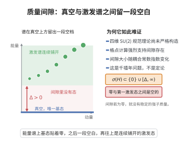

# Yang-Mills质量间隙

> **一句话大白话**：四维 $SU(2)$ Yang–Mills 理论应当存在且具非零"质量间隙"——但这是至今未证的（千禧年）猜想，而非定案。
>
> **小例子**：期望的谱性质
$$
\sigma(H)\subset\{0\}\cup[\Delta,\infty),\quad \Delta>0,
$$
即 Hamiltonian 在零和 $\Delta$ 之间有间隙（面积律对 Wilson 圈预示）。

## 一、定理介绍

> **前置依赖**：Wightman公理、格点规范理论、Wilson圈与面积律、重整化群、四维非线性规范场

Yang–Mills 存在性与质量间隙问题（Clay 千禧年问题）要求严格证明：对 $\mathbb R^4$ 上的 $SU(2)$ Yang–Mills，存在满足 Wightman 公理（质量隙/非线性收敛）的量子场论 $\{H,P,J,\Gamma\}$，Hamiltonian 谱在零与 $\Delta>0$（质量间隙）之间有隙。数十年涌动格点 QCD 证据强力支持，但严格证明仍未完成。

## 几何直观

图意在说明：Yang-Mills 的 Hamiltonian 谱若在零与某个正数 Delta 之间没有态，理论就具有正的质量间隙。

## 二、原理思路

其核心策略是格点规范理论：将 $\mathbb R^4$ 正则化为格点 $\Lambda=a\mathbb Z^4\cap[0,L]^4$，链接变量 $U_\ell=P\exp(i\int_\ell A)$ 代离散规范；取 Wilson 作用量 $S_W$ 后强耦合（$\beta\ll1$）的 Wilson 圈期望呈面积律 $\langle W(C)\rangle\sim e^{-A\cdot\text{Area}(C)}$，此即质量隙征兆。然后试图取连续极限/重整化并验证 Wightman 公理。

## 三、定理的严格表述

存在 $SU(2)$ Yang–Mills 量子场论，满足：
1. **存在性**：满足 Wightman 公理的量子场论，描述 $SU(2)$ 规范场。
2. **质量间隙**：其 Hamiltonian $H$ 满足 $\sigma(H)\subset\{0\}\cup[\Delta,\infty)$，$\Delta>0$。
（严格证明尚缺；[现状]：未证明。）候选途径的格点表述给出面积律与重正化群步骤的启发式理据。

## 四、证明过程（格点轮廓）

(1) 格点：$U_\ell\in SU(2)$，$S_W[U]=\beta\sum_p(1-\tfrac12\operatorname{Tr}(U_p+U_p^{-1}))$，$Z_{\mathrm{latt}}=\int\prod dU_\ell\,e^{-S_W}$；强耦合展开得面积律，指征 $\Delta>0$；(2) 连续极限：调节 $\beta(a)=\beta_0\ln(1/a^2\Lambda^2)+O(\ln\ln…)$，期望有限可观测量；(3) 未决步骤：严格证明连续/热力学极限的 Wightman 性质与质量隙非零。此为 open problem。

## 五、应用与意义

问题（若证）将严格奠基强作用规范理论（QCD），确立质量隙与粒子谱的场论起源，是凝聚态、格点与数学物理交汇的枢纽。其困难（非线性、四维存在性）本身深刻刻画了非Abel 规范理论的数学本质，长期驱动数值与解析方法（格点、SDP）发展。

## 课堂问答

**老师**：Yang–Mills 质量间隙问题究竟是"定理"还是"猜想"？

**学生**：结论：是尚未证明的千禧年猜想。它要求证明 $\mathbb R^4$ 上 $SU(2)$ Yang–Mills 存在满足 Wightman 公理的量子场论，且 Hamiltonian 谱有正间隙：

$$
\sigma(H)\subset\{0\}\cup[\Delta,\infty),\qquad \Delta>0 .
$$

**老师（追问）**：为什么大家相信它成立？格点理论给了什么证据？

**学生**：格点正则化把链接变量 $U_\ell\in SU(2)$ 放在格点上，取 Wilson 作用量 $S_W=\beta\sum_p\big(1-\tfrac12\operatorname{Tr}(U_p+U_p^{-1})\big)$。强耦合（$\beta\ll1$）时 Wilson 圈满足面积律 $\langle W(C)\rangle\sim e^{-A\cdot\mathrm{Area}(C)}$，这正是存在质量间隙的征兆。常见误区：把格点证据当作证明——真正的困难在于取连续极限并严格验证 Wightman 公理、保持谱间隙不被抹平。

**老师（拓展）**：如果证不出来，这个问题为何仍然重要？

**学生**：因为它触及"四维非线性量子场论是否存在"这一根本问题，是量子色动力学数学基础的试金石；其难度刻画了非阿贝尔规范理论的本质，并持续推动格点方法与半正定规划等数值、解析工具的发展。
