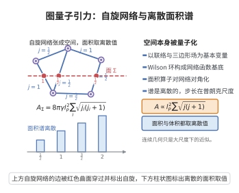

# 圈量子引力的量子化

> **一句话大白话**：圈量子引力（LQG）用施瓦尔茨变量的联络与三边形场量化引力，得到离散的面积/体积谱——普朗克尺度上的空间的量子几何。
>
> **小例子**：面积算子 $\widehat A$ 有离散谱 $A=8\pi\gamma l_P^2\sum_i\sqrt{j_i(j_i+1)}$（$j_i\in\frac12\mathbb Z_+$，$\gamma$ 巴罗罗参数），体积亦量子化。

## 一、定理介绍

> **前置依赖**：Ashtekar-Barbero变量、哈密顿与辛约化、Wilson环与holonomy、自旋网络表示、Barbero-Immirzi参数

圈量子引力（LQG；Rovelli–Smolin、Ashtekar–Lewandowski 等）的量子化把引力表述为 Ashtekar 变量（联络 $A_a^i$、三边形场 $E_i^a$）的量子理论。其主要结果是一个非微扰量子几何：面积、体积等几何算子具离散谱，态由**自旋网络**张成，从而在普朗克尺度刻画空间的量子性种，并给出黑洞熵的微态计数。

## 几何直观

图意在说明：几何算子作用在自旋网络上给出离散谱，面积与体积只能取分立的值，最小步长在普朗克尺度。

## 二、原理思路

制定：先用联络 $A$ 与三边形密度场 $E$ 把 Einstein–Hilbert 作用写成满立；做辛约化/Holonomy 量子化：以 Wilson 环（自旋网络的标量）为基态，运动学 Hilbert 空间是网络函数空间。面积经 $E$ 流算子，其作用对角于网络给出离散谱；体积由联结作用的组合谱。约束（Hamiltonian）约化是长期难点。

## 三、定理的严格表述（主主张）

运动学 Hilbert 空间 $\mathcal H_{\mathrm{kin}}$ 由自旋网络（图上边上 $SU(2)$ 表示、顶点交织）张成。面积算子（对曲面 $S$）
$$
\widehat{ \mathrm{Area}}_S\;\text{的本征值}\;=8\pi\gamma\,\ell_P^2\sum_{i}\sqrt{j_i(j_i+1)},
$$
$\ell_P$ 为 Planck 长度，$\gamma$ Barbero–Immirzi 参数，$j_i\in\frac12\mathbb Z_{\ge0}$。体积算子有相应的离散（但更复杂）谱。这些给出普朗克几何的量子化。

## 四、证明过程

历程（概要）：构造 Ashtekar–Barbero 变量并求其辛结构；把三边形场 $E$ 的几何量表达为$SU(2)$ 群的流算子；用自旋网络（由图的 $(si)$/交织器）构造运动学基与增益算符（C*-代数/测度）；对角化面积（对角于围面边）、构建体积（先对角于树配），证明其对称闭密算子与离散谱；并行用自旋网络/CYL 论证黑洞熵（$\frac A4$）微态配对。

## 五、应用与意义

LQG 是非微扰量子引力的主要方案之一：给出几何离散、宇宙奇点（Big-Bounce）与黑洞熵（面积律）的现象学，并支撑自旋泡沫、全息与 Ashtekar 宇宙学的现代研究，是"时空从哪里来"的量子几何回答。

## 课堂问答

**老师**：圈量子引力最核心的"量子化成果"是什么？

**学生**：结论：是几何算子的离散谱。用 Ashtekar–Barbero 变量（联络 $A_a^i$ 与三边形场 $E_i^a$）量子化后，运动学 Hilbert 空间由自旋网络张成，面积算子对曲面 $S$ 的本征值为

$$
\widehat{\mathrm{Area}}_S\;\longrightarrow\;8\pi\gamma\,\ell_P^2\sum_{i}\sqrt{j_i(j_i+1)},\qquad j_i\in\tfrac12\mathbb Z_{\ge0},
$$

其中 $\gamma$ 是 Barbero–Immirzi 参数；体积算子也有相应的离散（但更复杂）的谱。

**老师（追问）**：为什么几何量会"离散"？自旋网络在这里起什么作用？

**学生**：因为面积算子由 $E$ 对应的 $SU(2)$ 流算子构成，而自旋网络恰是这些流算子的联合本征态：每条边携带一个不可约表示 $j_i$，面积算子的贡献正是沿曲面穿过的边逐一给出 $\sqrt{j_i(j_i+1)}$，于是天然离散。常见误区：以为谱是"人为格点化"的产物——恰恰相反，它来自表示论，与背景无关。

**老师（拓展）**：这个框架目前最大的未解问题是什么？

**学生**：是 Hamiltonian 约束的量子化与连续极限。运动学层面的面积、体积谱与黑洞熵计数（面积律 $S=A/4$）已经得到，但动力学约束尚难严格求解，这也是自旋泡沫与全息方法要处理的核心难点。
