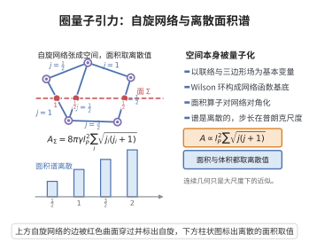

# 圈量子引力的量子化

> **状态：量子引力理论框架，不是完整且已获验证的量子引力定理。** 自旋网络、运动学 Hilbert 空间及面积谱等可在特定 LQG 形式化中严格讨论；动力学约束、连续与半经典极限、物理预言仍须另行处理，不能统称为已证定理。

> **一句话大白话**：圈量子引力（LQG）用 Ashtekar–Barbero 联络与标架三重场建立量子引力框架；在其运动学形式化中，面积和体积算子具有离散谱。
>
> **小例子**：面积算子 $\widehat A$ 有离散谱 $A=8\pi\gamma l_P^2\sum_i\sqrt{j_i(j_i+1)}$（$j_i\in\frac12\mathbb Z_+$，$\gamma$ 巴罗罗参数），体积亦量子化。

## 一、理论框架介绍

> **前置依赖**：Ashtekar-Barbero变量、哈密顿与辛约化、Wilson环与holonomy、自旋网络表示、Barbero-Immirzi参数

圈量子引力（LQG；Rovelli–Smolin、Ashtekar–Lewandowski 等）把引力表述为 Ashtekar–Barbero 变量（联络 $A_a^i$、密度化标架三重场 $E_i^a$）的量子理论。在其**运动学形式化**中，可构造由自旋网络张成的 Hilbert 空间，并研究面积、体积等几何算子的离散谱。这些是框架内具有明确假设的数学结果，不等于完整量子引力理论已经建立；黑洞熵计数、动力学和物理预言还依赖额外假设与未决问题。

## 几何直观

图意在说明：在 LQG 运动学模型中，几何算子作用在自旋网络上给出离散谱；具体谱值与谱间隔依赖算子和正则化约定，不能概括为所有几何量都有已确认的“最小步长”。

## 二、原理思路

先用联络 $A$ 与密度化标架三重场 $E$ 重写引力的 Hamiltonian 形式，再以 holonomy 和 flux 为基本变量构造运动学表示。自旋网络给出运动学 Hilbert 空间的基，面积由 $E$ 的通量算子构成，其 Casimir 本征值导致离散谱；体积算子则由顶点处的通量组合构造。Hamiltonian 约束的量子化及从运动学到物理 Hilbert 空间的过渡仍是长期难点。

## 三、框架内的运动学结论（有适用前提）

在标准 LQG 运动学表示及相应正则化约定下，运动学 Hilbert 空间 $\mathcal H_{\mathrm{kin}}$ 由自旋网络（图的边上携带 $SU(2)$ 表示、顶点携带交织子）张成。面积算子（对曲面 $S$）
$$
\widehat{ \mathrm{Area}}_S\;\text{的本征值}\;=8\pi\gamma\,\ell_P^2\sum_{i}\sqrt{j_i(j_i+1)},
$$
$\ell_P$ 为 Planck 长度，$\gamma$ Barbero–Immirzi 参数，$j_i\in\frac12\mathbb Z_{\ge0}$。体积算子也有相应的离散但更复杂的谱，其细节依赖算子构造与正则化约定。这些是 LQG 运动学量子几何的结论，不是关于自然界的已验证定理，也不自动解决动力学约束。

## 四、运动学构造概要（不是完整量子引力的证明）

构造 Ashtekar–Barbero 变量及其辛结构；通过 holonomy–flux 代数与相应测度构造运动学 Hilbert 空间，以自旋网络给出基；再把标架场的通量表示为 $SU(2)$ 右不变向量场等微分算子。面积算子在自旋网络态上的作用由表示的 Casimir 给出，从而得到离散谱；体积算子的构造与谱分析则更复杂且依赖约定。上述构造不证明 Hamiltonian 约束已正确量子化，也不证明连续极限、半经典极限或黑洞熵的物理结论。

## 五、应用与意义

LQG 是非微扰量子引力的主要研究方案之一：运动学量子几何为黑洞熵、圈量子宇宙学与自旋泡沫等研究提供出发点。Big Bounce、黑洞熵及半经典时空等结论需要各自额外的模型和假设，不能与本页运动学结果合并为一个已证、已验证的完整理论。

## 课堂问答

**老师**：圈量子引力最核心的"量子化成果"是什么？

**学生**：结论：在其运动学框架内，代表性成果是几何算子的离散谱，但这不是完整量子引力定理。用 Ashtekar–Barbero 变量（联络 $A_a^i$ 与密度化标架三重场 $E_i^a$）量子化后，运动学 Hilbert 空间由自旋网络张成，面积算子对曲面 $S$ 的本征值为

$$
\widehat{\mathrm{Area}}_S\;\longrightarrow\;8\pi\gamma\,\ell_P^2\sum_{i}\sqrt{j_i(j_i+1)},\qquad j_i\in\tfrac12\mathbb Z_{\ge0},
$$

其中 $\gamma$ 是 Barbero–Immirzi 参数；体积算子也有相应的离散但更复杂的谱。公式依赖所采用的运动学表示与正则化约定，不能直接当作实验已确认的自然界结论。

**老师（追问）**：为什么几何量会"离散"？自旋网络在这里起什么作用？

**学生**：因为面积算子由 $E$ 对应的 $SU(2)$ 通量算子构成，并可选择使面积算子对角的自旋网络态：每条边携带一个不可约表示 $j_i$，曲面与图的每个交点按 $\sqrt{j_i(j_i+1)}$ 贡献 Casimir 本征值，于是面积谱在该构造中离散。常见误区：以为这是人为空间格点化；它来自 holonomy–flux 表示论，但仍属于 LQG 的特定运动学框架。

**老师（拓展）**：这个框架目前最大的未解问题是什么？

**学生**：核心困难包括 Hamiltonian 约束的量子化、动力学 Hilbert 空间的构造，以及连续和半经典极限。运动学层面的面积、体积谱可在既定形式化中研究；黑洞熵的面积律计数则依赖额外物理假设，不能与这些运动学结果一并称为完整理论的已证预言。相关动力学问题仍是开放研究方向。

## 相关条目

- 本条使用的基本定义与记号见“分析”。
- [本级定理索引](./index.md)：查看同级的直接前置与后继条目。
- [总定理依赖表](../../index.md#定理分级表)：在完整依赖表中定位本条目。
