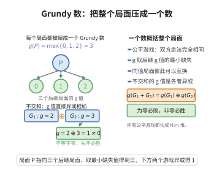

# Sprague-Grundy定理

> **一句话大白话**：任何公平游戏（正常模式）都能用一个"Grundy 数"编号，多个游戏的和等价于异或这些数——异或为 0 必败，否则必胜。
>
> **小例子**：$g(G_1+G_2)=g(G_1)\oplus g(G_2)$；"必胜 $\Leftrightarrow g\neq0$"。对单堆 Nim，$g(n)=n$。

## 一、定理介绍

> **前置依赖**：公平组合博弈、Nim游戏、$mex$运算、博弈的不交和、递归与归纳论证

Sprague–Grundy 定理（1935/1939；Sprague 与 Grundy 独立证明）断言：在公平（impartial）、有限步终止的正常模式游戏中，每个局面都有一个**Grundy 数** $g$，使得局面等价于一个 Nim 堆，且任意多个游戏的不交和满足
$$
g(G_1+G_2)=g(G_1)\oplus g(G_2),
$$
其中 $\oplus$ 为按位异或。于是博弈分析归结为异或算术："必败 $\Leftrightarrow g=0$"。

## 几何直观

图意在说明：每个公平游戏局面都有一个 Grundy 数，取后继值的最小缺失，多盘棋的不交和就等于这些数异或。

## 二、原理思路

Grundy 数按 mex（minimum excludant）递归定义：$g(P)=\mathrm{mex}\{g(Q):P\to Q\}$，即 $P$ 的可达局面 Grundy 数集合外最小非负整数。终局 $g=0$。核心是证明"和"的 Grundy 数等于各分量 Grundy 数异或——用 mex 的两条性质（达到任一更小、达不到自身）分别验证，从而粘合出紧凑判定。

## 三、定理的严格表述

设 $G$ 为公平游戏，局面 $P$ 的 Grundy 数为 $g(P)=\mathrm{mex}\{g(P'):P'\text{ 为 }P\text{ 的可达局面}\}$。则
1. 对不交和：$g(G_1+G_2)=g(G_1)\oplus g(G_2)$。
2. $P$ 为必败局面当且仅当 $g(P)=0$；为必胜局面当且仅当 $g(P)\ne0$。
3. 特别地，对单堆 Nim：$g(n)=n$。

## 四、证明过程

良定义性：游戏有限步终止，故 Grundy 数递归唯一。单堆 Nim：$g(n)=\mathrm{mex}\{0,1,\dots,n-1\}=n$。对"和"：设 $a=g(G_1),b=g(G_2)$，证 $g(G_1+G_2)=a\oplus b$。令 $d=(a\oplus b)\oplus k$（$0\le k<a\oplus b$），取 $d$ 最高位 $i$；若 $a$ 的 $i$ 位为 $1$，则移动到 $a'=a\oplus d<a$，使新局面 Grundy $=a'\oplus b=k$。反之任何单侧移动保持 $a'\oplus b\ne a\oplus b$（异或对某一位翻转），故 $k$ 达不到 $a\oplus b$。因此 $g=a\oplus b$。最后由三步不等式得 $g=0$ 必败判定。

## 五、应用与意义

Sprague–Grundy 理论把大量公平组合游戏（Nim 变体、翻转游戏等）统一到异或运算，是组合博弈论的标准工具；它把"分析一个游戏"化为"求各局面的 Grundy 数"，被广泛用于取石子类题目、算法竞赛与博弈等价刻画。

## 课堂问答

**老师**：Sprague–Grundy 定理凭什么把"任意公平游戏"化归成 Nim？

**学生**：结论：每个局面都有 Grundy 数 $g(P)=\mathrm{mex}\{g(P'):P\to P'\}$，且不交和满足

$$
g(G_1+G_2)=g(G_1)\oplus g(G_2),
$$

于是必败当且仅当 $g=0$；单堆 Nim 则 $g(n)=n$。

**老师（追问）**：为什么"和"的 Grundy 数恰好是异或？mex 的定义在这里起什么作用？

**学生**：设 $a=g(G_1)$、$b=g(G_2)$，要证 $g=a\oplus b$。一方面，任给 $k<a\oplus b$，令 $d=(a\oplus b)\oplus k$，取 $d$ 的最高位 $i$，在某一侧移动到把该位翻转的 $a'=a\oplus d<a$，便使新的和值恰为 $k$——说明所有更小的值都能达到；另一方面，任何单侧移动都翻转某一位，故新值 $\ne a\oplus b$——说明 $a\oplus b$ 达不到。mex 的两条性质（能达任一更小、达不到自身）正是对 $a\oplus b$ 的刻画。常见误区：忘记"游戏必须有限步终止"，否则 Grundy 数可能不是非负整数。

**老师（拓展）**：这个定理在实际解题中怎么用？

**学生**：把复杂游戏拆成若干独立子游戏，分别求出各局面的 Grundy 数（常能找出闭式或周期规律），再整体异或：非零则先手必胜并据此给出胜着，为零则后手必胜。它是组合博弈论的标准工具，Nim 变体、翻转游戏等都归约到这一步。
