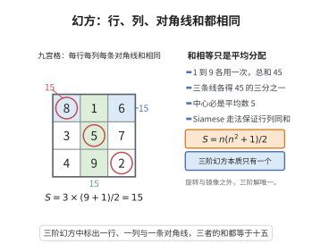

# 幻方的构造与性质

> **一句话大白话**：对任意奇数 $n$，都能用"右上步走"的 Siamese 方法造出 $n\times n$ 幻方——每行、每列、每条对角线相加都得同一个"幻和" $S=n(n^2+1)/2$。
>
> **小例子**：$n=3$ 得幻方 $\begin{pmatrix}8&1&6\\3&5&7\\4&9&2\end{pmatrix}$，每行/列/对角线和均为 $15$。

## 一、定理介绍

> **前置依赖**：模运算同余、正整数求和公式、剩余类遍历性质、置换与排列概念、Siamese构造算法

幻方构造定理断言：对任意奇数 $n$，存在满足「每行、每列、两条主对角线之和相等（为幻和 $S=n(n^2+1)/2$）」的 $n\times n$ 数字方阵，且 Siamese 方法（de la Loubère 方法）给出构造性证明。这是娱乐数学中最古老、最直观的构造之一。

## 几何直观

图意在说明：幻方的所有行、列与两条主对角线都加到同一个幻和，三阶时这个和由总数平均分配决定。

## 二、原理思路

Siamese 方法：把 $1$ 放第一行正中，接着每次往右上角走一格（越界循环）；若目标已占用或走到右上角，则改为往下走一格。关键观察是生成方阵满足模同余
$$
a_{i,j}\equiv i+j+\tfrac{n-1}{2}\pmod n,
$$
因此每行、每列恰好含每个模 $n$ 剩余类各一次，配合每类对应 $n$ 个连续数即得恒定行/列/对角线和。

## 三、定理的严格表述

设 $n$ 为奇数，$S=n(n^2+1)/2$。则存在 $n\times n$ 方阵 $(a_{i,j})$（$i,j=0,\dots,n-1$）由数字 $1,\dots,n^2$ 各恰出现一次，且
$$
\sum_{j=0}^{n-1}a_{i,j}=\sum_{i=0}^{n-1}a_{i,j}=\sum_i a_{i,i}=\sum_i a_{i,n-1-i}=S
$$
对一切 $i,j$ 成立。Siamese 算法（$1$ 于 $(0,(n-1)/2)$，依次向右上、占用则向下的规则）可构造之。

## 四、证明过程

先描述算法：放 $1$，对 $k\ge2$ 目标 $(i',j')=((i-1)\bmod n,(j+1)\bmod n)$，若已占用则取 $(i+1,j)$。证明核心是一条同余链：$a_{i,j}\equiv i+j+(n-1)/2\pmod n$ 且取值范围确定 $1..n^2$。于是行和：$j$ 遍历模 $n$ 剩余类，$\sum a_{i,j}=(\text{每类一份})\cdot n+(0+1+\cdots+n-1)$ 整理为 $S$；列和由对称；主对角线上 $2i$ 遍历剩余类（$(2,n)=1$）同样为 $S$；副对角线直接求和为 $S$。以 $n=3$ 验证。

## 五、应用与意义

幻方构造是组合设计、群论（模同余）与棋盘美学的经典交汇，体现"局部同余$\Rightarrow$全局守恒和"的思想，也是编程、艺术与谜题的基础素材，常被用作对称与数论结合的入门范例。

## 课堂问答

**老师**：为什么 $n$ 阶幻方的幻和必然是 $S=n(n^2+1)/2$，而不能任意指定？

**学生**：结论：这是由"用 $1,\dots,n^2$ 各一次"强制决定的。所有数字之和为 $\sum_{k=1}^{n^2}k=\frac{n^2(n^2+1)}{2}$，而 $n$ 条行各自之和都是 $S$，故 $nS$ 等于总和，得

$$
S=\frac{n(n^2+1)}{2}.
$$

**老师（追问）**：Siamese 方法产出的方阵为什么每行、每列都能公平地分到每个剩余类？

**学生**：关键是同余结构 $a_{i,j}\equiv i+j+m\pmod n$（$m=\frac{n-1}{2}$）：固定 $i$ 且让 $j$ 遍历时，$i+j+m$ 取遍模 $n$ 的每个剩余类恰好一次，每类对应 $n$ 个形如 $qn+r$ 的数，于是行和恒定；列和由 $i,j$ 的对称性同样成立。常见误区：以为"每条斜线之和也相等"——幻方只要求行、列与两条主对角线，要求所有泛对角线相等的是"泛幻方"。

**老师（拓展）**：主对角线为什么必须用到 $n$ 为奇数？

**学生**：主对角线上 $i=j$，指数出现 $2i$；只有 $\gcd(2,n)=1$（即 $n$ 为奇数）时 $i\mapsto 2i$ 才遍历剩余类，从而对角线之和为 $S$。偶数阶时 $\gcd(2,n)=2$，这条论证失效，只能改用双偶数阶的对称交换法等构造，可见奇数阶与偶数阶幻方是本质不同的两类问题。
