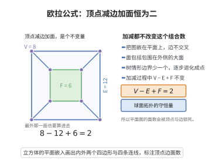

# 欧拉公式在网络中的应用

> **一句话大白话**：任何连通平面图的"顶点−边+面"恒等于 2，这是平面图的拓扑守恒律（多面体欧拉公式的图论形式）。
>
> **小例子**：$V-E+F=2$ 对连通平面图恒成立；对立方体有 $8-12+6=2$。

## 一、定理介绍

> **前置依赖**：连通图与图的基本概念、平面嵌入与面、多面体欧拉公式、归纳证明方法、球面拓扑

欧拉公式的图论形式：对任何连通平面图 $G=(V,E)$（嵌入平面/球面），设面数 $F$（含外部面），则
$$
V-E+F=2.
$$
它是极少数"全局组合恒等式"之一，常被用作进一步拓扑/组合论证（放电法、平面图边数上界、平面性判据）的起点。

## 几何直观

图意在说明：连通平面图的顶点数减边数加面数恒等于二，不论图怎样画，这个组合量都是拓扑不变量。

## 二、原理思路

证明思路以"逐步构造"或"对边/面对数归纳"进行：从单个顶点（$V=1,E=0,F=1$，即 $1-0+1=2$）出发，每加一条新边——要么连接两个不同分支成分（$E+1,V$ 不变，$F$ 不变？实际为保持 $V-E+F$），要么在同一面内连（$E+1,F+1$）——使 $V-E+F$ 不变，故恒为 $2$。或直接对多面体/三角剖分展开。

## 三、定理的严格表述

设 $G=(V,E)$ 为连通平面图，$F$ 为其在 $S^2$ 上的面数（含外面）。则
$$
V-E+F=2.
$$
推论：对简单平面图 $V\ge3$，$E\le3V-6$；对剖分（triangulation）等$E=3V-6$（连通的三角剖分情形）。

## 四、证明过程

**归纳法（对 $E$）**：基始 $E=0$ 时单顶点 $V=1,F=1$：$1-0+1=2$。归纳：设对 $E$ 成立。加入一条不引入新顶点的新边：若连接新顶点，则 $V+1,E+1,F$ 不变 → $V-E+F$ 不变；若在同一面内的两旧顶点间连，则 $E+1,F+1,V$ 不变 → 亦不变。故恒等式对所有连通平面图成立。另一种：由三角剖分之累积或对多面体投影、再对 $F$ 归纳同样成立。

## 五、应用与意义

欧拉公式是平面/多面体几何的守恒律，用于平面性的必要条件（$E\le3V-6$）、放电法（四色定理证明）、凸多面体的分类，以及化学（富勒烯、球状结构）与网络可平面性的判据，是其组合与拓扑价值的集中体现。

## 课堂问答

**老师**：$V-E+F=2$ 为什么对任意连通平面图都成立？它的不变性来自哪里？

**学生**：结论：来自"逐步构图中该组合量始终不变"。从单顶点 $V=1,E=0,F=1$ 出发（得 $1-0+1=2$），每加一条边：若连接新顶点或两个不同连通成分，则 $V$ 与 $E$ 同步加一、$F$ 不变；若在同一面内的两顶点间连边，则 $E$ 加一、$F$ 加一。两种情形 $V-E+F$ 都不变，故恒为 $2$。

**老师（追问）**：既然这么简单，它为什么成了平面图理论的支柱？

**学生**：因为它给出组合量之间的硬约束。简单平面图每个面至少 $3$ 条边、每条边至多被两个面共用，故 $3F\le2E$，代入 $V-E+F=2$ 得

$$
E\le3V-6,
$$

这就是平面性的必要条件，也是判定 $K_5$、$K_{3,3}$ 非平面的起点。常见误区：把公式用在非连通图上却忘记按连通分支修正（每多一个分支左边要多算 $1$）。

**老师（拓展）**：它在四色定理中扮演什么角色？

**学生**：它是放电法的能量来源。对平面图有 $\sum_{v\in V}(6-\deg v)=6V-2E\ge12>0$，总电量恒为正；放电时把正电量沿规则搬运，必然在某处形成对应可约构形的堆积，从而给出不可避免集——没有欧拉公式，四色定理的证明就失去骨架。
