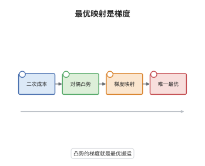

# Brenier 定理

> **一句话大白话**：当运费是距离的平方时，最省的那套搬沙子方案一定是"沿着某个凸函数的梯度走"：把每处的沙子顺着梯度的方向推出去，别处不绕路、不交叉，而且这套方案唯一。
>
> **小例子**：一维情形 $\mu$ 在 $[0,1]$ 上均匀、$\nu$ 在 $[1,2]$ 上均匀，二次成本下最优映射是 $T(x)=x+1$，它正是凸函数 $\varphi(x)=\tfrac12x^2+x$ 的导数 $\nabla\varphi(x)$。

## 介绍

Brenier 定理（1987，后由 Knott–Smith 与 Rüschendorf 独立得到）是二次成本最优传输的中心结论：若源测度 $\mu$ 关于 Lebesgue 测度绝对连续，则 Kantorovich 问题的最优耦合是唯一的，且必为某个凸函数梯度的图像。它把"在所有耦合中找最优"化归为"找一个凸函数"，把变分问题变成了凸分析问题。由此最优传输与 Monge–Ampère 方程、梯度流、最优控制的位移凸性、以及偏微分方程中的等周型不等式全面接通。

## 几何直观

图意在说明：最优映射把源区域的每一小块沿 $\nabla\varphi$ 的方向平移到目标区域，梯度方向随位置连续变化，因此传输路径互不交叉；若两条路径相交，交换终点就能降低总运费，这与最优性矛盾——这正是"支撑在次微分图上"的几何含义。

## 分析

**前置依赖**：Kantorovich 对偶定理、凸分析与 Legendre 共轭、Rademacher 定理、Kantorovich 最优性判据。

**数学内涵**：
- 二次成本可分解：$|x-y|^2=|x|^2-2x\cdot y+|y|^2$，其中 $\int|x|^2\,\mathrm d\mu$ 与 $\int|y|^2\,\mathrm d\nu$ 与耦合无关，故最小化运费等价于最大化 $\int x\cdot y\,\mathrm d\pi$。
- 凸函数的 Fenchel 不等式 $u(x)+u^*(y)\ge x\cdot y$ 恰好是"价格约束" $\varphi\oplus\psi\le c$ 在变量替换 $\varphi=\tfrac{|x|^2}{2}-u$、$\psi=\tfrac{|y|^2}{2}-u^*$ 下的形式，且等号成立当且仅当 $y\in\partial u(x)$。
- 常见误区：结论中的"唯一"是指 $\mu$-几乎处处唯一，映射在 $\mu$-零测集上可任意改动；若 $\mu$ 有原子，最优耦合可能分裂，定理失效（$\mu=\delta_0$ 时连可行映射都不存在）。

**结构**：
1. 用二次成本的代数分解，把最小化运费换成最大化 $\int x\cdot y\,\mathrm d\pi$。
2. 用 Fenchel 不等式把对偶问题压成"对凸函数 $u$ 极小化 $\int u\,\mathrm d\mu+\int u^*\,\mathrm d\nu$"，并说明最优势来自凸函数。
3. 用最优性判据得 $u(x)+u^*(y)=x\cdot y$ 在支撑上成立，即 $y\in\partial u(x)$。
4. 用凸函数的几乎处处可微性与 $\mu\ll\mathcal L^d$ 把次微分收缩成单点，读出 $T=\nabla u$。

## 思考过程

在 Brenier 之前，Knott 与 Smith 已经用"对偶势"语言描述了最优解，但缺少一个把势变成映射的机制。障碍在于：对偶只给出 $y\in\partial u(x)$，而凸函数的次微分可能是一个多值集合，无法直接定义映射。关键想法是两头夹逼：一侧用"循环单调性"说明最优耦合的支撑必然是某个凸函数的次微分图像（否则交换终点可降费），另一侧用 Rademacher 定理说明凸函数几乎处处可微——只要 $\mu$ 不把质量堆在不可微点集的逆像上，多值就退化为单值。$\mu\ll\mathcal L^d$ 正是这个条件的干净写法，因为不可微集是 Lebesgue 零集。

## 证明过程

**定理**：设 $\mu,\nu\in\mathcal P_2(\mathbb R^d)$ 且 $\mu\ll\mathcal L^d$。则二次成本 $c(x,y)=\tfrac12|x-y|^2$ 的 Kantorovich 问题有唯一最优耦合 $\pi$，且存在凸的、下半连续的函数 $u:\mathbb R^d\to\mathbb R$，使
$$
\pi=(\mathrm{id},\nabla u)_\#\mu,\qquad (\nabla u)_\#\mu=\nu .
$$
（成本 $|x-y|^2$ 只差因子 $2$，最优映射相同。）

**证明**：

### 1. 二次成本的代数分解

对任意 $\pi\in\Pi(\mu,\nu)$，
$$
\int\tfrac12|x-y|^2\,\mathrm d\pi=\tfrac12\int|x|^2\,\mathrm d\mu+\tfrac12\int|y|^2\,\mathrm d\nu-\int x\cdot y\,\mathrm d\pi,
$$
前两项与 $\pi$ 无关，故最小化运费等价于最大化 $\int x\cdot y\,\mathrm d\pi$。由于 $\mu,\nu$ 有二阶矩，$\Pi(\mu,\nu)$ 紧且该泛函连续，最大值在某个耦合 $\pi$ 上达到。

### 2. 对偶势写成凸函数的共轭

设 $u$ 凸，令 $u^*(y)=\sup_x\{x\cdot y-u(x)\}$ 为其 Legendre 共轭，则 $\varphi(x)=\tfrac12|x|^2-u(x)$、$\psi(y)=\tfrac12|y|^2-u^*(y)$ 满足
$$
\varphi(x)+\psi(y)=\tfrac12|x|^2+\tfrac12|y|^2-\big(u(x)+u^*(y)\big)\le\tfrac12|x|^2+\tfrac12|y|^2-x\cdot y=\tfrac12|x-y|^2 .
$$
反之，给定可行对 $(\varphi,\psi)$，令 $u=\tfrac12|\cdot|^2-\varphi$、$v=\tfrac12|\cdot|^2-\psi$，则可行性等价于 $u(x)+v(y)\ge x\cdot y$，即 $v\ge u^*$。把 $v$ 换成 $u^*$ 只会增大对偶值，故对偶上确界等于
$$
\tfrac12\int|x|^2\,\mathrm d\mu+\tfrac12\int|y|^2\,\mathrm d\nu-\inf_{u\ \text{凸}}\left\{\int u\,\mathrm d\mu+\int u^*\,\mathrm d\nu\right\}.
$$
该下确界在凸函数类中可达：把 $u$ 规范化为 $u(0)=0$，由 $\int u\,\mathrm d\mu$ 有下界得到局部 Lipschitz 的一致估计，再用 Arzelà–Ascoli 取极限即可。

### 3. 最优耦合支撑在次微分图上

取达到下确界的凸函数 $u$ 与对应的最优耦合 $\pi$。由 Kantorovich 最优性判据，$\varphi\oplus\psi=c$ 在 $\mathrm{supp}\,\pi$ 上成立，即 $u(x)+u^*(y)=x\cdot y$。而 Fenchel 不等式的等号成立当且仅当 $y\in\partial u(x)$，故
$$
\mathrm{supp}\,\pi\subset\{(x,y):\ y\in\partial u(x)\}.
$$

### 4. 次微分退化为梯度

凸函数 $u$ 局部 Lipschitz，由 Rademacher 定理在 $\mathcal L^d$-几乎处处可微，且在可微点处 $\partial u(x)=\{\nabla u(x)\}$。设 $N$ 为不可微点集，则 $\mathcal L^d(N)=0$；由 $\mu\ll\mathcal L^d$ 得 $\mu(N)=0$。于是存在 $\mu$-零测集 $Z$，使 $x\notin Z$ 时 $\partial u(x)$ 是单点 $\{\nabla u(x)\}$，从而
$$
\pi=\pi|_{Z\times\mathbb R^d}+(\mathrm{id},\nabla u)_\#\big(\mu|_{Z^c}\big).
$$
但 $Z$ 的 $\mu$-测度为零，且 $\mathrm{supp}\,\pi$ 不能包含"一点对多点"的情形，故 $\pi=(\mathrm{id},\nabla u)_\#\mu$，第二边际为 $\nu$ 即得 $(\nabla u)_\#\mu=\nu$。

### 5. 唯一性

设 $\pi_1,\pi_2$ 都是最优耦合。固定第 3 步中的最优对偶对 $(\varphi,\psi)$（对应凸函数 $u$），由最优性判据，$c-\varphi-\psi$ 在 $\mathrm{supp}\,\pi_i$ 上都恒为零，故两个测度都集中于同一张集合 $\{(x,y):y\in\partial u(x)\}$。只要一个测度的第一边际是 $\mu$、又集中在这张"每点至多一个 $y$"的图上，它就被 $\mu$ 唯一决定：对任一 Borel 集 $B$，$\pi_i(B\times\mathbb R^d)=\mu(\{x:(x,\nabla u(x))\in B\})$（$\mu$-几乎处处意义下）。故 $\pi_1=\pi_2$。$\square$

## 课堂问答

**老师**：为什么偏偏是二次成本给出"梯度映射"这种干净结论？换成 $c=|x-y|$ 还成立吗？

**学生**：因为二次成本可分离成 $|x|^2-2x\cdot y+|y|^2$，与耦合无关的项可以扔掉，剩下的内积恰好被凸函数的 Fenchel 不等式 $u+u^*\ge x\cdot y$ 精确刻画，等号条件是 $y\in\partial u$。换成 $|x-y|$ 就没有这种"共轭配对"结构，最优映射一般不再是梯度，只在 $\nu$ 绝对连续等附加条件下才能谈。

**老师（追问）**：证明里 $\mu\ll\mathcal L^d$ 用在哪一步？能不能去掉？

**学生**：用在第 4 步。Rademacher 只保证 $\nabla u$ 在 Lebesgue 几乎处处存在，而需要的是"$\mu$-几乎处处 $\partial u$ 为单点"。$\mu\ll\mathcal L^d$ 把 Lebesgue 零测集变成 $\mu$ 零测集，这一步才成立。去掉它就只剩"$y\in\partial u(x)$"，最优耦合可以是多值的分裂方案，例如 $\mu=\delta_0$、$\nu=\tfrac12(\delta_1+\delta_2)$ 时没有映射解。

**老师（拓展）**：Brenier 定理在更大图景里承担什么角色？

**学生**：它把最优传输从"线性规划"升级为"凸函数的梯度"，于是 $W_2$ 空间的切空间可以等同于梯度场，$W_2$ 测地线就是位移插值 $((1-t)\mathrm{id}+t\nabla u)_\#\mu$，这直接导出 Benamou–Brenier 公式、JKO 格式与 Wasserstein 空间的形式黎曼结构；在偏微分方程里它把最优传输问题化归为 Monge–Ampère 方程 $\det\nabla^2u=\rho/\sigma$，成为研究该方程弱解的标准工具。
