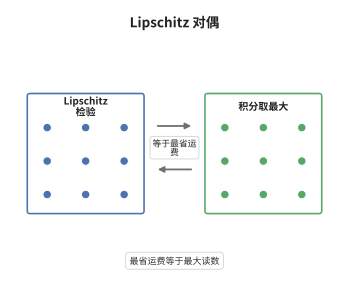

# Kantorovich–Rubinstein 对偶

> **一句话大白话**：把质量从 $\mu$ 搬到 $\nu$ 的最小总路程，等于"拿一把斜率为 1 的尺子去量两个分布的差，能撬出的最大读数"。
>
> **小例子**：数轴上 $\mu=\delta_0$、$\nu=\delta_3$，取 1-Lipschitz 的 $f(x)=-x$，则 $\int f\,\mathrm d(\mu-\nu)=f(0)-f(3)=0-(-3)=3$，恰等于 $W_1(\delta_0,\delta_3)=3$。

## 介绍

Kantorovich–Rubinstein 对偶是 $p=1$ 时的 Kantorovich 对偶的化简版：成本 $d(x,y)$ 本身是度量，于是对偶中的两个势可以合并成一个 1-Lipschitz 函数。结论是
$$
W_1(\mu,\nu)=\sup\left\{\int f\,\mathrm d(\mu-\nu):\ f\ \text{为 1-Lipschitz}\right\}.
$$
它把 $W_1$ 变成"Lipschitz 范数的对偶范数"，从而把最优传输与函数空间的对偶、Wasserstein GAN 的目标函数、以及度量测度空间的收敛理论连在一起。它也解释了为什么 $W_1$ 比 $W_2$ 更容易计算：右侧是一个凸的、可用线性规划或对偶上升求解的问题。

## 几何直观

图意在说明：检验函数 $f$ 的斜率被限制在 $\pm1$ 以内，它无法"夸大"质量差；把所有这样的 $f$ 都试一遍，能取到的最大值恰好是把正质量搬到负质量处所需的最短路程，于是左右两栏的数值相等。

## 分析

**前置依赖**：Wasserstein 距离、Lipschitz 函数与 Arzelà–Ascoli 定理、Kantorovich 对偶定理。

**数学内涵**：
- 关键化简：对任意可行对 $(\varphi,\psi)$，函数 $\tilde\varphi(x)=\inf_y\{d(x,y)-\psi(y)\}$ 是 1-Lipschitz 的、满足 $\tilde\varphi\ge\varphi$ 且 $-\tilde\varphi\ge\psi$，故 $\int\tilde\varphi\,\mathrm d(\mu-\nu)\ge\int\varphi\,\mathrm d\mu+\int\psi\,\mathrm d\nu$。于是所有可行对被单个 Lipschitz 函数取代。
- 上界方向是一行估计：$\int f\,\mathrm d(\mu-\nu)=\int(f(x)-f(y))\,\mathrm d\pi\le\int d\,\mathrm d\pi$ 对一切耦合成立。
- 适用边界：这个"合并成一个函数"的技巧依赖 $c=d$ 满足三角不等式。对 $c=d^p$（$p>1$），同样的做法失效，$W_p$ 不对应任何 Lipschitz 类的上确界，必须保留两个势（Brenier 势）。

**结构**：
1. 用一个 Lipschitz 检验函数给出任意耦合下的上界。
2. 用 $c$-变换把对偶可行对规范化成一个 1-Lipschitz 函数，说明对偶上确界就是 Lipschitz 上确界。
3. 合并 Kantorovich 对偶定理得等号，并说明上确界可达。

## 思考过程

Kantorovich 对偶给出两个势 $\varphi,\psi$，但 $p=1$ 时它们并不独立：成本是度量，三角不等式 $d(x,y)\le d(x,z)+d(z,y)$ 使得"把 $\psi$ 的信息搬到 $\varphi$ 里"不会损失。Rubinstein 在 1970 年代研究运输问题的对偶范数时发现了这一化简，它把对偶问题从一个无界函数对的优化变成单个 Lipschitz 函数的优化。这个形式立刻暴露出 $W_1$ 的一个本质：它只依赖 Lipschitz 结构，与测度的绝对连续性、原子性都无关，因此在离散测度、经验测度与符号测度上同样有效——这正是它在机器学习的分布比较中被大量使用的原因。

## 证明过程

**定理**：设 $(X,d)$ 完备可分，$\mu,\nu\in\mathcal P_1(X)$。则
$$
W_1(\mu,\nu)=\sup\left\{\int f\,\mathrm d(\mu-\nu):\ f:X\to\mathbb R\ \text{满足}\ |f(x)-f(y)|\le d(x,y)\right\},
$$
且上确界可由某个 1-Lipschitz 函数达到。

**证明**：

### 1. 上界

设 $f$ 为 1-Lipschitz，$\pi\in\Pi(\mu,\nu)$。由边际条件，
$$
\int f\,\mathrm d(\mu-\nu)=\int\big(f(x)-f(y)\big)\,\mathrm d\pi\le\int d(x,y)\,\mathrm d\pi .
$$
对 $\pi$ 取下确界得 $\int f\,\mathrm d(\mu-\nu)\le W_1(\mu,\nu)$，故上确界不超过 $W_1$。

### 2. 把对偶对合并成一个函数

由 Kantorovich 对偶定理，$W_1(\mu,\nu)=\sup\{\int\varphi\,\mathrm d\mu+\int\psi\,\mathrm d\nu\}$，上确界取遍满足 $\varphi(x)+\psi(y)\le d(x,y)$ 的连续有界对。给定这样的对，定义
$$
\tilde\varphi(x)=\inf_{y\in X}\big\{d(x,y)-\psi(y)\big\}.
$$
先看可行性：取 $y=x$ 得 $\tilde\varphi(x)\le-\psi(x)$，即 $-\tilde\varphi\ge\psi$；又由 $\varphi(x)\le d(x,y)-\psi(y)$ 对一切 $y$ 成立得 $\varphi\le\tilde\varphi$。再看 Lipschitz 性：对任意 $x,x'$ 与 $y$，
$$
\tilde\varphi(x)\le d(x,y)-\psi(y)\le d(x,x')+d(x',y)-\psi(y),
$$
对 $y$ 取下确界得 $\tilde\varphi(x)\le d(x,x')+\tilde\varphi(x')$，交换 $x,x'$ 即得 $|\tilde\varphi(x)-\tilde\varphi(x')|\le d(x,x')$。最后，
$$
\int\tilde\varphi\,\mathrm d\mu+\int(-\tilde\varphi)\,\mathrm d\nu\ge\int\varphi\,\mathrm d\mu+\int\psi\,\mathrm d\nu,
$$
且 $\tilde\varphi(x)+(-\tilde\varphi)(y)=\tilde\varphi(x)-\tilde\varphi(y)\le d(x,y)$，故 $(\tilde\varphi,-\tilde\varphi)$ 仍是可行对。于是对偶上确界等于 Lipschitz 上确界。

### 3. 可达性

把 $\tilde\varphi$ 规范化为 $\tilde\varphi(x_0)=0$，则 $|\tilde\varphi(x)|\le d(x_0,x)$，函数族被可积的控制函数界住且等度连续。在紧集上由 Arzelà–Ascoli 取极限，在一般 Polish 空间上用截断加对角化论证，即得极值函数 $f$ 存在。

### 4. 结论

第 1 步给"$\le$"，第 2 步把 Kantorovich 对偶上确界改写成 Lipschitz 上确界、第 3 步保证可达，合起来得等号。$\square$

## 课堂问答

**老师**：为什么 $p=1$ 时两个势能合并成一个，$p=2$ 时就不行？

**学生**：因为 $d$ 满足三角不等式。构造 $\tilde\varphi(x)=\inf_y\{d(x,y)-\psi(y)\}$ 时，正是三角不等式给出了 $\tilde\varphi$ 的 1-Lipschitz 性，同时 $y=x$ 给出 $-\tilde\varphi\ge\psi$，所以一个函数就够。对 $c=d^2$，$\inf_y\{d(x,y)^2-\psi(y)\}$ 一般不满足任何 Lipschitz 估计，成本也不满足三角不等式，两个势无法合并。

**老师（追问）**：证明里"可达性"这一步真的需要吗？上确界取不到会有问题吗？

**学生**：公式本身只要求上确界，不需要可达。但可达性有实际价值：它说明最优检验函数存在，可以写成某个 Kantorovich 势的 $c$-变换；在应用中（例如对偶上升算法）正是这个函数被迭代求解。技术上靠规范化 $\tilde\varphi(x_0)=0$ 得到一致界 $|\tilde\varphi|\le d(x_0,\cdot)$，再用紧性取极限。

**老师（拓展）**：这个公式还能推广到什么对象上？

**学生**：对符号测度也成立：若 $\sigma=\mu-\nu$ 总质量为 $0$，则 $\|\sigma\|_{KR}=\sup_{\mathrm{Lip}(f)\le1}\int f\,\mathrm d\sigma$ 是一个范数，$W_1$ 就是它；由此 $W_1$ 成为"有界 Lipschitz 对偶"的度量，可用来定义度量测度空间的紧性。把 $d$ 换成一个更一般的成本、把 Lipschitz 条件换成"$f$ 的梯度被约束"，就得到最优传输的对偶表述与偏微分方程中的对偶方法。
