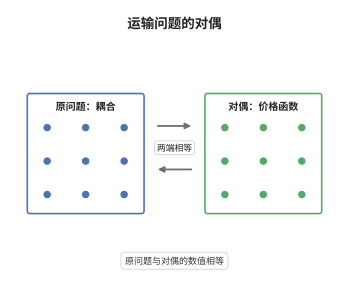

# Kantorovich 对偶定理

> **一句话大白话**：最省的运输方案，其总运费等于"给每个出发地定一个价、给每个目的地定一个价，使任一单程都亏本，然后把这些价按货物量加起来"所能得到的最大收入——这就是运输问题的对偶。
>
> **小例子**：$\mu=\nu=\tfrac12(\delta_0+\delta_1)$、$c(x,y)=|x-y|$。取 $\varphi(x)=x$、$\psi(y)=-y$，则 $\varphi(x)+\psi(y)=x-y\le|x-y|$ 处处成立，对偶值 $\int\varphi\,\mathrm d\mu+\int\psi\,\mathrm d\nu=0$，恰等于最优运费（不搬即可）。

## 介绍

Kantorovich 对偶定理断言：耦合上的线性规划之最小值，等于对所有满足逐点约束 $\varphi(x)+\psi(y)\le c(x,y)$ 的"价格函数"对 $(\varphi,\psi)$ 求 $\int\varphi\,\mathrm d\mu+\int\psi\,\mathrm d\nu$ 的最大值。它是线性规划强对偶在无穷维测度空间上的版本，也是最优传输理论全部定量结论的发动机：最优性判据、$c$-变换、Brenier 定理、Kantorovich–Rubinstein 公式都由它导出。定理把一个"在测度上求极小"的问题转化为"在函数上求极大"的问题，后者往往更容易构造显式解。

## 几何直观

图意在说明：左栏是原问题——在耦合上把运费压到最低；右栏是对偶问题——给每个点标一个"价"，要求任何一对 $(x,y)$ 的价格和不超过运费 $c(x,y)$，再让总价最大；定理说两栏的最优数值相等，且在最优处每个被使用的运输对都恰好使价格和等于运费。

## 分析

**前置依赖**：Monge 问题与 Kantorovich 松弛、Fenchel 对偶与凸共轭、弱收敛与紧性。

**数学内涵**：
- 对偶变量是无界函数，但可以用 $c$-变换规范：固定 $\varphi$，取 $\psi=\varphi^c$、$\varphi^c(y)=\inf_x\{c(x,y)-\varphi(x)\}$ 时约束最松、对偶值最大，故只需最大化 $\varphi\mapsto\int\varphi\,\mathrm d\mu+\int\varphi^c\,\mathrm d\nu$。
- 最优性判据：$\pi$ 最优当且仅当存在可行对 $(\varphi,\psi)$ 使 $\varphi\oplus\psi=c$ 在 $\mathrm{supp}\,\pi$ 上成立（即"互补松弛"）。
- 需注意 $c$ 有下界且适当连续时才有强对偶与可达性；若 $c$ 取值 $\pm\infty$ 或约束无内点，可能出现对偶间隙，此时结论要减弱为"上确界等于下确界"。

**结构**：
1. 把原问题写成"线性泛函 + 示性函数"的形式，用 Fenchel–Rockafellar 定理求其对偶。
2. 用 $c$-变换把双变量问题压缩成单变量问题，并说明上确界可达。
3. 用"互补松弛"导出最优性判据，并说明原问题与对偶问题的值互相夹住。

## 思考过程

Monge 问题的困难在于约束 $T_\#\mu=\nu$ 是非线性的，而 Kantorovich 把它线性化之后，问题的凸性立刻显形：目标线性、约束线性，剩下的就交给凸对偶。真正的技术障碍是对偶变量所在的空间——$\varphi,\psi$ 一般无界、既不可积也不连续，直接套 Fenchel 公式会碰到"示性函数的共轭是示性函数"这类无法计算的对象。突破点是 $c$-变换：它把任意可行对替换成一个"饱和"的可行对而不降低对偶值，从而把可行域压成一个可以用紧性论证的函数类。L. Kantorovich 在 1942 年给出离散情形，Kellerer 与 Rüschendorf 等人把它推广到一般 Polish 空间与下半连续成本。

## 证明过程

**定理**：设 $X,Y$ 为紧度量空间，$c:X\times Y\to\mathbb R$ 连续，$\mu\in\mathcal P(X)$、$\nu\in\mathcal P(Y)$。则存在 $\pi^*\in\Pi(\mu,\nu)$ 与连续函数 $\varphi\in C(X)$、$\psi\in C(Y)$，满足 $\varphi\oplus\psi\le c$，使
$$
\int c\,\mathrm d\pi^*=\int\varphi\,\mathrm d\mu+\int\psi\,\mathrm d\nu=\sup_{\varphi\oplus\psi\le c}\left(\int\varphi\,\mathrm d\mu+\int\psi\,\mathrm d\nu\right).
$$

**证明**：

### 1. 弱对偶

设 $(\varphi,\psi)$ 满足 $\varphi\oplus\psi\le c$，$\pi\in\Pi(\mu,\nu)$。由边际条件，$\varphi\oplus\psi$ 在 $\pi$ 下的积分只依赖 $\pi$ 的两个边际：
$$
\int(\varphi\oplus\psi)\,\mathrm d\pi=\int\varphi\,\mathrm d\mu+\int\psi\,\mathrm d\nu .
$$
于是
$$
\int c\,\mathrm d\pi=\int(\varphi\oplus\psi)\,\mathrm d\pi+\int(c-\varphi-\psi)\,\mathrm d\pi\ge\int\varphi\,\mathrm d\mu+\int\psi\,\mathrm d\nu,
$$
最后一步用了 $c-\varphi-\psi\ge0$。对 $\pi$ 取下确界、对 $(\varphi,\psi)$ 取上确界，得 $K\ge D$，其中 $K$ 是原问题最小值、$D$ 是对偶上确界。

### 2. 用分离定理得到强对偶

在 $\mathcal M(X\times Y)$ 上取弱拓扑，令 $\Lambda\pi=((P_1)_\#\pi,(P_2)_\#\pi)$，并令
$$
C=\left\{(\Lambda\pi,s)\in\mathcal M(X)\oplus\mathcal M(Y)\oplus\mathbb R:\ \pi\ge0,\ s\ge\int c\,\mathrm d\pi\right\},
$$
它是闭凸锥，且 $(\mu,\nu,s)\in C$ 当且仅当 $s\ge K$，故 $(\mu,\nu,K)$ 是 $C$ 的边界点。由 Hahn–Banach 定理（$C$ 在 $s$ 方向有内点）存在非零连续线性泛函 $(\varphi,\psi,-1)$ 与实数 $\alpha$，使
$$
\int\varphi\,\mathrm dm+\int\psi\,\mathrm dn-s\le\alpha\quad\text{对一切 }(m,n,s)\in C,
$$
且 $(\mu,\nu,K)$ 处取等号，即 $\int\varphi\,\mathrm d\mu+\int\psi\,\mathrm d\nu-K=\alpha$。取 $m=t\delta_x$、$n=t\delta_y$、$s=tc(x,y)$ 并令 $t\to\infty$，得 $\varphi(x)+\psi(y)\le c(x,y)$，故 $(\varphi,\psi)$ 可行。又 $(\mu,\nu,K+\varepsilon)\in C$ 对一切 $\varepsilon>0$ 成立，代入得 $-\varepsilon\le\alpha$，故 $\alpha\ge0$；而弱对偶给出 $K\ge\int\varphi\,\mathrm d\mu+\int\psi\,\mathrm d\nu=K+\alpha$，故 $\alpha\le0$。于是 $\alpha=0$，即 $\int\varphi\,\mathrm d\mu+\int\psi\,\mathrm d\nu=K=D$。

### 3. $c$-变换与可达性

给定可行对 $(\varphi,\psi)$，令 $\varphi^c(y)=\inf_x\{c(x,y)-\varphi(x)\}$。由 $\varphi\oplus\psi\le c$ 得 $\psi\le\varphi^c$，故 $(\varphi,\varphi^c)$ 仍可行且对偶值不减；$\varphi^c$ 是连续函数族的一致下确界，因 $c$ 在紧集上一致连续而仍有界且一致连续。于是只需在 $\{\varphi:\varphi=\varphi^{cc}\}$ 上求上确界。该函数族被 $\pm\|c\|_\infty$ 一致界住且等度连续，由 Arzelà–Ascoli 定理紧，故上确界被某对 $(\varphi,\psi)$ 达到。

### 4. 互补松弛与最优性判据

设 $\pi$ 为任意耦合、$(\varphi,\psi)$ 为任意可行对，则
$$
\int c\,\mathrm d\pi=\int(\varphi\oplus\psi)\,\mathrm d\pi+\int(c-\varphi-\psi)\,\mathrm d\pi=\int\varphi\,\mathrm d\mu+\int\psi\,\mathrm d\nu+\int(c-\varphi-\psi)\,\mathrm d\pi .
$$
第二项非负，故 $\int c\,\mathrm d\pi\ge\int\varphi\,\mathrm d\mu+\int\psi\,\mathrm d\nu$；若 $\varphi\oplus\psi=c$ 在 $\mathrm{supp}\,\pi$ 上成立，则等号成立，$\pi$ 与 $(\varphi,\psi)$ 同时最优。反之取最优对与最优耦合，两边数值相等迫使 $\int(c-\varphi-\psi)\,\mathrm d\pi=0$，即 $c=\varphi\oplus\psi$ 在 $\mathrm{supp}\,\pi$ 上成立。

### 5. 结论

第 2 步给出强对偶，第 3 步给出对偶最优对的存在，第 4 步给出判据，于是原问题最小值与对偶上确界相等且都由上述对象达到。$\square$

## 课堂问答

**老师**：对偶问题里 $\varphi,\psi$ 是无界函数，"上确界"凭什么能取到？

**学生**：靠 $c$-变换做规范化。若 $(\varphi,\psi)$ 可行，则 $\psi\le\varphi^c$ 且 $(\varphi,\varphi^c)$ 仍可行、对偶值不减，所以只需考虑 $\varphi=\varphi^{cc}$ 的函数。这类函数被 $\pm\|c\|_\infty$ 界住，且因 $c$ 一致连续而等度连续；在紧空间上 Arzelà–Ascoli 给出紧性，上确界自然可达。

**老师（追问）**：强对偶的证明里，哪一步用到了"存在严格可行点"？

**学生**：用在 Fenchel–Rockafellar 的约束品性上。取 $\varphi_0\equiv0$、$\psi_0\equiv-\|c\|_\infty-1$，则 $\varphi_0\oplus\psi_0\le c-1$ 严格成立，即约束有内点，示性函数的共轭在所需点处有限，强对偶才成立。若没有内点（例如 $c$ 取到 $-\infty$），只能得到上确界不超过下确界的一般不等式。

**老师（拓展）**：这个对偶还给出什么定量信息？

**学生**：它给出最优性判据：$\pi$ 最优当且仅当存在可行对 $(\varphi,\psi)$ 使 $\varphi\oplus\psi=c$ 在所有被运输的 $(x,y)$ 上成立。取 $c$ 为度量 $d$ 时可进一步把两个势合并成一个 Lipschitz 函数，得到 Kantorovich–Rubinstein 公式；取 $c=|x-y|^2$ 时 $c$-凹势的梯度给出 Brenier 映射，对偶因此是全部定量传输理论的出发点。
