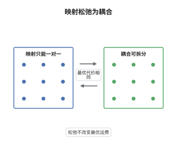

# Monge 问题与 Kantorovich 松弛

> **一句话大白话**：要把一堆沙子按分布 $\mu$ 搬到分布 $\nu$，Monge 要求"每个出发点只发一辆车"，路线必须是一个函数；Kantorovich 允许把一处的沙子拆开分给好几个目的地，于是问题变成耦合上的线性规划，而两者的最小运费相同。
>
> **小例子**：取 $\mu=\tfrac12(\delta_0+\delta_1)$、$\nu=\tfrac12(\delta_2+\delta_3)$、$c(x,y)=|x-y|$。映射 $T(0)=2,T(1)=3$ 的运费是 $\tfrac12\cdot2+\tfrac12\cdot2=2$；交换后的映射运费也是 $\tfrac12\cdot3+\tfrac12\cdot1=2$，而全部耦合的运费恒为 $2$，两种最优值相同。

## 介绍

Monge 问题（1781，土方运输）问：给定源分布 $\mu$、目标分布 $\nu$ 与单位距离费用 $c(x,y)$，是否存在映射 $T$ 使 $T_\#\mu=\nu$，且总运费 $\int c(x,T(x))\,\mathrm d\mu$ 最小。它是变分法中的非线性问题，可行集既非凸也不闭，甚至可能为空。Kantorovich（1942）把"运输方案"换成联合分布 $\pi\in\Pi(\mu,\nu)$，目标 $\int c\,\mathrm d\pi$ 对 $\pi$ 线性，可行集是弱紧凸集，问题因此成为线性规划。这一步的重要性在于：松弛后的总有解、可作对偶（下一节主题），并且在 $\mu$ 无原子时最优值与 Monge 问题相等——"松弛"并不损失最优值。

## 几何直观

图意在说明：左栏的 Monge 方案要求每个 $x$ 只对应一个 $T(x)$，右栏的耦合允许 $x$ 处的质量被拆分给多个 $y$；把"点对点"放宽成"按比例分流"，可行集就从非凸的映射集合膨胀为凸的耦合集合，而最优运费并不改变。

## 分析

**前置依赖**：测度论与推前测度、弱收敛与 Prokhorov 定理、线性规划对偶。

**数学内涵**：
- 耦合集 $\Pi(\mu,\nu)=\{\pi\in\mathcal P(X\times Y):(P_1)_\#\pi=\mu,\ (P_2)_\#\pi=\nu\}$ 是弱紧凸集，而 $\pi\mapsto\int c\,\mathrm d\pi$ 是线性泛函，故 Kantorovich 问题的极小元必存在。
- 每个映射 $T$ 诱导 $\pi_T=(\mathrm{id},T)_\#\mu\in\Pi(\mu,\nu)$，于是"松弛值不大于原值"是平凡的；反向不等式要靠用分片常值映射去逼近最优耦合。
- 等号必须用 $\mu$ 无原子：若 $\mu=\delta_0$、$\nu=\tfrac12(\delta_1+\delta_2)$，则不存在 $T_\#\mu=\nu$ 的映射（一个点的像只能是一个点），Monge 问题无解，而 Kantorovich 最优值是 $\tfrac12c(0,1)+\tfrac12c(0,2)$。这是最常见的误区——松弛不总是无损的。

**结构**：
1. 把 Monge 可行集嵌入耦合集，得到松弛值不大于原值。
2. 证明 $\Pi(\mu,\nu)$ 弱紧、运费泛函弱连续，故最优耦合 $\pi^*$ 存在。
3. 把 $X$ 切成小块，用无原子性在每块上造出与 $\pi^*$ 条件边际一致的映射，令分块直径趋零即得等号，并对极限取子列得到达到下确界的映射。

## 思考过程

Monge 的原问题是"把这堆土搬到那堆去"，他默认运输方案是一个映射，这在连续介质中看似自然。障碍在于可行映射集合既非凸也不闭，极小化序列的极限可能退化为"分裂的质量"，从而逃出映射集合。Kantorovich 的想法是把"一个 $x$ 被送到哪里"换成"从 $x$ 到 $y$ 运多少"，用联合分布记录运输计划：非线性约束变成线性约束，变分问题变成线性规划，正好接上对偶理论。此后人们发现，只要源测度没有原子，被拆散的质量总能重新打包成单一映射，两种表述的最优值一致；二次成本下这个映射还是某个凸函数的梯度（Brenier 定理），松弛因此成为进攻原问题的桥梁而非终点。

## 证明过程

**定理**：设 $X,Y$ 为紧度量空间，$c:X\times Y\to\mathbb R$ 连续，$\mu\in\mathcal P(X)$ 无原子，$\nu\in\mathcal P(Y)$。则 Kantorovich 问题有极小元，且
$$
\inf_{\pi\in\Pi(\mu,\nu)}\int c\,\mathrm d\pi=\inf\left\{\int c(x,T(x))\,\mathrm d\mu:\ T\ \text{为 Borel 映射},\ T_\#\mu=\nu\right\},
$$
并且右端的下确界可由某个 Borel 映射达到。

**证明**：

### 1. 松弛给出下界

若 $T_\#\mu=\nu$，令 $\pi_T=(\mathrm{id},T)_\#\mu$。对任意 $\pi_T$-可积的 $f$ 有 $\int f\,\mathrm d\pi_T=\int f(x,T(x))\,\mathrm d\mu$，故两个边际分别是 $\mu$（因为第一坐标就是 $\mathrm{id}$）与 $T_\#\mu=\nu$，即 $\pi_T\in\Pi(\mu,\nu)$。因此

$$
\inf_{\pi\in\Pi(\mu,\nu)}\int c\,\mathrm d\pi\le \inf_{T_\#\mu=\nu}\int c(x,T(x))\,\mathrm d\mu .
$$

### 2. 最优耦合存在

$X\times Y$ 紧，故 $\mathcal P(X\times Y)$ 弱紧；$\Pi(\mu,\nu)$ 是弱闭集（$(P_1)_\#,(P_2)_\#$ 弱连续），所以紧。$c$ 在紧集上连续有界，$\pi\mapsto\int c\,\mathrm d\pi$ 弱连续，故存在 $\pi^*\in\Pi(\mu,\nu)$ 使 $\int c\,\mathrm d\pi^*$ 等于左端。取其一分解 $\pi^*(\mathrm dx\,\mathrm dy)=\mu(\mathrm dx)\otimes\pi_x(\mathrm dy)$，其中 $x\mapsto\pi_x$ 是 Borel 核。

### 3. 分片造映射

取分块 $A_1,\dots,A_m$，它们是互不相交的 Borel 集、覆盖 $X$、直径小于 $\delta$，且 $\mu(\partial A_i)=0$ 只影响极限不影响估计。由于 $\mu$ 无原子，其限制 $\mu|_{A_i}$ 也无原子；把 $\mu|_{A_i}$ 推前成 $\nu_i:=\pi^*(A_i\times\cdot)$（质量为 $\mu(A_i)$）的 Borel 映射 $T_i:A_i\to Y$ 存在。拼接 $T_\delta|_{A_i}=T_i$，则 $(T_\delta)_\#\mu=\sum_i\nu_i$，即

$$
(\mathrm{id},T_\delta)_\#\mu\ \text{在每块}\ A_i\ \text{上的第二边际与}\ \pi^*\ \text{相同}.
$$

于是 $\int c\,\mathrm d(\mathrm{id},T_\delta)_\#\mu=\sum_i\int_{A_i}\!\int c(x,y)\,\mathrm d\nu_i(y)\,\mathrm d\mu(x)$。当 $x\in A_i$ 时 $\mathrm{diam}\,A_i<\delta$，用 $c$ 在紧集上的一致连续性（模 $\omega(\delta)\to0$）比较被积函数，得

$$
\left|\int c\,\mathrm d(\mathrm{id},T_\delta)_\#\mu-\int c\,\mathrm d\pi^*\right|\le\omega(\delta).
$$

### 4. 结论

由上式与第 1 步，$\inf_T\int c\,\mathrm d\pi_T\le\int c\,\mathrm d\pi^*+\omega(\delta)$，令 $\delta\to0$ 得右端下确界不超过 $\int c\,\mathrm d\pi^*$，即不超过左端；结合第 1 步的反向不等式，两者相等。又 $c$ 有界使极小化序列的运费一致有界，取 $T_{\delta_n}$ 的弱极限即得达到下确界的映射。$\square$

## 课堂问答

**老师**：Monge 问题看起来很自然，为什么非要换成 Kantorovich 的形式？

**学生**：因为 Monge 的可行集 $\{T:T_\#\mu=\nu\}$ 不是凸集，目标泛函对 $T$ 也非线性，极小化序列的极限可能"分裂质量"而不再是映射，最坏情况连可行映射都没有，例如 $\mu=\delta_0$ 而 $\nu$ 有两个原子。Kantorovich 用耦合 $\pi$ 代替 $T$，可行集是弱紧凸集、目标是线性的，最优解一定存在，还可以做对偶。

**老师（追问）**：既然松弛后的可行集变大了，凭什么最优值不变？哪一步用到了 $\mu$ 无原子？

**学生**：变大只说明左端不超过右端。反向要靠第 3 步：把 $X$ 分成直径小于 $\delta$ 的小块 $A_i$，在每块上把 $\mu|_{A_i}$ 推前成 $\nu_i=\pi^*(A_i\times\cdot)$。若 $\mu|_{A_i}$ 有原子，一个原子的像只能是一个点，无法把质量按 $\nu_i$ 摊开；无原子才保证这样的映射存在。于是构造出的映射运费与最优耦合相差不超过 $\omega(\delta)$，令 $\delta\to0$ 即得等号。

**老师（拓展）**：若把 $\mu$ 有原子的情形也纳入，最优耦合长什么样？这种做法在别的领域还有用吗？

**学生**：此时最优耦合会把原子的质量按比例分配给多个目标，形成"分裂"，无法用单个映射表示；这正是"松弛"必须保留的原因。同样的技巧在经济学里叫运输问题的最优分配，在偏微分方程里用于构造测度解，在概率论里给出耦合的显式构造，而 Brenier 定理说明二次成本下只要源测度绝对连续，分裂就消失、最优耦合恰是某个凸函数梯度的图像。
