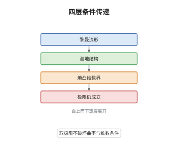

# RCD 空间与 Gromov–Hausdorff 稳定性

> **一句话大白话**：把"Ricci 曲率不小于 $K$、维数不超过 $N$"翻译成只用到距离、测度和最优传输的语言，就得到 RCD$(K,N)$ 条件；这种空间在测度 Gromov–Hausdorff 极限下不会被破坏，所以"黎曼流形的极限"仍然是一个有曲率、有维数界的合理对象。
>
> **小例子**：球面 $S^N$ 满足 RCD$(N-1,N)$（Ricci 曲率恒为 $N-1$、维数为 $N$）；把一列半径趋于零的球面 $S^N$（测度归一化）取 mGH 极限，得到单点空间 $\{*\}$ 上的 $\delta$ 测度——它的 $W_2$ 距离恒为 $0$、熵恒为 $0$，熵凸不等式自动成立，故仍是 RCD$(N-1,N)$ 空间。

## 介绍

RCD$(K,N)$ 是"黎曼曲率–维数条件"的非光滑版本：RCD 由"CD"（Lott–Villani 与 Sturm 独立提出的曲率–维数条件）加上"无穷小 Hilbert 性"（infinitesimally Hilbertian）构成，后者排除 Finsler 型几何，使空间在无穷小尺度上像黎曼流形。它的定义完全由 $W_2$ 最优传输与熵写成，因此不依赖坐标系与张量。稳定性定理说：RCD$(K,N)$ 空间在测度 Gromov–Hausdorff 收敛下封闭，且（归一化后）构成紧类。这条结论把"取极限"这一几何分析中最常用的操作合法化，是研究流形收敛、奇点形成与能量泛函稳定性的基础设施。

## 几何直观

图意在说明：最底层是满足 $\mathrm{Ric}\ge K$、$\dim\le N$ 的流形；上一层把它们共有的测地结构与最优传输结构抽出来；再往上是只用熵凸性与维数参数写出的 RCD 条件；最上层表示取 mGH 极限后这些结构逐层保持，条件不丢失。

## 分析

**前置依赖**：Wasserstein 距离、Gromov–Hausdorff 收敛、相对熵与 Rényi 熵、Cheeger 能量与 Sobolev 空间。

**数学内涵**：
- 熵凸（曲率下界）：$N=\infty$ 时要求 Boltzmann 熵 $\mathrm{Ent}(\mu|m)=\int\rho\log\rho\,\mathrm dm$ 沿 $W_2$ 测地线 $K$-凸，即 $\mathrm{Ent}(\mu_t|m)\ge(1-t)\mathrm{Ent}(\mu_0|m)+t\mathrm{Ent}(\mu_1|m)+\frac K2t(1-t)W_2^2(\mu_0,\mu_1)$。
- 维数界：$N<\infty$ 时把 Boltzmann 熵换成 Rényi 熵 $S_N(\mu)=-\int\rho^{1-1/N}\,\mathrm dm$，并把右端的线性插值换成带畸变系数 $\tau^{(t)}_{K,N}$ 的非线性插值（$K>0$ 由 $\sin$、$K<0$ 由 $\sinh$ 给出，$N\to\infty$ 时退化回上式）；参数 $N$ 同时控制体积增长，给出 Bishop–Gromov 型估计。
- 无穷小 Hilbert 性：Cheeger 能量 $\mathrm{Ch}(u)=\frac12\inf\{\liminf_n\int|\nabla u_n|^2\,\mathrm dm\}$ 是二次型（满足平行四边形恒等式），等价于 $W^{1,2}$ 是 Hilbert 空间。缺了它，Grushin 平面与 Heisenberg 群这类 Finsler 型空间也满足 CD，却不是黎曼式的。

**结构**：
1. 用公共度量空间实现 mGH 收敛，把测度与函数搬到同一空间上比较。
2. 证明 Cheeger 能量在 mGH 下 Γ-收敛，二次性传递到极限，得无穷小 Hilbert 性封闭。
3. 证明熵在 mGH 下收敛、$W_2$ 测地线可提升，畸变系数连续，故熵凸不等式取极限仍成立。
4. 用体积 doubling 与 Poincaré 不等式加 Gromov 紧性定理得预紧，结合封闭性得紧性。

## 思考过程

Lott、Villani 与 Sturm 在 2000 年代中期发现，Ricci 曲率下界可以等价地写成"熵沿 $W_2$ 测地线凸"，这个刻画只用测度与距离，因此可以定义在度量测度空间上。但 CD 条件太宽：Heisenberg 群满足 CD$(K,N)$ 却不具备任何黎曼结构，导致"切空间"、"拉普拉斯"这些概念失效。Gigli 与 Ambrosio–Gigli–Savaré 的想法是再加一条"能量是二次型"的要求，把 Finsler 型情形排除掉，得到 RCD。此后 Gigli–Mondino–Savaré 证明 RCD 在 mGH 极限下封闭，关键在于：Γ-收敛保持凸性，二次型在极限中仍是二次型，而熵与测地线的稳定性早已由 Sturm 建立。这样一来，"黎曼流形的极限"就有了内蕴的、不依赖嵌入的定义。

## 证明过程

**定理**：设 $K\in\mathbb R$、$N\in[1,\infty)$，$(X_n,d_n,m_n)$ 为 RCD$(K,N)$ 空间，$m_n(X_n)=1$，且 $(X_n,d_n,m_n)$ 在测度 Gromov–Hausdorff 意义下收敛到 $(X,d,m)$。则 $(X,d,m)$ 也是 RCD$(K,N)$ 空间。进一步，归一化的 RCD$(K,N)$ 空间全体在 mGH 拓扑下是紧的。

**证明**：

### 1. 把收敛实现为公共空间上的收敛

由 mGH 收敛的定义，存在度量空间 $(Z,d_Z)$ 与等距嵌入 $\iota_n:X_n\to Z$、$\iota:X\to Z$，使 $\iota_n(X_n)$ 在 $Z$ 中按 Hausdorff 距离收敛到 $\iota(X)$，且 $(\iota_n)_\#m_n\rightharpoonup\iota_\#m$；在 RCD$(K,N)$ 与 $m_n(X_n)=1$ 的假设下还可取到 $W_2$ 意义下的收敛（一致二次矩由体积增长估计提供）。以下把 $X_n$ 与 $X$ 都看作 $Z$ 的子集，略去 $\iota$。

### 2. Cheeger 能量的 Γ-收敛

对 $u\in W^{1,2}(X)$，定义 $\mathrm{Ch}(u)=\frac12\inf\{\liminf_n\mathrm{Ch}_n(u_n):u_n\in W^{1,2}(X_n),\ u_n\to u\ \text{于}\ L^2\}$。由 Ambrosio–Gigli–Savaré 的稳定性结果，这个下极限定义与"在 $X$ 上直接算能量"一致，且对每个 $u$ 存在恢复序列使 $\mathrm{Ch}_n(u_n)\to\mathrm{Ch}(u)$。因此 $\mathrm{Ch}$ 是 $L^2(X,m)$ 上的下半连续凸泛函，其定义域 $W^{1,2}(X)$ 是闭的。

### 3. 二次性传递

每个 $\mathrm{Ch}_n$ 是二次型，故满足平行四边形恒等式
$$
\mathrm{Ch}_n(u_n+v_n)+\mathrm{Ch}_n(u_n-v_n)=2\mathrm{Ch}_n(u_n)+2\mathrm{Ch}_n(v_n).
$$
取 $u,v\in W^{1,2}(X)$ 与它们的恢复序列 $u_n,v_n$，注意 $u_n+v_n$、$u_n-v_n$ 分别是 $u+v$、$u-v$ 的恢复序列（能量的一致凸性保证这一点），在恒等式两边取极限即得 $\mathrm{Ch}$ 也满足平行四边形恒等式。于是 $\mathrm{Ch}$ 是二次型，$W^{1,2}(X)$ 在内积 $\langle u,v\rangle_{L^2}+\frac12\big(\mathrm{Ch}(u+v)-\mathrm{Ch}(u)-\mathrm{Ch}(v)\big)$ 下是 Hilbert 空间，即 $X$ 无穷小 Hilbert。

### 4. 熵凸性取极限

设 $\mu_0=\rho_0m$、$\mu_1=\rho_1m$ 为 $X$ 上的概率测度，$S_N$ 有限，$(\mu_t)$ 为连接它们的 $W_2$ 测地线。由 mGH 收敛与 $W_2$ 收敛，可取 $X_n$ 上的测度 $\mu^n_0,\mu^n_1$ 使 $\mu^n_i\to\mu_i$ 于 $W_2$ 且 $S_N(\mu^n_i)\to S_N(\mu_i)$（用密度在 $L^1$ 中的逼近）；再用测地线的稳定性，取连接 $\mu^n_0,\mu^n_1$ 的 $W_2$ 测地线 $(\mu^n_t)$，它收敛到 $(\mu_t)$。每个 $X_n$ 满足 RCD$(K,N)$，故
$$
S_N(\mu^n_t)\ge-\int_{X_n\times X_n}\Phi_{K,N}\big(t,d_n(x,y),\rho^n_0(x),\rho^n_1(y)\big)\,\mathrm d\pi^n(x,y),
$$
其中 $\Phi_{K,N}$ 由畸变系数 $\tau^{(t)}_{K,N}$ 与指数 $1-1/N$ 组成，是 $t,d$ 的连续函数。$\pi^n$ 收敛到 $X$ 上的最优计划 $\pi$，$\rho^n_i\to\rho_i$，$d_n\to d$ 在支撑上一致，故右端收敛，左端下半连续，取极限即得 $X$ 上的熵凸不等式。

### 5. 紧性

RCD$(K,N)$（$N<\infty$）蕴含体积 doubling：存在 $C=C(K,N)$ 使 $m(B_{2r}(x))\le C\,m(B_r(x))$；并蕴含 $(1,1)$-Poincaré 不等式。由 Gromov 紧性定理，满足这两个条件的归一化度量测度空间族在 mGH 下预紧。第 1 至 4 步说明该族对 mGH 极限封闭，故预紧加封闭即得紧性。

### 6. 结论

第 2、3 步给出无穷小 Hilbert 性的封闭，第 4 步给出熵凸与维数界（参数 $N$ 原样保留）的封闭，二者合起来即极限空间满足 RCD$(K,N)$；第 5 步给出紧性。特别地，$\mathrm{Ric}\ge K$、$\dim\le N$ 的黎曼流形的 mGH 极限都落在 RCD$(K,N)$ 中。$\square$

## 课堂问答

**老师**：CD 条件已经能刻画 Ricci 下界，为什么还要加"无穷小 Hilbert"这一条？

**学生**：因为 CD 在 Finsler 型空间上也成立。Heisenberg 群、Grushin 平面都满足某个 CD$(K,N)$，但它们的最短测地线不唯一、能量泛函不是二次型，"梯度"与"拉普拉斯"无从定义，很多黎曼几何的结论失效。无穷小 Hilbert 性等价于 Cheeger 能量是二次型，恰好把这些情形排除，保留下来的才是"黎曼式"的度量测度空间。

**老师（追问）**：稳定性证明里，"二次性传递"这一步为什么不能直接说"极限保持凸性"？

**学生**：凸性只能给出 $\mathrm{Ch}$ 是凸泛函，而二次型要求更强：平行四边形恒等式必须精确成立。做法是对 $u,v$ 各取恢复序列 $u_n,v_n$，利用 $u_n\pm v_n$ 也是 $u\pm v$ 的恢复序列，把 $\mathrm{Ch}_n$ 上的恒等式逐项取极限。这里用到 Γ-收敛的"恢复序列可相加"性质，若只知下半连续而不懂恢复序列，就推不出等号。

**老师（拓展）**：$N=\infty$ 与 $N<\infty$ 的情形有什么实质差别？

**学生**：$N=\infty$ 只需 Boltzmann 熵的 $K$-凸性，允许空间在任何尺度上都有无穷维行为，典型例子是 Wiener 空间；$N<\infty$ 则给出 Rényi 熵的带畸变凸性，附带体积 doubling、Bishop–Gromov 体积比较与局部 Poincaré 不等式，正是这些额外结构支撑了 Gromov 紧性定理，因此紧性结论只在 $N<\infty$ 时成立。
