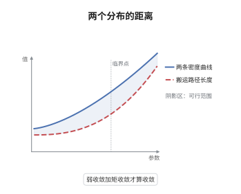

# Wasserstein 距离的度量性质

> **一句话大白话**：把两个分布之间的"运费"开 $p$ 次方根，就得到一个真正的距离 $W_p$；它比"弱收敛"更强一点，除了要求分布逐渐重合，还要求 $p$ 阶矩也不逃到无穷远。
>
> **小例子**：$\mu_n=\delta_{1/n}$、$\mu=\delta_0$，$p=2$ 时 $W_2(\mu_n,\mu)=1/n\to0$；但若 $\mu_n=(1-\tfrac1n)\delta_0+\tfrac1n\delta_n$，则 $\mu_n\to\delta_0$ 弱收敛，而 $W_2^2=\tfrac1n\cdot n^2=n\to\infty$，说明弱收敛不足以保证 $W_p$ 收敛。

## 介绍

给定完备可分度量空间 $X$ 与 $p\ge1$，$p$-Wasserstein 距离定义为
$$
W_p(\mu,\nu)=\left(\inf_{\pi\in\Pi(\mu,\nu)}\int d(x,y)^p\,\mathrm d\pi\right)^{1/p},
$$
它是"把 $\mu$ 搬成 $\nu$ 的最省运费"的 $p$ 次根。本节说明：$W_p$ 确实是 $\mathcal P_p(X)$ 上的度量，而且它给出的拓扑恰好是"弱收敛 + $p$ 阶矩收敛"。这条刻画把最优传输从几何工具变成了概率测度空间上的度量工具，使 $(\mathcal P_p(X),W_p)$ 成为可以谈测地线、梯度流的完备空间。

## 几何直观

图意在说明：$W_p$ 量的是两条密度曲线之间的"搬土总功"，两峰离得越远、需要搬的质量越多，距离就越大；它同时看见曲线的形状差异与位置差异，因此比只看累积分布差上确界的距离更能反映几何位移。

## 分析

**前置依赖**：Kantorovich 松弛、弱收敛与 Prokhorov 定理、gluing 引理、Kantorovich–Rubinstein 对偶。

**数学内涵**：
- 三角不等式靠"粘合"：把 $\mu_1$ 到 $\mu_2$ 与 $\mu_2$ 到 $\mu_3$ 的最优计划沿中间的 $\mu_2$ 拼接成 $X^3$ 上的计划，再用 Minkowski 不等式。
- 拓扑刻画：$W_p(\mu_n,\mu)\to0$ 当且仅当 $\mu_n\rightharpoonup\mu$ 且 $\int d(x_0,x)^p\,\mathrm d\mu_n\to\int d(x_0,x)^p\,\mathrm d\mu$。$p$ 阶矩条件不可省：原子逃向无穷时弱收敛成立而 $W_p$ 发散。
- 适用边界：$p<1$ 时 $d^p$ 不再是度量，$W_p$ 只是"代价"而非距离；$p=\infty$ 需另行定义为本质上确界，且不再由上述矩条件刻画。

**结构**：
1. 用 gluing 引理把两个最优计划拼成三元计划，验证三角不等式。
2. 由 $W_p\to0$ 推出弱收敛（用有界 Lipschitz 检验函数）与 $p$ 阶矩收敛（用初等不等式加 Hölder）。
3. 反向：先由矩有界得一致紧，再把测度截断到紧集上，在紧集上借 Kantorovich–Rubinstein 公式与 Arzelà–Ascoli 得 $W_1\to0$，最后用 Hölder 把 $W_p$ 换成 $W_1$。

## 思考过程

Monge 与 Kantorovich 给出的只是一个"最优值"，要把它变成距离，必须验证正定性与三角不等式。正定性容易；三角不等式的障碍是：两个最优计划并不共享同一个中间空间，无法直接相加。gluing 引理解决了这一点——只要中间测度相同，就能用条件测度把两个计划"缝"起来，缝出来的三元计划在 $(1,2)$ 与 $(2,3)$ 上的边际正好是原来的计划。剩下的就是 $L^p$ 的 Minkowski 不等式。拓扑刻画则更微妙：$W_p$ 收敛自动蕴含弱收敛，因为 $1$-Lipschitz 函数是最灵敏的检验函数；反过来，弱收敛只控制有界连续函数，对"质量跑到远处"完全无感，必须额外要求矩收敛才能拦住。这一认识在 1990 年代由 Sturm 与 Villani 系统化。

## 证明过程

**定理**：设 $(X,d)$ 完备可分，$p\ge1$，$\mathcal P_p(X)$ 为 $p$ 阶矩有限的概率测度全体。则 (i) $W_p$ 是 $\mathcal P_p(X)$ 上的有限度量；(ii) $(\mathcal P_p(X),W_p)$ 完备可分；(iii) $W_p(\mu_n,\mu)\to0$ 当且仅当 $\mu_n\rightharpoonup\mu$ 且对某个（等价地对一切）$x_0\in X$ 有 $\int d(x_0,x)^p\,\mathrm d\mu_n\to\int d(x_0,x)^p\,\mathrm d\mu$。

**证明**：

### 1. 三角不等式

设 $\pi_{12}$、$\pi_{23}$ 分别是 $(\mu_1,\mu_2)$、$(\mu_2,\mu_3)$ 的最优计划。由分解定理，存在 Borel 核 $x\mapsto\pi^{1|2}_x$ 使 $\pi_{12}(\mathrm dx\,\mathrm dy)=\mu_2(\mathrm dy)\otimes\pi^{1|2}_x(\mathrm dx)$。定义 $X^3$ 上的测度
$$
\mathrm d\pi(x,y,z)=\mu_2(\mathrm dy)\,\pi^{1|2}_y(\mathrm dx)\,\pi^{2|3}_y(\mathrm dz),
$$
它的 $(1,2)$、$(2,3)$ 边际恰为 $\pi_{12},\pi_{23}$（这是 gluing 引理）。其 $(1,3)$ 边际是 $(\mu_1,\mu_3)$ 的一个耦合，故
$$
W_p(\mu_1,\mu_3)\le\left(\int d(x,z)^p\,\mathrm d\pi\right)^{1/p}\le\left(\int\big(d(x,y)+d(y,z)\big)^p\,\mathrm d\pi\right)^{1/p}.
$$
对 $L^p$ 用 Minkowski 不等式，右端不超过
$$
\left(\int d(x,y)^p\,\mathrm d\pi_{12}\right)^{1/p}+\left(\int d(y,z)^p\,\mathrm d\pi_{23}\right)^{1/p}=W_p(\mu_1,\mu_2)+W_p(\mu_2,\mu_3).
$$

### 2. 正定与有限性

$W_p\ge0$ 且由 $d^p\ge0$ 有限（因两个测度都有 $p$ 阶矩，取乘积耦合即得有限上界）。若 $W_p(\mu,\nu)=0$，则存在 $\pi$ 使 $\int d^p\,\mathrm d\pi=0$，即 $x=y$ 在 $\pi$-几乎处处成立，于是对任意有界连续 $f$ 有 $\int f\,\mathrm d\mu=\int f(x)\,\mathrm d\pi=\int f(y)\,\mathrm d\pi=\int f\,\mathrm d\nu$，故 $\mu=\nu$。

### 3. 收敛蕴含弱收敛与矩收敛

设 $W_p(\mu_n,\mu)\to0$。因 $W_1\le W_p$，对任意有界 Lipschitz 的 $f$，
$$
\left|\int f\,\mathrm d(\mu_n-\mu)\right|\le\mathrm{Lip}(f)\,W_1(\mu_n,\mu)\le\mathrm{Lip}(f)\,W_p(\mu_n,\mu)\to0,
$$
故 $\mu_n\rightharpoonup\mu$。取 $\pi_n$ 为最优计划，用初等不等式 $\big||a|^p-|b|^p\big|\le p|a-b|\big(|a|^{p-1}+|b|^{p-1}\big)$（$a=d(x_0,x)$、$b=d(x_0,y)$）与 Hölder 不等式，
$$
\left|\int d(x_0,x)^p\,\mathrm d\mu_n-\int d(x_0,x)^p\,\mathrm d\mu\right|\le p\,W_p(\mu_n,\mu)\left(\int\big(|a|^{p-1}+|b|^{p-1}\big)^{\frac{p}{p-1}}\,\mathrm d\pi_n\right)^{\frac{p-1}{p}},
$$
右端因矩有界而趋于 $0$。

### 4. 反向：截断到紧集

设 $\mu_n\rightharpoonup\mu$ 且 $p$ 阶矩收敛。则 $M:=\sup_n\int d(x_0,x)^p\,\mathrm d\mu_n<\infty$，故 $\{\mu_n\}$ 一致紧：给定 $\varepsilon>0$ 可取 $R$ 使球外质量对应的 $p$ 阶矩小于 $\varepsilon$。令 $\nu_n,\nu$ 为 $\mu_n,\mu$ 在球 $B_R$ 上的限制重归一化，则 $\nu_n\rightharpoonup\nu$，且 $B_R$ 紧。由 Kantorovich–Rubinstein 公式，$W_1(\nu_n,\nu)=\sup_{\mathrm{Lip}(f)\le1}\int f\,\mathrm d(\nu_n-\nu)$；$B_R$ 上 1-Lipschitz 函数族被 $d(x_0,\cdot)$ 界住且等度连续，由 Arzelà–Ascoli 紧，故有有限 $\delta$-网 $f_1,\dots,f_N$，于是 $W_1(\nu_n,\nu)\to0$。再用 Hölder（$\mathrm{diam}\,B_R\le 2R$）
$$
W_p(\nu_n,\nu)\le(2R)^{1-1/p}\,W_1(\nu_n,\nu)^{1/p}\to0 .
$$

### 5. 拼回原测度

由三角不等式与乘积耦合的估计，
$$
W_p^p(\mu_n,\mu)\le 3^{p-1}\Big(W_p^p(\mu_n,\nu_n)+W_p^p(\nu_n,\nu)+W_p^p(\nu,\mu)\Big),
$$
其中首末两项由球外质量被 $\varepsilon$ 控制（乘积耦合给出 $W_p^p(\mu_n,\nu_n)\le2^{p-1}\big(\int_{B_R^c}d^p\,\mathrm d\mu_n+\int d(x_0,y)^p\,\mathrm d\nu_n\big)\le C\varepsilon$），中间项由第 4 步趋于零。先令 $n\to\infty$ 再令 $\varepsilon\to0$，得 $W_p(\mu_n,\mu)\to0$。

### 6. 结论

第 1、2 步给出度量性质，第 3、4、5 步给出拓扑刻画。完备性随之而来：$W_p$-Cauchy 列一致紧、有弱收敛子列 $\mu$，第 5 步的论证（把 $\mu_n$ 换成 Cauchy 列）给出整列 $W_p$-收敛到 $\mu$；可分性由稠密的有限支撑有理系数测度给出。$\square$

## 课堂问答

**老师**：既然 $\mu_n\rightharpoonup\mu$ 已经是很强的收敛，为什么还要 $W_p$？

**学生**：弱收敛看不见"质量跑远"。例如 $\mu_n=(1-\tfrac1n)\delta_0+\tfrac1n\delta_n$ 弱收敛到 $\delta_0$，但 $W_2^2(\mu_n,\delta_0)=n\to\infty$。$W_p$ 把位置信息编码进代价，因此在需要比较"形状与位置同时变化"的分布时更合适，例如图像、点云与 PDE 的梯度流。

**老师（追问）**：三角不等式的证明里，哪一步是关键的、不能省的？

**学生**：关键是把两个最优计划"缝"成同一个空间 $X^3$ 上的计划，即 gluing 引理：只有当两个计划的中间边际是同一个 $\mu_2$ 时，才能用条件测度把它们拼起来。拼好之后，$(1,3)$ 边际给出 $\mu_1$ 到 $\mu_3$ 的可行计划，再用 Minkowski 不等式即得。缺少共同的中间测度，这一步完全失效。

**老师（拓展）**：$(\mathcal P_p(X),W_p)$ 还有什么结构？

**学生**：它是完备可分度量空间，$X$ 紧时 $\mathcal P_p(X)$ 也紧（Prokhorov）。$p>1$ 时它还是"形式黎曼流形"：切空间可等同于梯度场，测地线就是位移插值，这给出 Benamou–Brenier 公式；$p=1$ 时结构不同，$W_1$ 由 Kantorovich–Rubinstein 对偶刻画，测地线一般不唯一，因此 $W_2$ 才是研究梯度流的首选。
