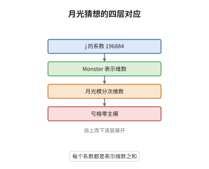

# Monstrous Moonshine与Borcherds证明

> **一句话大白话**：模函数 $j$ 的 Fourier 系数 196884、21493760 等等，恰好是 Monster 群不可约表示维数的和；Borcherds 在 1992 年用一个顶点代数把这件事证成了定理。
>
> **小例子**：$196884=196883+1$，其中 $196883$ 是 Monster 最小的非平凡不可约表示的维数，$1$ 是平凡表示；这就是月光模权 $1$ 空间的分解。

## 介绍

1978 年 McKay 注意到 $196884=196883+1$，前者是模函数 $j$ 的 $q$ 系数，后者是 Monster 群——最大的散在单群——最小非平凡表示的维数。Conway 与 Norton 在 1979 年把这个巧合提升为猜想：存在一个分次 Monster 模，其分次维数正是 $j-744$ 的系数；并且对每个群元素 $g$，其迹函数都是亏格零函数。Frenkel、Lepowsky 与 Meurman 在 1988 年用 Leech 格的顶点代数构造出候选对象 $V^\natural$，称为月光模。Borcherds 在 1992 年证明它确实满足全部猜想，用的是顶点代数、广义 Kac-Moody 代数与 no-ghost 定理。这是有限群、模形式与量子场论三条线索的交汇点，也为他赢得了 1998 年的 Fields 奖。

## 几何直观

图意在说明：最上层是 $j$ 的系数序列，往下对应 Monster 不可约表示维数的组合，再往下落到月光模各权空间的维数，最底层是每个群元素的迹函数所满足的亏格零性质；四层是同一组数字的不同解释。

## 分析

**前置依赖**：顶点算子代数、有限群表示、模函数；另需 Leech 格与 orbifold 构造的基本概念。

**数学内涵**：
- $j(\tau)=q^{-1}+744+\sum_{n\ge1}c(n)q^n$，其中 $c(1)=196884$、$c(2)=21493760$、$c(3)=864299970$；月光模的配分函数取的是 $J(\tau)=j(\tau)-744$。
- $V^\natural=\bigoplus_{n\ge-1}V^\natural_n$ 满足 $\dim V^\natural_n=c(n)$（约定 $c(-1)=1$、$c(0)=0$），带有 Monster 作用，中心荷为 $24$，由 Leech 格顶点代数的 $\mathbb Z/2$-orbifold 得到。
- 常见误区：并非"每个系数等于某个不可约表示的维数"，而是等于若干不可约表示维数之和；真正困难的是等变版本——每个 $g$ 的迹函数 $T_g$ 都要是亏格零群的主模。

**结构**：
1. 用 Leech 格顶点代数及其 orbifold 造出 $V^\natural$，并识别 Monster 作用。
2. 用 $V^\natural$ 造 Monster Lie 代数，其分母恒等式给出 $j$ 的无穷乘积。
3. 比较乘积与级数的系数，得到每个 $T_g$ 的模性与极点，从而证明亏格零性质。

## 思考过程

最初的困难是"猜想的表述本身就不清楚"：Monster 是一个 $8\times10^{53}$ 阶的单群，没有任何几何对象自然地承载它。FLM 的想法来自弦论：Leech 格的顶点代数是 24 维自由玻色子的实现，把它对中心反演作 orbifold，恰好得到中心荷 $24$ 的候选对象；他们证明其自同构群包含 Monster，且配分函数正是 $J$。剩下的问题是如何证明等变部分。Borcherds 的关键一步是反过来用：把 $V^\natural$ 的物理态空间做成一个广义 Kac-Moody 代数，其根重数由 $j$ 的系数给出，而分母恒等式自动产生 $j(\sigma)-j(\tau)$ 的乘积公式。有了乘积公式，每个 $T_g$ 的函数方程就只剩模性与极点两条，而这两条正好刻画亏格零函数。

## 证明过程

**定理**（Borcherds 1992）：存在分次 Monster 模 $V^\natural=\bigoplus_{n\ge-1}V_n$，使 $j(\tau)-744=\sum_{n\ge-1}c(n)q^n$ 且 $\dim V_n=c(n)$；对每个 $g\in\mathbb M$，迹函数 $T_g(\tau)=\sum_n\operatorname{tr}(g|V_n)q^{n-1}$ 是其亏格零群 $\Gamma_g$ 上的主模。特别地 $V^\natural$ 的配分函数等于 $J$。

**证明**：

### 1. 月光模的构造

取 Leech 格 $\Lambda$ 的顶点算子代数 $V_\Lambda$（中心荷 $24$），对中心反演 $\theta$ 作 orbifold，得 $V^\natural=V_\Lambda^{+}\oplus V_\Lambda^{\mathrm{tw},+}$。FLM 证明 $V^\natural$ 是顶点算子代数，$\operatorname{Aut}(V^\natural)$ 包含 Monster，且其分次维数为 $c(n)$。

### 2. Monster Lie 代数与分母恒等式

以 $V^\natural$ 的态为根空间造 Monster Lie 代数 $\mathfrak m$，由 no-ghost 定理算得根重数恰为 $c(mn)$。其分母恒等式为

$$
p^{-1}\prod_{m>0}\ \prod_{n\in\mathbb Z}(1-p^mq^n)^{c(mn)}=j(\sigma)-j(\tau),
$$

其中 $p=\mathrm e^{2\pi\mathrm i\sigma}$、$q=\mathrm e^{2\pi\mathrm i\tau}$。这一步把 $j$ 的加法展开翻译成乘法展开。

### 3. 等变迹函数与亏格零

把分母恒等式中的 $q$ 换成 $\mathrm e^{2\pi\mathrm i g}$ 意义下的等变版本，得到 $T_g$ 的乘积公式；它给出 $T_g$ 在 $\mathrm{SL}_2(\mathbb Z)$ 某子群 $\Gamma_g$ 下的模变换性质，以及在尖点处形如 $q^{-1}+O(q)$ 的极点结构。亏格为零的模函数由"极点阶数 + 模性"唯一确定，故 $T_g$ 是 $\Gamma_g$ 的主模，Conway–Norton 猜想成立。$\square$

## 课堂问答

**老师**：Moonshine 猜想到底在说什么？为什么它不只是一个数值巧合？

**学生**：它说存在一个分次 Monster 模，其每个权空间的维数就是 $j-744$ 的系数，而且这个模带有顶点算子代数结构。若只是数值巧合，就无法解释为什么所有系数同时对上、还要满足等变的亏格零性质；$V^\natural$ 的存在把这些数字组织成一个整体。

**老师（追问）**：Borcherds 为什么要造一个 Lie 代数，而不直接算 $V^\natural$ 的迹？

**学生**：因为等变迹函数的模性很难从顶点代数直接读出。造出 Monster Lie 代数后，分母恒等式把 $j$ 的系数变成根重数，乘积公式自动携带模变换信息；再由极点和模性确定函数，就把"算迹"化归为"验证函数方程"。

**老师（拓展）**：Monster 之外还有别的 Moonshine 吗？

**学生**：有。Conway–Norton 猜想被证明后，人们发现其他散在群也有类似现象，如 Thompson Moonshine、Norton 的 generalized Moonshine，以及后来的 Mathieu Moonshine；它们大多仍以顶点代数或相关结构为实现工具，说明这条思路不是孤例。
