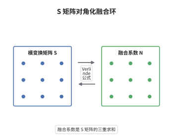

# Verlinde公式

> **一句话大白话**：融合系数可以写成模变换矩阵 $S$ 的三重求和，也就是说融合环被 $S$ 矩阵对角化。
>
> **小例子**：$\mathfrak{sl}_2$ 的 level $1$ 理论只有两个不可约模，标号为 $0$ 与 $\frac12$，此时 $S_{00}=S_{0\frac12}=S_{\frac12 0}=\frac{1}{\sqrt2}$、$S_{\frac12\frac12}=-\frac{1}{\sqrt2}$，公式给出 $N_{\frac12,\frac12}^{\,0}=1$，即 $\sigma\boxtimes\sigma=\mathbf 1$。

## 介绍

Verlinde 在 1988 年研究有理共形场论时发现：融合系数不是一个需要逐个计算的新数据，它完全由模变换矩阵 $S$ 决定。$S$ 是特征标在 $\tau\mapsto-1/\tau$ 下的变换矩阵，属于模数据；而融合系数描述模的张量积，属于表示论数据。Verlinde 公式说这两套数据互为表里，因而等价。对 WZW 模型，这条公式先后由 Tsuchiya–Ueno–Yamada 与 Faltings 用共形块方法证明；对一般有理顶点算子代数，Huang 在 2005 年由模张量范畴的存在性推出它。今天它是构造融合环、计算任意子聚变规则的标准工具。

## 几何直观

图意在说明：左边的 $S$ 来自环面上特征标的模变换（几何数据），右边的 $N$ 来自模的张量积（表示论数据），箭头表示两者由一条显式求和公式互相决定，任何一侧的知识都足以复原另一侧。

## 分析

**前置依赖**：模张量范畴、模不变性；另需 Zhu 的特征标理论与融合规则的定义。

**数学内涵**：
- 公式为 $N_{ij}^{\,k}=\sum_l S_{il}S_{jl}\overline{S_{kl}}/S_{0l}$，其中 $S$ 是 $\tau\mapsto-1/\tau$ 的模变换矩阵，$S_{0l}$ 取真空所在行作归一化，共轭来自幺正性 $S^{-1}=\overline S^{\,T}$。
- 等价说法：融合矩阵 $N_i$ 的共同本征向量由 $S$ 的列给出，本征值为 $S_{il}/S_{0l}$；公式只是把这一对角化用 Fourier 反演写开。
- 常见误区：必须假设 $S_{0l}\ne0$ 且矩阵幺正；对非有理或非半单情形，公式需要推广（伪迹、对数模、一般化融合）。

**结构**：
1. 由模张量范畴的半单性，融合环是有限维半单代数。
2. 用环面一点函数的模变换证明 $S$ 的列给出融合环的特征标。
3. 对特征标作 Fourier 反演，得到三重求和公式。

## 思考过程

Verlinde 的原始论证来自环面：在环面上插入一个算子再取迹，模变换 $S$ 会把这个态"翻转"成一组基本态的和，系数正是 $S_{il}$。另一方面，融合系数控制的正是把一个模插进环面后展开成哪些模。把两种展开对比，就得到融合矩阵与 $S$ 的关系。真正的困难在于证明这些展开确实收敛、以及 $S$ 确实可逆；前者需要 $C_2$ 余有限带来的有限维性，后者需要模张量范畴的非退化辫子。这也解释了为什么 Verlinde 公式在数学上迟至 2005 年才被 Huang 对一般有理顶点算子代数证完：缺的不是公式，而是范畴层面的基础。

## 证明过程

**定理**：设 $V$ 是有理且 $C_2$ 余有限的顶点算子代数，$M_0=V,M_1,\dots,M_{n-1}$ 为全部不可约模，$S=(S_{ij})$ 为特征标在 $\tau\mapsto-1/\tau$ 下的变换矩阵。则融合系数满足

$$
N_{ij}^{\,k}=\sum_{l=0}^{n-1}\frac{S_{il}\,S_{jl}\,\overline{S_{kl}}}{S_{0l}} .
$$

**证明**：

### 1. 融合环半单

由模张量范畴的结构，$\mathrm{Mod}(V)$ 半单且只有 $n$ 个单对象，故融合环 $K_0$ 是 $n$ 维半单交换代数，同构于 $\mathbb C^n$。于是存在 $n$ 个特征标 $\lambda^{(l)}$，使 $N_i$ 在 $l$ 分量上作用为 $\lambda^{(l)}_i$，且 $N_{ij}^{\,k}$ 由这些特征标唯一决定。

### 2. 特征标由 S 给出

在环面上插入第 $i$ 个模的算子并取迹，模变换 $\tau\mapsto-1/\tau$ 把该态写成基本态 $\chi_l$ 的线性组合，系数为 $S_{il}$。与融合展开比较，$N_i$ 在 $l$ 分量上的作用恰为乘以 $S_{il}/S_{0l}$，故

$$
\lambda^{(l)}_i=\frac{S_{il}}{S_{0l}} .
$$

### 3. 对角化与求和

记融合矩阵 $(N_i)_{jk}=N_{ij}^{\,k}$。本征方程 $N_iS^{(l)}=(S_{il}/S_{0l})S^{(l)}$ 说明 $S$ 的第 $l$ 列是 $N_i$ 的本征向量，故

$$
N_i=S\,\mathrm{diag}\Big(\frac{S_{i0}}{S_{00}},\dots,\frac{S_{i,n-1}}{S_{0,n-1}}\Big)S^{-1}.
$$

由 $S$ 幺正且对称得 $(S^{-1})_{lk}=\overline{S_{kl}}$，取矩阵元即得

$$
N_{ij}^{\,k}=\sum_l S_{jl}\frac{S_{il}}{S_{0l}}\overline{S_{kl}}=\sum_l\frac{S_{il}S_{jl}\overline{S_{kl}}}{S_{0l}} .
$$

一致性由 $(ST)^3=S^2=C$ 保证：它使 $S$ 的列彼此正交，故上式必给出非负整数。$\square$

## 课堂问答

**老师**：Verlinde 公式为什么能用一个矩阵的三重求和算出融合系数？

**学生**：因为融合环是半单交换代数，$n$ 维半单交换代数由它的 $n$ 个特征标完全决定。模变换矩阵 $S$ 的列恰好给出这些特征标，即 $N_i$ 在第 $l$ 个分量上的本征值是 $S_{il}/S_{0l}$；把结构常数按特征标展开，就得到这个三重求和。

**老师（追问）**：公式里的 $S_{0l}$ 起什么作用，能不能去掉？

**学生**：不能。$S_{0l}$ 是真空模那一行的分量，它把特征标归一化成 $1$（因为 $S_{00}$ 对应单位模），从而使 $N_{ij}^{\,k}$ 取整数值；去掉归一化后公式只在对 $S$ 作特定标度时成立，也失去"融合系数是非负整数"的直观。

**老师（拓展）**：如果理论不是有理的，公式会怎样失效？

**学生**：融合环不再半单，特征标不再给出完整的对角化，$S$ 可能不可逆，$S_{0l}$ 甚至可能为零；此时需要用到伪迹、对数模或一般化的融合张量，Verlinde 公式只剩形式上的类比。这说明公式的成立依赖"半单 + 非退化"这一整套结构。
