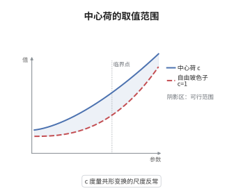

# Virasoro代数与中心荷

> **一句话大白话**：Virasoro 代数是 Witt 代数（圆上的多项式向量场）的一维中心扩张，多出的那个中心元素 $c$ 叫中心荷，它度量共形对称在量子化后被破坏的程度。
>
> **小例子**：一个自由玻色子给出 $c=1$，两个独立自由玻色子给出 $c=2$；临界 Ising 模型给出 $c=\frac12$，而玻色弦只有在 $c=26$ 时才无共形反常。

## 介绍

Witt 代数由 $L_n=-z^{n+1}\mathrm d/\mathrm dz$ 张成，满足 $[L_m,L_n]=(m-n)L_{m+n}$，它是圆上共形变换的李代数。把它作一维中心扩张，就得到 Virasoro 代数，括号里多出一项 $\frac{c}{12}(m^3-m)\delta_{m+n,0}$，常数 $c$ 称为中心荷（central charge）。在二维共形场论中 $c$ 同时扮演三个角色：能量动量张量迹反常的系数、圆周上真空能 $-\frac{c}{24}$ 的来源、以及环面配分函数在模变换下的权重。它把"经典共形对称"与"量子化之后剩下的对称"之间的差距量化了。由于 Witt 代数的二阶上同调是一维的，这个扩张在相差常数倍的意义下唯一。

## 几何直观

图意在说明：幺正极小模型的中心荷只能取离散值 $c=1-\frac{6}{m(m+1)}$ 并单调逼近 $1$，而自由玻色子的中心荷沿整数轴线性增长，每加一个玻色子就加 $1$；两类理论的 $c$ 取值方式截然不同。

## 分析

**前置依赖**：李代数、Witt 代数；另需共形向量 $\omega$ 与顶点代数的基本语言。

**数学内涵**：
- 括号为 $[L_m,L_n]=(m-n)L_{m+n}+\frac{c}{12}(m^3-m)\delta_{m+n,0}$，其中 $c$ 与所有 $L_n$ 交换，因而张成中心。
- 在顶点代数中取 $\omega=L_{-2}\mathbf 1$，则 $Y(\omega,z)=\sum_nL_nz^{-n-2}$，且 $L_2\omega=\frac{c}{2}\mathbf 1$，即 $c$ 由 $\omega$ 的两点函数唯一确定。
- 常见误区：$c$ 不是空间维数，也不必为正——Lee-Yang 模型的 $c=-\frac{22}{5}$；幺正性要求 $c\ge0$ 且 $L_0$ 的谱有下界，但 $c$ 相同并不意味着两个理论相同。

**结构**：
1. 写出 Witt 代数并检查扩张括号满足 Jacobi 恒等式。
2. 在顶点代数中用共形向量 $\omega$ 实现这些模式，读出 $c$。
3. 对自由玻色子直接计算算符乘积展开，验证 $c=1$。

## 思考过程

Witt 代数本身没有中心，为什么量子化后必须扩张？根源是正规序：把能量动量张量相乘时，无穷多个振荡模式需要重新排序，减法留下的有限残余正是 $c$ 项。这在一维是"正规序导致的不对易"，在高维就是著名的迹反常。Virasoro 在 1969 年研究弦的振谱时写下这个括号，当时 $c$ 只是使理论自洽的常数；Belavin、Polyakov、Zamolodchikov 在 1984 年把它变成共形场论的分类工具，才发现 $c<1$ 的离散值对应极小模型。关键的数学想法是：中心扩张由二阶上同调分类，而 Witt 代数的二阶上同调一维，所以除 $c$ 之外没有别的选择。

## 证明过程

**定理**：设 $[L_m,L_n]=(m-n)L_{m+n}$ 为 Witt 代数。则其括号

$$
[L_m,L_n]=(m-n)L_{m+n}+\frac{c}{12}(m^3-m)\delta_{m+n,0},\qquad [c,L_n]=0
$$

定义了一个一维中心扩张，$c$ 为任意复常数；且在顶点算子代数中 $c$ 由共形向量 $\omega$ 决定。

**证明**：

### 1. 验证 Jacobi 恒等式

记 $f(k)=\frac{c}{12}(k^3-k)$，则新增项为 $f(m)\delta_{m+n,0}$。中心项进入 Jacobi 恒等式后，三项只能同时非零，此时 $p=-m-n$，条件化为

$$
(m-n)f(m+n)-(m+2n)f(m)+(2m+n)f(n)=0 .
$$

把 $f(k)$ 拆成 $k^3$ 与 $k$ 两部分分别代入即知该式成立（两项都是该齐次方程的解），故括号满足 Jacobi 恒等式，得到李代数。$[c,L_n]=0$ 说明 $c$ 是中心元素。

### 2. 由共形向量读出中心荷

在顶点代数中令 $\omega=L_{-2}\mathbf 1$，$Y(\omega,z)=\sum_nL_nz^{-n-2}$。由 Borcherds 恒等式，$Y(\omega,z)Y(\omega,w)$ 的极点最高四阶，且

$$
Y(\omega,z)Y(\omega,w)\sim\frac{c/2}{(z-w)^4}+\frac{2Y(\omega,w)}{(z-w)^2}+\frac{\partial Y(\omega,w)}{z-w},
$$

取 $(z-w)^{-4}$ 与 $(z-w)^{-2}$ 的系数即得上述括号。特别地 $L_2\omega=\frac{c}{2}\mathbf 1$，故 $c$ 完全由 $\omega$ 决定。

### 3. 自由玻色子的计算

对秩一自由玻色子，$\partial\varphi(z)\partial\varphi(w)\sim(z-w)^{-2}$，取 $T(z)=\frac12{:}\partial\varphi(z)\partial\varphi(z){:}$。由 Wick 定理收缩四项，得

$$
T(z)T(w)\sim\frac{1/2}{(z-w)^4}+\frac{2T(w)}{(z-w)^2}+\frac{\partial T(w)}{z-w},
$$

与一般公式中的 $\frac{c/2}{(z-w)^4}$ 对比，得 $c=1$。$c$ 对独立系统可加，故 $n$ 个自由玻色子给出 $c=n$，这正是"每增加一个玻色子就加一"的来源。$\square$

## 课堂问答

**老师**：中心荷 $c$ 究竟是数学参数还是物理量？为什么它必须是常数？

**学生**：它在数学上是中心扩张的系数，在物理上是尺度反常的强度。它必须与所有 $L_n$ 交换，即属于代数的中心；否则 $c$ 会被共形变换改变，能量动量张量的迹就不再是常数，理论也就没有确定的"尺度"。

**老师（追问）**：证明的第一步为什么要单独验算 Jacobi 恒等式？反对称不是显然的吗？

**学生**：反对称确实由 $\delta_{m+n,0}$ 与 $m^3-m$ 的奇性给出，但括号能否成为李代数取决于 Jacobi 恒等式，而新增的中心项恰恰可能破坏它。把三项都非零的情形化为一个关于 $f$ 的三项递推，才能确认 $f(k)=k^3-k$ 是合格的 2-上闭链。

**老师（拓展）**：$c$ 能不能取负值？负值意味着什么？

**学生**：能，Lee-Yang 模型的 $c=-\frac{22}{5}$ 就是例子。负的 $c$ 意味着理论非幺正，表示空间里出现负模的态；幺正性要求 $c\ge0$ 且 $L_0$ 谱有下界。这也说明 $c$ 相同并不代表理论相同，$c$ 只是共形数据的一个粗指纹。
