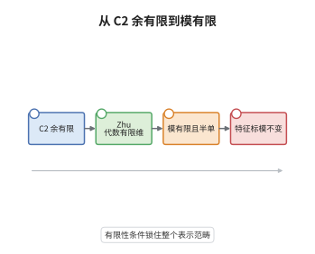

# Zhu 代数与 $C_2$ 余有限性

> **一句话大白话**：$C_2$ 余有限是一条"二次生成"的有限性条件，它保证顶点算子代数的 Zhu 代数有限维，从而不可约模只有有限多个。
>
> **小例子**：秩一自由费米子（临界 Ising 型）的顶点算子代数满足 $C_2$ 余有限，它恰有 $3$ 个不可约模，其 Zhu 代数同构于 $\mathbb C\oplus\mathbb C\oplus\mathbb C$。

## 介绍

顶点算子代数的表示论长期缺少一个像"有限维结合代数表示论"那样的抓手。Zhu 在 1996 年给出一个巧妙构造：把 $V$ 商掉由 $a\circ b$ 张成的子空间，得到一个结合代数 $A(V)$，称为 Zhu 代数，并证明 $V$ 的 admissible 模与 $A(V)$ 的左模在低权部分上是同一回事。问题是 $A(V)$ 未必有限维。$C_2$ 余有限性正是让 $A(V)$ 有限维的条件：它要求由所有二次乘积 $a_{(-2)}b$ 张成的子空间 $C_2(V)$ 在 $V$ 中余维有限。Wang 在 1993 年证明这两件事等价。于是"表示只有有限多个"这个整体性质，被一条可以逐项验算的代数条件替代了。

## 几何直观

图意在说明：从二次乘积张成的子空间出发，余维有限推出 Zhu 代数有限维，再推出不可约模只有有限多个、且特征标满足模不变性，四步构成一条单向的推理链。

## 分析

**前置依赖**：顶点算子代数、Zhu 代数；另需 $C_2$ 子空间的定义与结合代数的半单性。

**数学内涵**：
- 定义 $C_2(V)=\operatorname{span}\{a_{(-2)}b:a,b\in V\}$，称 $V$ 为 $C_2$ 余有限，若 $\dim V/C_2(V)<\infty$。
- Zhu 代数 $A(V)=V/O(V)$，其中 $O(V)$ 由 $a\circ b=\operatorname{Res}_zY(a,z)b\,(1+z)^{\mathrm{wt}\,a}z^{-2}$ 张成，乘法为 $a*b=\operatorname{Res}_zY(a,z)b\,(1+z)^{\mathrm{wt}\,a}z^{-1}$。
- 常见误区：$C_2$ 余有限并不自动推出有理——存在 $C_2$ 余有限但非有理的例子；有理加 $C_2$ 余有限才等价于正则性（Abe–Buhl–Dong）。

**结构**：
1. 用 $C_2$ 余有限控制二次生成，证明每个权空间有限维。
2. 在权过滤下把 $\operatorname{gr}A(V)$ 看成 $V/C_2(V)$ 的商，得 $\dim A(V)<\infty$。
3. 用 Zhu 的对应定理把不可约模等同于 $A(V)$ 的单模，得模有限。

## 思考过程

Zhu 的动机很实际：他要证明特征标的模不变性，而这需要一个有限维代数来承载"插入算子的迹"。直接取 $V$ 太大，必须商掉一些关系；商掉什么才不损失表示信息？答案是商掉那些在迹里自动消失的项，即以 $a\circ b$ 为生成元的子空间。剩下的问题是如何保证商有限维，这就要靠 $C_2$：若二次乘积已经张成 $V$ 的绝大部分，那么高次乘积都能用二次项重写，$A(V)$ 自然有限维。Wang 后来补上反向：$A(V)$ 有限维时 $C_2$ 必余有限，两者其实等价。这条线索解释了为什么"有理"这个看似表示论的条件，可以用一条纯代数的有限生成条件来检验。

## 证明过程

**定理**：设 $V$ 是顶点算子代数。则 $V$ 是 $C_2$ 余有限的当且仅当 Zhu 代数 $A(V)$ 有限维。若再有 $V$ 有理，则 $A(V)$ 半单，$V$ 的不可约模恰为 $A(V)$ 的单模，个数有限。

**证明**：

### 1. 由余有限得到权空间有限

设 $\dim V/C_2(V)=d<\infty$，取代表元 $v_1,\dots,v_d$。任意 $a\in V$ 可写成 $\sum_ic_iv_i+c$，其中 $c\in C_2(V)$ 是二次乘积之和。对权数作下降归纳，可把任意元素写成 $v_i$ 与若干二次项的组合，于是 $V$ 由 $v_1,\dots,v_d$ 二次生成，每个权空间 $V_n$ 有限维。

### 2. Zhu 代数有限维

在按 $L_0$ 权给出的过滤下，$a\circ b$ 的最高权项恰为二次乘积 $a_{(-2)}b$，低权项可递归消去，故 $\operatorname{gr}A(V)$ 是 $V/C_2(V)$ 的商，从而

$$
\dim A(V)\le\dim V/C_2(V)=d<\infty .
$$

反向由 Wang 的论证：若 $A(V)$ 有限维，则 $V$ 由有限多个元素二次生成，故 $V/C_2(V)$ 有限维。

### 3. 模的有限性与半单性

Zhu 的对应定理给出：$V$ 的 admissible 模与 $A(V)$ 的左模之间存在范畴等价（在低权部分上）。于是不可约 admissible 模与 $A(V)$ 的单模一一对应。若 $V$ 有理，其 admissible 模完全可约，$A(V)$ 必半单，单模个数等于 $\dim A(V)$ 的分解块数，故有限。$\square$

## 课堂问答

**老师**：$C_2$ 余有限为什么盯住"二次"乘积，而不是一次或三次？

**学生**：二次乘积对应权数最低的非平凡项，正是权过滤下 $a\circ b$ 的最高权项；用二次项做商，既能保证高次乘积可递推降阶，又不会伤及真正携带表示信息的低权部分。一次乘积不足以生成整个 $V$，三次以上又商得太少，都得不到有限维。

**老师（追问）**：定理为什么还要求"有理"这个额外假设？$C_2$ 余有限本身不够吗？

**学生**：不够。$C_2$ 余有限只保证 Zhu 代数有限维，不保证它半单；确实存在 $C_2$ 余有限但模不完全可约的例子。半单性来自有理假设，两者合起来才有"不可约模有限、每个模完全可约"的结论。

**老师（拓展）**：那"有理"能否反过来推出 $C_2$ 余有限？

**学生**：单独的有理推不出，通常需要额外条件；Abe、Buhl、Dong 证明"有理加 $C_2$ 余有限"与"正则"等价。这就是为什么现代文献常把这两个假设并列写出，而不会只写其中一个。
