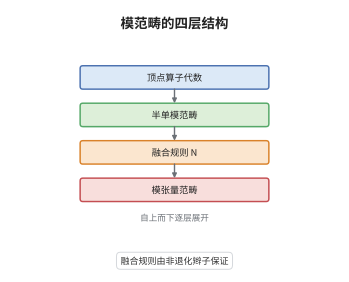

# 有理顶点算子代数的模张量范畴

> **一句话大白话**：有理顶点算子代数的模之间能"相乘"，这套乘法有单位、有结合约束、还有辫子，S 矩阵非退化时整个模范畴就是一个模张量范畴。
>
> **小例子**：Ising 型顶点算子代数有三个不可约模 $\mathbf 1,\varepsilon,\sigma$，其融合规则为 $\sigma\boxtimes\sigma=\mathbf 1\oplus\varepsilon$，这正是中心荷 $c=\frac12$ 的融合代数。

## 介绍

有理顶点算子代数 $V$ 只有有限多个不可约模，但这些模并不是彼此孤立的：把两个模"相乘"会得到模的直和，系数称为融合系数。严格化这件事需要交错算子（intertwining operator）：它把两个模的场夹在中间，输出第三个模的场。Huang 与 Lepowsky 在 1990 年代用交错算子构造了模范畴上的张量积与辫子，Huang 在 2005 年进一步证明酉性条件下的 S 矩阵非退化，于是模范畴成为模张量范畴。这一步的意义超出表示论：模张量范畴正是 Reshetikhin–Turaev 构造三维拓扑量子场论的输入，因此一个有理顶点算子代数直接给出一个三维不变量。

## 几何直观

图意在说明：最上层是顶点算子代数 $V$ 本身，往下得到半单的模范畴，再由交错算子算出融合系数，最底层加上非退化的辫子就成为模张量范畴；每一层都由上一层的数据唯一决定。

## 分析

**前置依赖**：顶点算子代数、张量范畴；另需交错算子与 Zhu 的模有限性结论。

**数学内涵**：
- 融合空间是型 $(i,j;k)$ 的交错算子空间，融合系数 $N_{ij}^{\,k}$ 等于该空间的维数；半单时 $M_i\boxtimes M_j\cong\bigoplus_kN_{ij}^{\,k}M_k$。
- 张量单位是 $V$ 自身；结合约束由亏格零的五点函数给出并满足五边形公理；辫子由交错算子解析延拓绕行一周的单值性给出，满足 Yang–Baxter 方程。
- 常见误区：非有理情形的模范畴一般不是半单的，只能得到非半单张量范畴；仅有张量结构还不够，必须辫子非退化才能称"模张量范畴"。

**结构**：
1. 用交错算子定义融合空间，得到半单模范畴的张量积。
2. 由五点函数验证结合约束，由六点函数验证辫子的 Yang–Baxter 方程。
3. 用模不变性证明 S 矩阵可逆，得到非退化辫子，从而成为模张量范畴。

## 思考过程

把模"相乘"的直觉来自共形场论：两个插入点靠近时，两个场合成一个场，展开成第三个模的场之和，系数就是融合系数。困难在于这种"相乘"要先定义在一个无穷维空间上，还要证明它与插入点的位置无关。Huang 与 Lepowsky 的办法是把交错算子当作基本对象，用顶点算子的局部性把不同结合方式之间的差别压缩成有限个系数，这些系数恰好满足五边形公理。辫子则来自绕行：把一个场绕另一个场转一圈，模的标签按单值性改变，改变的方式是一个矩阵，它满足 Yang–Baxter 方程。最后一步用 Zhu 的模不变性：特征标在 $S$ 变换下给出的矩阵可逆，辫子才真正非退化，范畴才"模"。

## 证明过程

**定理**：设 $V$ 是有理且 $C_2$ 余有限的顶点算子代数。则其模范畴 $\mathrm{Mod}(V)$ 是半单的有限 $\mathbb C$-线性范畴，带双线性张量积 $\boxtimes$、单位 $V$、辫子 $\mathcal R$ 与 ribbon 元素 $\theta$；且 $S$ 矩阵非退化，故 $\mathrm{Mod}(V)$ 是模张量范畴。

**证明**：

### 1. 有限性与半单性

由 Zhu 的定理，$V$ 只有有限多个不可约模 $M_0=V,M_1,\dots,M_{n-1}$，每个模完全可约，任意两个不可约模之间的交错算子空间有限维。于是 $\mathrm{Mod}(V)$ 是半单范畴，其单对象恰为这 $n$ 个模。

### 2. 张量积与结合约束

对不可约模定义张量积

$$
M_i\boxtimes M_j\cong\bigoplus_{k=0}^{n-1}N_{ij}^{\,k}M_k,
$$

其分量维数由交错算子空间的维数确定。用顶点算子的局部性可把两个相邻插入的乘积重排，重排的差别只在有限个奇异项上，于是三种结合方式给出的融合空间之间存在典范同构，且这些同构满足五边形公理。

### 3. 辫子与模性

把一个交错算子沿绕另一个插入点的闭路解析延拓，得到辫子 $\mathcal R_{M_i,M_j}:M_i\boxtimes M_j\to M_j\boxtimes M_i$；六点函数的单值性保证它满足 Yang–Baxter 方程。令 $\theta_i=\mathrm e^{2\pi\mathrm i(h_i-c/24)}$ 给出 ribbon 结构。由 Zhu 的模不变性，特征标的 $S$ 矩阵满足 $S^2=C$ 且可逆，故辫子非退化，$\mathrm{Mod}(V)$ 为模张量范畴。$\square$

## 课堂问答

**老师**：为什么"有理"还不够，非要再加 $C_2$ 余有限才能得到模张量范畴？

**学生**：有理只给出有限多个模与完全可约性；要构造张量积还需要交错算子空间有限维、融合系数有限，这靠 $C_2$ 余有限。少了它，融合空间可能是无穷维的，张量积无从定义。

**老师（追问）**：辫子为什么由"绕行"给出，而不是直接交换两个模？

**学生**：因为交错算子只在形式幂级数意义下有定义，两个插入点的相对位置有绕行方式的信息。把算子沿闭路解析延拓，单值性给出一个矩阵，这就是辫子；它一般不满足 $\mathcal R^2=\mathrm{id}$，而满足 Yang–Baxter 方程，正是这一点让范畴"辫"而不"对称"。

**老师（拓展）**：得到模张量范畴之后能做什么？

**学生**：可以喂给 Reshetikhin–Turaev 构造，得到三维拓扑量子场论与三维流形不变量；融合系数给出任意子模型的聚变规则，S 矩阵给出编织统计。Ising 型的 $\sigma\boxtimes\sigma=\mathbf 1\oplus\varepsilon$ 正是非阿贝尔任意子最经典的例子。
