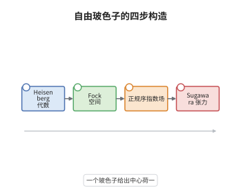

# 自由场实现与Fock空间

> **一句话大白话**：把自由玻色子的振荡模式做成 Fock 空间，再用正规序指数造出顶点算子，就得到最简单的顶点代数——Heisenberg 顶点算子代数，它的应力张量由 Sugawara 构造给出。
>
> **小例子**：秩一情形取 $\lambda=\mu=1$，则 $Y(\mathrm e^{1},z)\mathrm e^{1}=z\,\mathrm e^{2}+\cdots$，即两个顶点算子相乘出现的幂次恰为内积 $\lambda\cdot\mu=1$。

## 介绍

自由玻色子是共形场论里最朴素的模型：一个无质量的标量场 $\varphi$，其振荡模式满足 Heisenberg 代数 $[\alpha_m,\alpha_n]=m\delta_{m+n,0}$。把这个代数的表示做成 Fock 空间，再用正规序指数构造顶点算子 $Y(\mathrm e^{\lambda},z)={:}\mathrm e^{\lambda\varphi(z)}{:}$，就得到一个顶点算子代数。它是顶点代数理论的原型：Virasoro 代数在这里第一次被具体实现，能量动量张量由振荡模式的二次型给出，这就是 Sugawara 构造的秩一情形。更一般地，仿射 Kac-Moody 代数在同一思路下给出 WZW 模型，因此自由场既是玩具模型，也是构造更复杂理论的积木。

## 几何直观

图意在说明：振荡模式的交换关系定义了代数，Fock 空间承载其表示，正规序指数把态变成顶点算子，最后用模式的二次型拼出应力张量；四步串成一条构造链，中心荷在最后一步出现。

## 分析

**前置依赖**：顶点代数、Fock 空间；另需 Heisenberg 代数与正规序的基本操作。

**数学内涵**：
- Heisenberg 代数由 $\alpha_n$（$n\in\mathbb Z$）张成，满足 $[\alpha_m,\alpha_n]=m\delta_{m+n,0}$；Fock 空间 $\pi_\lambda$ 由 $\alpha_n|0\rangle=0$（$n>0$）与 $\alpha_0|0\rangle=\lambda|0\rangle$ 生成。
- 顶点算子 $Y(\mathrm e^{\lambda},z)={:}\mathrm e^{\lambda\varphi(z)}{:}$ 满足算符乘积展开 $Y(\mathrm e^{\lambda},z)Y(\mathrm e^{\mu},w)\sim(z-w)^{\lambda\mu}Y(\mathrm e^{\lambda+\mu},w)$，指数相加而幂次由内积决定。
- 常见误区：$\pi_\lambda$ 对 $\lambda\ne0$ 是模而不是顶点代数本身；Heisenberg 顶点算子代数既不是有理的，也不满足 $C_2$ 余有限，故 Verlinde 公式对它不适用。

**结构**：
1. 用振荡模式造出 Fock 空间，验证它是 Heisenberg 代数的表示。
2. 用正规序指数定义顶点算子，由 Baker–Campbell–Hausdorff 公式验证顶点代数公理。
3. 令 $T$ 为模式的二次型，计算算符乘积展开读出中心荷。

## 思考过程

把"场"写成指数是物理学的传统：$j$ 之类的顶点算子本身就是 $j$ 由 $\mathrm e^{i\lambda\varphi}$ 的展开给出的。数学上的困难在于指数里的算子是无穷和，必须先规定正规序（产生算子放左、湮灭算子放右）才能定义。一旦正规序固定，两个指数的乘积就能用 Baker–Campbell–Hausdorff 公式算成"常数因子乘第三个指数"，而常数因子恰是 $(z-w)^{\lambda\mu}$，这正好给出局部性。应力张量则更简单：它是模式的二次型 $T(z)=\frac12{:}\partial\varphi^2{:}$，其极点结构由 Wick 定理直接给出，中心荷等于玻色子的个数。这套构造后来被推广到仿射李代数，成为 WZW 模型的代数基础。

## 证明过程

**定理**：设 $\pi_\lambda$ 为秩一 Heisenberg 代数的 Fock 空间，$Y(\mathrm e^{\lambda},z)={:}\mathrm e^{\lambda\varphi(z)}{:}$。则这些顶点算子满足顶点代数公理，且

$$
T(z)=\frac12{:}\partial\varphi(z)\partial\varphi(z){:}=\frac12\sum_{n\in\mathbb Z}{:}\alpha_{-n}\alpha_n{:}\,z^{-n-2}
$$

给出中心荷 $c=1$ 的 Virasoro 元素；一般地 Sugawara 构造给出 $c=k\dim\mathfrak g/(k+h^\vee)$ 的 Virasoro 元素。

**证明**：

### 1. Fock 空间与正规序

由 $[\alpha_m,\alpha_n]=m\delta_{m+n,0}$，$\pi_\lambda$ 以 $\alpha_{-n}$（$n>0$）为产生算子、$\alpha_n$（$n>0$）为湮灭算子，$\alpha_0$ 作用为 $\lambda$。正规序规定产生算子一律放在湮灭算子左边，从而每个正规序乘积在 $\pi_\lambda$ 上有定义。

### 2. 顶点算子的局部性

把指数按产生与湮灭部分拆开，${:}\mathrm e^{\lambda\varphi(z)}{:}=\mathrm e^{\lambda\varphi_-(z)}\mathrm e^{\lambda}\mathrm e^{\lambda\varphi_+(z)}z^{\lambda\alpha_0}$。用 $[\,\alpha_m,\alpha_n\,]=m\delta_{m+n,0}$ 计算两部分的对易子，得 $\mathrm e^{\lambda\varphi_+(z)}\mathrm e^{\mu\varphi_-(w)}=(z-w)^{\lambda\mu}\mathrm e^{\mu\varphi_-(w)}\mathrm e^{\lambda\varphi_+(z)}$，故

$$
Y(\mathrm e^{\lambda},z)Y(\mathrm e^{\mu},w)=(z-w)^{\lambda\mu}\,{:}\mathrm e^{\lambda\varphi(z)+\mu\varphi(w)}{:}.
$$

右端只带 $(z-w)$ 的非负整数次幂（当 $\lambda\mu\in\mathbb Z$），于是两个场彼此局部，顶点代数公理成立。

### 3. 应力张量与中心荷

取 $T(z)=\frac12{:}\partial\varphi(z)\partial\varphi(z){:}$，由 Wick 定理对两个二次型作四次收缩，得

$$
T(z)T(w)\sim\frac{1/2}{(z-w)^4}+\frac{2T(w)}{(z-w)^2}+\frac{\partial T(w)}{z-w},
$$

与一般公式对比即得 $c=1$。推广到 $\mathfrak g$ 时取 $T=\frac{1}{2(k+h^\vee)}\sum_a{:}J^aJ^a{:}$，同一计算给出 $c=k\dim\mathfrak g/(k+h^\vee)$；阿贝尔情形 $h^\vee=0$，每个玻色子贡献 $1$。$\square$

## 课堂问答

**老师**：为什么顶点算子必须写成正规序指数，而不能直接写 $\mathrm e^{\lambda\varphi(z)}$？

**学生**：因为 $\varphi(z)$ 本身是无穷和，含无穷多个产生与湮灭算子，直接取指数没有定义。正规序先把产生算子移到左边、湮灭算子移到右边，使每一项作用在 Fock 空间上都有意义；代价是乘积时出现由对易子产生的常数因子，而这个因子正是 $(z-w)^{\lambda\mu}$。

**老师（追问）**：这个常数因子为什么恰好保证了局部性？

**学生**：因为 $\lambda\mu$ 是整数时 $(z-w)^{\lambda\mu}$ 只有非负幂，两个场相乘没有极点；即使 $\lambda\mu$ 不是整数，指数也是有限的，乘以足够高的 $(z-w)^N$ 就能消去奇性。局部性要求"乘以某次幂后对易为零"，这里正好满足。

**老师（拓展）**：Heisenberg 顶点算子代数为什么不是有理的？

**学生**：它的不可约模 $\pi_\lambda$ 有连续多个（$\lambda$ 取模格点的不同陪集），不是有限多个；它的 $C_2$ 商是 $\alpha_{-1}$ 的多项式环，无穷维，故也不 $C_2$ 余有限。正因如此，Verlinde 公式与模张量范畴的结论都不能直接套用它。
