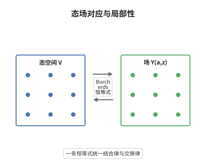

# 顶点代数的定义与 Borcherds 恒等式

> **一句话大白话**：顶点代数给向量空间里每个向量 $a$ 配一个取值在形式幂级数里的场 $Y(a,z)=\sum_n a_{(n)}z^{-n-1}$，并要求这些场彼此满足一条同时包含结合律与交换律的恒等式。
>
> **小例子**：真空 $\mathbf 1$ 的场就是恒等算子 $Y(\mathbf 1,z)=\mathrm{id}_V$；在秩一自由玻色子中，态 $a=\alpha_{(-1)}\mathbf 1$ 的场是 $Y(a,z)=\sum_{n\in\mathbb Z}\alpha_nz^{-n-1}$，即物理上的电流 $\partial\varphi(z)$。

## 介绍

顶点代数（vertex algebra）是二维共形场论的代数骨架，1986 年由 Borcherds 提出。普通代数的乘法是一个二元运算，而这里每个态 $a$ 对应无穷多个模式 $a_{(n)}$，把"在点 $z$ 处插入态 $a$"这件事编码成一个算子值形式幂级数 $Y(a,z)$，称为态场对应。若不施加相容性条件，这族算子毫无约束；Borcherds 的洞察是把共形场论里的算符乘积展开打包成一条恒等式，让"先插入再相乘"与"先相乘再插入"的差别被写成有限个正规序项之和。于是原本依赖解析与收敛的场论操作，变成了纯代数的系数比较。这条恒等式被称为 Borcherds 恒等式，也叫顶点代数的 Jacobi 恒等式。

## 几何直观

图意在说明：左边是离散的态空间 $V$，右边是带形式变量 $z$ 的算子级数；态场对应 $a\mapsto Y(a,z)$ 把两侧连起来，而 Borcherds 恒等式约束的正是右侧这些级数彼此的相容性。

## 分析

**前置依赖**：线性代数、形式幂级数、域算子；另需李代数的基本语言与共形向量 $\omega$ 的概念。

**数学内涵**：
- 态场对应写成 $Y(a,z)=\sum_{n\in\mathbb Z}a_{(n)}z^{-n-1}$，其中 $a_{(n)}\in\operatorname{End}V$ 称为模式；平移算子由 $Ta=a_{(-2)}\mathbf 1$ 定义，并满足 $[T,Y(a,z)]=\partial_zY(a,z)$。
- 截断性要求对固定的 $a,b$ 有 $a_{(n)}b=0$（$n$ 充分大），于是 $Y(a,z)b$ 只有有限个负幂项，恒等式中的求和才对每个向量局部有限。
- 常见误区：$Y(a,z)$ 不是复变量 $z$ 的算子值函数，而是形式幂级数；把 $z$ 代入具体复数会立刻遇到发散，公理的整套设计正是为了绕开这一点。

**结构**：
1. 先立两条结构性公理：真空是单位，且 $Y(a,z)\mathbf 1=a+O(z)$。
2. 再要求任意两个场彼此局部：存在 $N$ 使 $(z-w)^N[Y(a,z),Y(b,w)]=0$。
3. 把局部性与结合性合起来，比较 $(z-w)$ 的负幂系数，得到 Borcherds 恒等式；反向逐项提取即恢复局部性。

## 思考过程

真正棘手的是奇性：两个场靠近时会出现无穷多个极点项，直接公理化会依赖收敛半径。Borcherds 的做法是把一切搬进形式幂级数环，用乘以 $(z-w)^N$ 的方式消去奇性，再提取系数；代价是得到无穷族恒等式，收益是它们可以用一条带二项式系数的公式统一书写。Frenkel、Lepowsky 与 Meurman 在构造月光模时把它叫作 Jacobi 恒等式，因为它与 Lie 代数的 Jacobi 恒等式同源：把 $Y(a,z)$ 看成"带参数括号"的生成函数，Borcherds 恒等式就是这族括号的 Jacobi 恒等式。正是这一点，使顶点代数能同时容纳 Virasoro 代数、仿射 Kac-Moody 代数与格顶点代数。

## 证明过程

**定理**：设 $V$ 是复向量空间，带真空 $\mathbf 1$、平移算子 $T$ 与线性映射 $Y:V\to(\operatorname{End}V)[[z,z^{-1}]]$，满足 $Y(\mathbf 1,z)=\mathrm{id}$、$Y(a,z)\mathbf 1=a+O(z)$ 与截断性。则局部性与下述 Borcherds 恒等式等价：对 $a,b\in V$ 及任意 $m,n\in\mathbb Z$，

$$
\big(a_{(m)}b\big)_{(n)}=\sum_{j\ge0}(-1)^j\binom{m}{j}\Big(a_{(m-j)}b_{(n+j)}-(-1)^m b_{(m+n-j)}a_{(j)}\Big),
$$

其中对每个 $c\in V$，右侧作用在 $c$ 上只有有限项非零。

**证明**：

### 1. 用局部性消去奇性

由局部性存在 $N\ge0$ 使 $(z-w)^N[Y(a,z),Y(b,w)]=0$。把 $Y(a,z-w)b$ 按 $(z-w)$ 作形式 Taylor 展开，可把它改写成 $w$ 处的场，得到结合性公式

$$
(z-w)^N Y(a,z)Y(b,w)c=(z-w)^N Y\big(Y(a,z-w)b,w\big)c .
$$

这一步合法，是因为截断性保证 $Y(a,z-w)b$ 中 $(z-w)$ 的负幂只有有限个。

### 2. 比较系数

把 $Y(a,z-w)=\sum_j a_{(j)}(z-w)^{-j-1}$ 与 $w$ 处的展开代入上式，再用二项式展开把 $(z-w)^{-m-1}$ 写成 $w$ 的幂级数。比较 $(z-w)^{-j-1}w^{-n-1}$ 的系数，二项式系数同时给出交错符号与 $\binom{m}{j}$，整理即得定理中的恒等式。作为直接推论，令相关项合并即得交换子公式

$$
[a_{(m)},b_{(n)}]=\sum_{j\ge0}\binom{m}{j}\big(a_{(j)}b\big)_{(m+n-j)},
$$

它说明所有模式 $a_{(n)}$ 张成一个李代数。

### 3. 结论

反向推导是同一套系数比较的逆运算：当恒等式对全部 $m,n$ 成立时，把它按 $n$ 求和并重排即可恢复结合性公式，再由结合性与交换性得到局部性。因此顶点代数的全部公理可以压缩成这一条恒等式，而截断性保证压缩过程中不出现无穷和。$\square$

## 课堂问答

**老师**：公理里为什么非要有"截断性"这一条，它到底排除了什么？

**学生**：没有它，$Y(a,z)b$ 可能有无限多个负幂项，$a_{(n)}b$ 对无穷多个 $n$ 非零，Borcherds 恒等式右边的和就不再局部有限。截断性保证每个场作用在一个向量上只产生有限个极点，这正是"场"与一般形式幂级数的分界。

**老师（追问）**：那局部性中的 $(z-w)^N$ 和截断性各自管什么？

**学生**：局部性管两个场靠近时的极点阶数，$N$ 是其上界；截断性管单个场沿 $z$ 方向的极点个数。两者合起来才使 $(z-w)^NY(a,z)Y(b,w)c$ 成为 $z,w$ 的非负幂级数，从而可以合法地提取 $(z-w)^{-j-1}w^{-n-1}$ 的系数。

**老师（拓展）**：这条恒等式与 Lie 代数的 Jacobi 恒等式真是一回事吗？

**学生**：在 $n\ge1$ 时 $a_{(n)}b=0$ 的交换情形，恒等式退化为 $[a_{(0)},b_{(0)}]=0$，顶点代数就是交换结合代数；在只有 $a_{(-1)},a_{(0)}$ 起作用的李代数型情形，它恰好是通常的 Jacobi 恒等式。一般情形是两者的统一：所有模式张成一个李代数，Borcherds 恒等式正是这个李代数的 Jacobi 恒等式。
