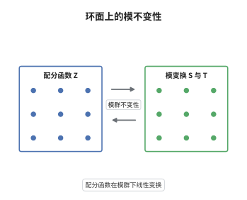

# 顶点算子代数与模不变性

> **一句话大白话**：把顶点算子代数的特征标放到环面上算，得到的函数在模群变换下只作有限线性组合，所以配分函数"几乎"是模形式。
>
> **小例子**：月光模 $V^\natural$ 的配分函数是 $J(\tau)=q^{-1}+196884q+21493760q^2+\cdots$，它在 $\tau\mapsto-1/\tau$ 下不变，因而是 $\mathrm{SL}_2(\mathbb Z)$ 不变的模函数。

## 介绍

把二维共形场论放在环面 $\mathbb C/(\mathbb Z+\tau\mathbb Z)$ 上，配分函数是 $Z(\tau)=\operatorname{tr}_V(q^{L_0-c/24})$，其中 $q=\mathrm e^{2\pi\mathrm i\tau}$。环面的复结构由上半平面中的 $\tau$ 参数化，而 $\tau$ 与 $\tau+1$、$-1/\tau$ 给出同一个环面，物理上 $Z$ 必须在模群作用下不变。Zhu 在 1996 年证明：对有理且 $C_2$ 余有限的顶点算子代数，有限多个不可约模的特征标张成一个有限维空间，模群在其上线性地作用。于是"共形场论在环面上自洽"这个物理要求，被翻译成纯表示论的命题：特征标给出 $\mathrm{SL}_2(\mathbb Z)$ 的有限维表示。这也是构造模形式的一条重要途径，月光模的 $J$ 函数就是最著名的产物。

## 几何直观

图意在说明：上半平面中的 $\tau$ 与经 $T:\tau\mapsto\tau+1$、$S:\tau\mapsto-1/\tau$ 得到的点描述同一个环面，因此环面上的配分函数只能在这些变换下作线性组合，而不能任意变化。

## 分析

**前置依赖**：顶点代数、模形式；另需有理顶点算子代数与 Zhu 代数的基本结论。

**数学内涵**：
- 配分函数 $Z(\tau)=\operatorname{tr}_V(q^{L_0-c/24})$，按权空间分解即 $\sum_n\dim V_nq^{n-c/24}$，故它是一个 $q$ 级数。
- 特征标 $\chi_i(\tau)=\operatorname{tr}_{M_i}(q^{L_0-c/24})$ 满足 $\chi_i(\tau+1)=\mathrm e^{2\pi\mathrm i(h_i-c/24)}\chi_i(\tau)$ 与 $\chi_i(-1/\tau)=\sum_jS_{ij}\chi_j(\tau)$，其中 $h_i$ 是 $M_i$ 的共形权。
- 常见误区：单个特征标一般不是模形式；只有当 $V$ 全纯（唯一不可约模）时 $Z$ 才是权 $0$ 的模函数，一般情形是"向量值模形式"。

**结构**：
1. 把环面配分函数写成权空间的迹，得到 $q$ 级数。
2. 用 Zhu 代数把插入算子的迹化归为有限维代数上的迹，证明特征标空间有限维。
3. 验证 $S$ 与 $T$ 满足 $(ST)^3=S^2=C$，故给出模群的（投影）表示。

## 思考过程

模不变性最初是物理要求：环面没有标记的"起点"，换一组同调基不应改变配分函数。难点在于 $Z$ 是无穷维空间上的迹，直接验证模变换无从下手。Zhu 的关键想法是沿 $L_0$ 的谱把迹展开，再用顶点算子的局部性把高阶插入化归为低阶，从而证明所有这类迹都落在一个由有限多个特征标张成的空间里。一旦有限维，模变换就只需在这有限维空间上验证两个生成元的关系。这个论证把"无穷维迹"变成"有限维矩阵"，也解释了为什么有理顶点算子代数的模只有有限多个——否则特征标空间不可能是有限维的。

## 证明过程

**定理**：设 $V$ 是有理且 $C_2$ 余有限的顶点算子代数，$M_0=V,M_1,\dots,M_{n-1}$ 为全部不可约模，$h_i$ 为 $M_i$ 的共形权。则特征标 $\chi_0,\dots,\chi_{n-1}$ 张成的空间 $W$ 在 $\mathrm{SL}_2(\mathbb Z)$ 作用下不变，即

$$
\chi_i(-1/\tau)=\sum_{j=0}^{n-1}S_{ij}\chi_j(\tau),\qquad \chi_i(\tau+1)=\mathrm e^{2\pi\mathrm i(h_i-c/24)}\chi_i(\tau),
$$

且 $S^2=C$、$(ST)^3=C$，其中 $C$ 为电荷共轭给出的置换。

**证明**：

### 1. 迹的谱展开

按 $L_0$ 的特征分解 $M_i=\bigoplus_nM_i(n)$，得 $\chi_i(\tau)=\sum_n\dim M_i(n)q^{n-c/24}$。$C_2$ 余有限保证每个权空间 $M_i(n)$ 有限维，故这是良定义的形式幂级数，并在上半平面收敛。

### 2. 有限维性

把环面上的多点函数按 Zhu 的递推公式化归为一点函数，可得所有 $\operatorname{tr}_{M_i}\big(o(a_1)\cdots o(a_k)q^{L_0-c/24}\big)$ 都是有限多个 $\chi_j$ 的常系数线性组合。因此 $S$ 与 $T$ 作用后仍落在 $W$ 中，$W$ 有限维且在模群下稳定。

### 3. 生成元的关系

在 $W$ 上 $T$ 是对角的，第 $i$ 个特征值为 $\mathrm e^{2\pi\mathrm i(h_i-c/24)}$；$S$ 由 $\tau\mapsto-1/\tau$ 给出。模群的经典关系 $S^2=(ST)^3$ 来自环面同构，故在 $W$ 上成立，而 $S^2$ 正是把模 $M_i$ 送到其电荷共轭 $M_{i^*}$ 的置换。全纯情形 $n=1$ 时 $W$ 是一维，$Z$ 是权 $0$ 的模函数；对月光模即得 $J(\tau)=q^{-1}+196884q+\cdots$。$\square$

## 课堂问答

**老师**：为什么配分函数必须在模群下不变，而不能只是一个普通函数？

**学生**：因为 $\tau$ 与 $\tau+1$、$-1/\tau$ 描述的是同一个环面，只是选取了不同的同调基。物理量不应依赖基的选取，所以 $Z$ 必须不变；当有多个不可约模时，单个特征标可以彼此混合，于是得到的是模群的线性表示而不是不变函数。

**老师（追问）**：Zhu 的证明里，无穷维的迹凭什么落到有限维空间？

**学生**：靠 $C_2$ 余有限。它保证每个权空间有限维，并且高阶插入算子可以用低阶重新表达；于是所有迹都是有限多个基本特征标的线性组合。若没有这条有限性，特征标空间可能是无穷维的，模变换就无从验证。

**老师（拓展）**：如果 $V$ 不是有理的，模不变性还成立吗？

**学生**：一般不成立。非有理情形会出现无穷多个不可约模，特征标空间不再有限维，只能得到"迹函数在某个无穷维表示里变换"这类弱结论；对数共形场论中还会出现带 $\log q$ 的特征标，需要推广的模不变性表述。
