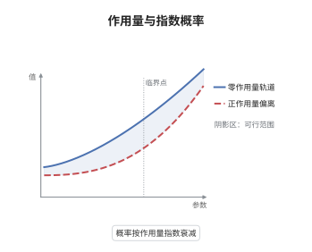

# Freidlin-Wentzell 大偏差原理

> **一句话大白话**：噪声越小，随机轨道偏离确定性轨道的概率越小，而且这个概率按"偏离所需的能量"指数衰减，指数就是作用量泛函。
>
> **小例子**：取 $b\equiv0$、$\sigma=1$、$d=1$，则 $X^\varepsilon=\sqrt\varepsilon\,W$，作用量为 $I(\varphi)=\tfrac12\int_0^T|\dot\varphi|^2\,\mathrm dt$；在时间 $T$ 内爬到 $1$ 的最小作用量是 $\tfrac{1}{2T}$，于是 $\mathbb P(\sup_{t\le T}X^\varepsilon\ge1)\approx e^{-1/(2\varepsilon T)}$。

## 介绍

Freidlin-Wentzell 理论回答一个非常具体的问题：当扩散方程 $\mathrm dX^\varepsilon=b(X^\varepsilon)\,\mathrm dt+\sqrt\varepsilon\,\sigma(X^\varepsilon)\,\mathrm dW$ 中的噪声强度趋于零时，轨道以多快的速度、沿哪些路径偏离确定性流。答案由作用量泛函 $I(\varphi)=\tfrac12\int_0^T|\dot\varphi-b(\varphi)|^2\,\mathrm dt$ 给出：偏离越"费力"，概率越小，且对数概率与 $1/\varepsilon$ 成正比。这把"罕见事件"变成"最小作用量"的变分问题，是亚稳态、逃逸问题、随机动力系统与量子力学的经典桥梁。

## 几何直观

图意在说明：确定性轨道的作用量为零，偏离轨道则要付出正的作用量。代价是速度与漂移之差的平方积分，概率按该代价的负指数衰减。

## 分析

**前置依赖**：大偏差原理、Itô 公式；补充：Girsanov 定理、Cameron-Martin 空间、指数鞅不等式。

**数学内涵**：
- 速率函数（作用量）定义为 $I(\varphi)=\tfrac12\int_0^T|\dot\varphi(t)-b(\varphi(t))|^2\,\mathrm dt$，只对绝对连续且 $\varphi(0)=x$ 的路径有限，其余取 $+\infty$；一般 $\sigma$ 时为 $\tfrac12\int_0^T|\sigma(\varphi)^{-1}(\dot\varphi-b(\varphi))|^2\,\mathrm dt$。
- 大偏差原理的精确含义是两条不等式：闭集 $F$ 上 $\limsup\varepsilon\log\mathbb P(X^\varepsilon\in F)\le-\inf_F I$，开集 $G$ 上 $\liminf\varepsilon\log\mathbb P(X^\varepsilon\in G)\ge-\inf_G I$，合起来记作 $\varepsilon\log\mathbb P\approx-I$。
- $I$ 是下半连续、紧水平集的"好速率函数"，因此 $\inf$ 可取到，最可能路径就是变分问题的极小元。
- 常见误区：把 $\varepsilon\log\mathbb P\to-I$ 当成逐点收敛。它只是指数尺度的上下界，前置因子（多项式因子）在对数除以 $\varepsilon$ 后消失，不能由此读出精确概率。

**结构**：
1. 用 Girsanov 变换把"轨道靠近给定路径"的概率写成密度的期望。
2. 在球上估计密度，得到下界（开集方向的 $\liminf$）。
3. 用指数鞅不等式与紧性把任意闭集上的概率压到最小作用量，得到上界。

## 思考过程

Freidlin 与 Wentzell 在 1970 年代研究小噪声扰动下的动力系统，动机是解释亚稳态跃迁：系统在势阱里停留极久，然后突然跳到另一个阱。逐条轨道分析没有意义，因为跃迁是罕见事件；正确尺度是对数概率。关键技巧是 Cameron-Martin-Girsanov：噪声的平移由一个 $L^2$ 漂移实现，平移的"代价"正好是作用量。这样概率问题变成"在路径空间里，哪个方向的平移最便宜"的变分问题。上限的困难在于要一致处理所有路径，解法是把路径空间紧化并用指数鞅控制大偏差，这也是大偏差理论后来的标准范式。

## 证明过程

**定理**：设 $b,\sigma$ 有界 Lipschitz，$\sigma\sigma^{\mathsf T}$ 一致椭圆，$X^\varepsilon$ 是初值为 $x$ 的上述扩散。则族 $(X^\varepsilon)$ 在 $C([0,T];\mathbb R^d)$ 上满足大偏差原理，好速率函数为 $I(\varphi)=\tfrac12\int_0^T|\sigma(\varphi)^{-1}(\dot\varphi-b(\varphi))|^2\,\mathrm dt$（绝对连续路径），否则为 $+\infty$。

**证明**：

### 1. Girsanov 变换

固定绝对连续路径 $\varphi$，$\varphi(0)=x$，$I(\varphi)<\infty$。令

$$
h(t)=\sigma(\varphi(t))^{-1}\big(\dot\varphi(t)-b(\varphi(t))\big)\in L^2(0,T).
$$

在概率空间上定义测度 $Q^\varepsilon$，其密度为

$$
\frac{\mathrm dQ^\varepsilon}{\mathrm dP}=\exp\Big(\varepsilon^{-1/2}\int_0^Th\cdot\mathrm dW-\frac1{2\varepsilon}\int_0^T|h|^2\,\mathrm dt\Big).
$$

由 Girsanov 定理，$W^\varepsilon=W-\varepsilon^{-1/2}\int_0^\cdot h\,\mathrm dt$ 在 $Q^\varepsilon$ 下是 Brown 运动。反解密度得

$$
\frac{\mathrm dP}{\mathrm dQ^\varepsilon}=\exp\Big(-\varepsilon^{-1/2}\int_0^Th\cdot\mathrm dW^\varepsilon-\frac1{2\varepsilon}\int_0^T|h|^2\,\mathrm dt\Big).
$$

### 2. 下界

在 $Q^\varepsilon$ 下，$X^\varepsilon$ 满足 $\mathrm dX^\varepsilon=b(X^\varepsilon)\,\mathrm dt+\sigma(X^\varepsilon)h\,\mathrm dt+\sqrt\varepsilon\,\sigma(X^\varepsilon)\,\mathrm dW^\varepsilon$。当 $X^\varepsilon$ 与 $\varphi$ 的 sup 距离不超过 $\delta$ 时，Lipschitz 性给出漂移差为 $O(\delta)$，于是

$$
\mathbb P\big(\sup_{t\le T}|X^\varepsilon-\varphi|\le\delta\big)=\mathbb E_{Q^\varepsilon}\Big[\frac{\mathrm dP}{\mathrm dQ^\varepsilon};\ \sup|X^\varepsilon-\varphi|\le\delta\Big].
$$

在事件上把 $h$ 换成 $h(\varphi)$ 只产生 $O(\delta)$ 的漂移误差，指数中的随机积分是方差为 $O(\delta^2/\varepsilon)$ 的鞅，由指数鞅不等式它以概率 $1-o(1)$ 不超过 $\eta/\varepsilon$。于是对任意 $\eta>0$，

$$
\mathbb P\big(\sup|X^\varepsilon-\varphi|\le\delta\big)\ge\exp\Big(-\frac{I(\varphi)+\eta}{\varepsilon}\Big)
$$

对充分小的 $\varepsilon$ 成立。取 $\varphi$ 逼近开集 $G$ 中作用量的下确界，即得开集的 $\liminf$ 不等式。

### 3. 上界

对闭集 $F$ 与 $\delta>0$，令 $F^\delta$ 为 $F$ 的 $\delta$ 邻域，$\Phi=\{I\le M\}$ 为紧的水平集。把 $[0,T]$ 分成 $n$ 段，在每段上用指数鞅不等式估计"增量偏离漂移积分超过 $\delta$"的概率：

$$
\mathbb P\Big(\sup_{t\le T}\Big|X^\varepsilon(t)-x-\int_0^tb(X^\varepsilon)\,\mathrm ds\Big|\ge\delta\Big)\le C\exp\Big(-\frac{c\,\delta^2}{\varepsilon T}\Big).
$$

再用 $I$ 的紧水平集做有限覆盖：任何离开 $F^\delta$ 的轨道，其分段线性插值的作用量至少为 $\inf_F I-\eta$。合并估计并令 $\delta\to0$，得

$$
\limsup_{\varepsilon\to0}\varepsilon\log\mathbb P(X^\varepsilon\in F)\le-\inf_{F}I .
$$

### 4. 结论

开集下界与闭集上界合起来即大偏差原理；$I$ 的下半连续性与水平集紧性来自被积函数对 $(\varphi,\dot\varphi)$ 的凸性与 $\sigma$ 的一致椭圆性，故 $I$ 是好速率函数。$\square$

## 课堂问答

**老师**：作用量泛函为什么长成速度减漂移的平方积分？

**学生**：因为把轨道从确定性流"掰"到 $\varphi$ 所需的控制量正是 $\dot\varphi-b(\varphi)$。在 Itô 形式下这相当于给噪声加一个漂移，由 Cameron-Martin 定理，该漂移的 $L^2$ 能量就是测度平移的指数代价，于是 $I(\varphi)=\tfrac12\int|\dot\varphi-b(\varphi)|^2\,\mathrm dt$；有 $\sigma$ 时先除以 $\sigma$ 把噪声白化。

**老师（追问）**：$\varepsilon\log\mathbb P\approx-I$ 里，为什么前置因子不影响结论？

**学生**：因为结论只在指数尺度成立。若 $\mathbb P\approx C_\varepsilon e^{-I/\varepsilon}$ 且 $C_\varepsilon$ 至多多项式增长，则 $\varepsilon\log\mathbb P=-I+\varepsilon\log C_\varepsilon\to-I$。所以大偏差原理只断言上下界，不断言精确常数；要得到前置因子需要更精细的分析。

**老师（拓展）**：如果漂移有多个稳定平衡点，这个原理能推出什么？

**学生**：可以推出亚稳态跃迁的指数时间尺度：从吸引子 $A$ 逃到 $B$ 的平均时间约为 $\exp(\Delta/\varepsilon)$，其中 $\Delta$ 是连接 $A$ 与 $B$ 的路径所需的最小作用量，即"势垒高度"。这就是 Kramers 型定律的严格版本，也是 Freidlin-Wentzell 理论在物理与化学反应速率理论中的核心应用。
