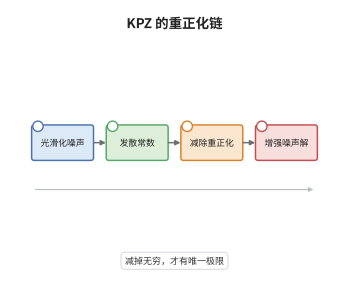

# KPZ 方程与正则性结构

> **一句话大白话**：KPZ 方程里的斜率平方在噪声下会发散成无穷大，必须减去一个随光滑尺度爆掉的常数，方程才有不依赖截断的极限解。
>
> **小例子**：取时空白噪声的光滑化 $\xi_\varepsilon$，则 $\mathbb E[(\partial_xh_\varepsilon)^2]\asymp c\,\varepsilon^{-1}$；减去 $C_\varepsilon=c\,\varepsilon^{-1}$ 后，$h_\varepsilon$ 在 $C^{1/2-}$ 中收敛到与光滑核无关的极限。

## 介绍

KPZ 方程 $\partial_th=\partial_x^2h+(\partial_xh)^2+\xi$ 由 Kardar、Parisi、Zhang 于 1986 年提出，描述随机生长界面的高度涨落，是一维界面增长与随机介质中定向 Polymer 的普适方程。它的麻烦在于 $(\partial_xh)^2$：白噪声驱动下 $h$ 只有 $1/2-$ 阶正则性，斜率平方形式上属于 $-1-$ 阶分布，乘积根本没有定义。Hairer 在 2013 年用正则性结构把"减发散常数"这一物理操作变成定理，给出了局部适定性与解的正则性，并证明解与 Cole-Hopf 解一致。这是奇异 SPDE 理论的分水岭。

## 几何直观

图意在说明：光滑化让方程可解，但引入随尺度发散的常数。减掉它之后各尺度的解才落在同一个极限上，这个极限由正则性结构的增强噪声唯一确定。

## 分析

**前置依赖**：随机热方程、正则性结构；补充：Cole-Hopf 变换、抛物尺度分析、Wick 重正化。

**数学内涵**：
- 尺度分析：若 $h\in C^{\alpha}$，则 $(\partial_xh)^2$ 名义上属于 $C^{2\alpha-2}$；白噪声下 $\alpha=1/2-$，故该项是 $-1-$ 阶分布，既不是函数也不是测度，乘积无定义。
- 重正化：对光滑化噪声解 $h_\varepsilon$，减去 $C_\varepsilon=\mathbb E[(\partial_xh_\varepsilon)^2]\asymp\varepsilon^{-1}$，方程变为 $\partial_th_\varepsilon=\partial_x^2h_\varepsilon+(\partial_xh_\varepsilon)^2-C_\varepsilon+\xi_\varepsilon$，其解收敛。
- Cole-Hopf：$v=\exp(\lambda h)$ 在噪声光滑时把 KPZ 化为随机热方程 $\partial_tv=\partial_x^2v+\lambda v\xi_\varepsilon$；Hairer 证明正则性结构给出的解与该变换在极限下一致。
- 常见误区：以为重正化只是"减期望"。一般方程中需要减除的常数与更高阶项由 BPHZ 树展开确定；也误以为解是函数，其实它只是 $C^{1/2-}$ 分布，且定理只给局部时间适定性。

**结构**：
1. 光滑化噪声，计算斜率平方的期望并确定发散常数。
2. 用树展开识别所有奇异子结构，写出增强噪声模型。
3. 在 modelled distribution 空间中对重正化方程做不动点。
4. 证明重正化解与截断核无关，得到极限解。

## 思考过程

物理学家早就知道 KPZ 需要"减一个无穷大"，但减法的合法性长期悬空：减掉期望后剩下的项仍然奇异，高阶关联会带来新的发散。Hairer 的想法是把噪声连同它的奇异乘积一起当作基本对象（增强噪声），解不再是一个分布，而是"分布加有限个奇异项"的展开。方程在这个展开空间里变成良定义的抛物方程，压缩映射照常工作。真正困难的是证明重正化后的模型收敛且极限与截断无关，这一步用 BPHZ 定理完成。此后 Gubinelli-Imkeller-Perkowski 用旁切分布给出等价处理，两条路线互为验证。

## 证明过程

**定理**：设 $\xi$ 是圆周上的时空白噪声，$\xi_\varepsilon=\xi*\rho_\varepsilon$ 为光滑化。存在常数 $C_\varepsilon\asymp c\varepsilon^{-1}$，使得初值为 $h_0\in C^{1/2-}$ 的重正化方程

$$
\partial_th_\varepsilon=\partial_x^2h_\varepsilon+(\partial_xh_\varepsilon)^2-C_\varepsilon+\xi_\varepsilon
$$

的解 $h_\varepsilon$ 在 $C([0,T];C^{1/2-})$ 中依概率收敛到与 $\rho$ 无关的极限 $h$；该极限对给定的增强噪声局部唯一，称为 KPZ 方程的解。

**证明**：

### 1. 发散常数的计算

线性解 $h_{\mathrm{lin}}=\int_0^te^{(t-s)\partial_x^2}\xi_\varepsilon\,\mathrm ds$ 的斜率满足

$$
\mathbb E\big[(\partial_xh_{\mathrm{lin}}(t,x))^2\big]=\int_0^t\big\|\partial_xe^{s\partial_x^2}\big\|_{L_2}^2\,\mathrm ds=\int_0^t\!\!\int|k|^2e^{-2sk^2}|\hat\rho_\varepsilon(k)|^2\,\mathrm dk\,\mathrm ds .
$$

对 $s$ 积分得 $\tfrac12\int|\hat\rho_\varepsilon(k)|^2\,\mathrm dk\asymp\varepsilon^{-1}$，这正是截断去掉的高频模数，故 $C_\varepsilon\asymp c\varepsilon^{-1}$ 必须减去。减去后 $\partial_xh_\varepsilon$ 的方差在 $\varepsilon\to0$ 时有界。

### 2. 奇异子结构的树展开

把解按噪声的幂次展开，每一项对应一棵树。一级树给出 $\partial_xh_{\mathrm{lin}}$，二级树给出 $(\partial_xh_{\mathrm{lin}})^2$，其期望正是 $C_\varepsilon$；减去它之后，二级树只留下与增强噪声的第二个分量（记为 $\Xi_2$）耦合的部分。更高阶树在 $1+1$ 维都是可积的，因此只需要这一个反项。

### 3. 增强噪声与不动点

增强噪声是三元组 $\Xi=(\xi,\Xi_2,\Xi_3)$，配上模型算子 $\Pi$ 与重整化群 $\Gamma$。把解写成 modelled distribution $H$，其分量是 $\xi$ 的多项式系数。重正化方程等价于

$$
H=\mathcal K\big(\Pi H\cdot\nabla H\big)+H_0 ,
$$

其中 $\mathcal K$ 是热核卷积。由于 $\mathcal K$ 把正则性提高两阶，而 $\Pi H\cdot\nabla H$ 至多损失一阶，映射在小时间区间上是压缩，得到唯一不动点。

### 4. 截断无关性与结论

不同光滑核给出的增强噪声在 BPHZ 重正化后收敛到同一极限模型，故不动点极限与 $\rho$ 无关；解的正则性为 $C^{1/2-}$，低于函数空间，故所有乘积都在增强空间中理解。$\square$

## 课堂问答

**老师**：为什么不能直接对 $\partial_th=\partial_x^2h+(\partial_xh)^2+\xi$ 做 Picard 迭代？

**学生**：因为 $(\partial_xh)^2$ 无定义。白噪声下 $h\in C^{1/2-}$，$\partial_xh\in C^{-1/2-}$，两个这样的分布相乘超出分布理论的范围；Picard 迭代第一步就要求这个乘积，方程本身没有意义。

**老师（追问）**：减掉 $\mathbb E[(\partial_xh_\varepsilon)^2]$ 为什么还不够，还要"增强噪声"？

**学生**：减期望只消除二级树的发散部分，但减去后期望为零的项仍然与噪声的高阶关联耦合，它的乘积又会产生新的奇异项。正则性结构把这些项一并打包进增强噪声的各个分量，解被写成"分布加奇异项"的展开，乘积在展开空间里才有定义。这也是为什么定理断言的是增强噪声给定下的唯一性。

**老师（拓展）**：KPZ 与随机热方程的关系在严格层面还成立吗？

**学生**：成立。通过 Cole-Hopf 变换 $v=\exp(\lambda h)$，光滑噪声下 KPZ 等价于 $\partial_tv=\partial_x^2v+\lambda v\xi_\varepsilon$；Hairer 证明重正化后的 KPZ 解与 Cole-Hopf 解在极限中一致。这也给出 KPZ 的一类显式可解情形，并解释了它的普适性：不同的微观模型在极限中都落到同一个方程上。
