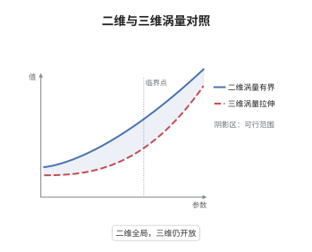

# 二维随机 Navier-Stokes 方程的适定性

> **一句话大白话**：二维流体的涡量不会被流动拉长，能量和涡量都被噪声稳稳压住，所以从任意初值出发都有唯一的全局解；三维没有这个运气，问题至今开放。
>
> **小例子**：在二维环面上取 $\nu=1$、加性噪声强度 $\epsilon$，涡量 $\omega=\partial_1u_2-\partial_2u_1$ 满足 $\mathrm d\|\omega\|^2+2\|\nabla\omega\|^2\,\mathrm dt=\epsilon^2\,\mathrm dt+2\langle\omega,\mathrm dW\rangle$，取期望即得 $\mathbb E\|\omega(t)\|^2+2\mathbb E\int_0^t\|\nabla\omega\|^2\,\mathrm ds=\|\omega_0\|^2+\epsilon^2t$。

## 介绍

随机 Navier-Stokes 方程是流体力学与随机分析交汇的核心模型：$\mathrm du+(\nu Au+B(u,u))\,\mathrm dt=G(u)\,\mathrm dW$。在二维，涡量方程中的对流项与涡量的配对恰好为零，涡量既不产生也不被拉伸，于是能量与涡量的先验估计都封闭，可以把随机热方程那套"先局部、再 Gronwall 延拓"的论证完整跑通。三维则因为涡量拉伸项无法控制，只有局部强解与全局弱解，唯一性是公开问题。本节把二维的估计链条写清楚，并明确三维的边界在哪里。

## 几何直观

图意在说明：二维涡量被对流项守恒地搬运，曲线始终有界。三维涡量拉伸项可以让曲线在有限时间冲向无穷，全局有界性无法先验得到。

## 分析

**前置依赖**：Navier-Stokes 方程、随机分析；补充：Leray 投影、Stokes 算子、Ladyzhenskaya 不等式。

**数学内涵**：
- 抽象形式为 $\mathrm dU+(\nu AU+B(U,U))\,\mathrm dt=G(U)\,\mathrm dW$，其中 $A=-P\Delta$ 是 Stokes 算子，$B(U,U)=P(u\cdot\nabla u)$，$P$ 为 Leray 投影。
- 二维涡量 $\omega=\partial_1u_2-\partial_2u_1$ 满足 $\partial_t\omega+(u\cdot\nabla)\omega=\nu\Delta\omega+\text{噪声}$，且 $\int(u\cdot\nabla\omega)\omega\,\mathrm dx=\tfrac12\int u\cdot\nabla|\omega|^2\,\mathrm dx=0$，这是维数二特有的消去。
- 三维对应项 $\int(\omega\cdot\nabla)u\cdot\omega\,\mathrm dx\ne0$，量级为 $\|\omega\|^3$，Gronwall 只能给出有限时间的界，故仅有局部强解与全局 martingale 弱解，唯一性未知。
- 常见误区：把"全局弱解存在"误读为"全局强解存在"。弱解在概率意义下用 martingale 问题表述，不保证轨道唯一，也不保证能量等式。

**结构**：
1. 投影到无散度空间，写出抽象随机演化方程。
2. 对 $\|u\|^2$ 用 Itô 公式与 Burkholder-Davis-Gundy 不等式得能量估计。
3. 对 $\|\omega\|^2$ 用涡量方程得 enstrophy 估计，指数 martingale 控制噪声项。
4. 用 Ladyzhenskaya 不等式估计差分解，Gronwall 得轨道唯一性。

## 思考过程

确定性二维 Navier-Stokes 的全局适定性早在二十世纪三十年代就由 Leray 的思路配合二维技巧解决，真正的新困难来自噪声：Itô 修正项会让能量等式多出 $\|G\|_{L_2}^2$，而随机积分没有逐点界。处理办法是把噪声项分成"迹类部分的漂移"与"鞅部分"，前者并入 Gronwall，后者用指数 martingale 与 BDG 不等式控制。二维之所以能走通，全靠涡量方程里对流项的消去；三维一旦出现 $\omega\cdot\nabla u$，所有估计都差一个 $\|\omega\|$ 的幂次，这正是千禧年问题的随机版本仍然开放的原因。

## 证明过程

**定理**：设区域为二维环面，$\nu>0$，$G$ 取值于 Hilbert-Schmidt 算子空间且满足 $\|G(u)\|_{L_2}^2\le C(1+\|u\|^2)$、$\|\nabla G(u)\|_{L_2}^2\le C(1+\|u\|^2)$ 与 Lipschitz 条件。则对任意 $u_0\in H$ 与 $T>0$，存在唯一的适应过程 $u\in C([0,T];H)\cap L^2(0,T;V)$ 几乎必然满足温和解等式。

**证明**：

### 1. 能量估计

对 $\|u(t)\|^2$ 用 Itô 公式，非线性项满足 $\langle B(u,u),u\rangle=0$，故

$$
\mathrm d\|u\|^2+2\nu\|\nabla u\|^2\,\mathrm dt=\|G(u)\|_{L_2}^2\,\mathrm dt+2\langle u,G(u)\,\mathrm dW\rangle .
$$

对鞅部分用 BDG 不等式并用 $\|G(u)\|_{L_2}^2\le C(1+\|u\|^2)$ 吸收，得

$$
\mathbb E\sup_{t\le T}\|u(t)\|^2+2\nu\,\mathbb E\int_0^T\|\nabla u\|^2\,\mathrm dt\le C_T\big(1+\|u_0\|^2\big).
$$

### 2. 涡量估计

令 $\omega=\partial_1u_2-\partial_2u_1$，对涡量方程用 Itô 公式。二维恒等式 $\int(u\cdot\nabla\omega)\omega\,\mathrm dx=0$ 消去对流项，只剩

$$
\mathrm d\|\omega\|^2+2\nu\|\nabla\omega\|^2\,\mathrm dt=\|\nabla G(u)\|_{L_2}^2\,\mathrm dt+2\langle\omega,\nabla\times G(u)\,\mathrm dW\rangle .
$$

由 Poincaré 不等式 $\|\omega\|^2\le\lambda_1^{-1}\|\nabla\omega\|^2$ 与假设 $\|\nabla G(u)\|_{L_2}^2\le C(1+\|u\|^2)$，得

$$
\mathrm d\|\omega\|^2+2\nu\lambda_1\|\omega\|^2\,\mathrm dt\le C(1+\|u\|^2)\,\mathrm dt+\mathrm dM_t ,
$$

其中 $M$ 是连续鞅。用指数 martingale 估计 $\mathbb E\sup_{t\le T}|M_t|^p<\infty$，再对 $\|\omega\|^2$ 用随机 Gronwall 引理，得到对每个 $T$ 的一致界 $\mathbb E\sup_{t\le T}\|\omega\|^2<\infty$。

### 3. 唯一性

设 $u,v$ 是两解，$w=u-v$。相减并用 Itô 公式，$\langle B(u,w),w\rangle=0$ 与 $\langle B(w,w),w\rangle=0$ 两次消去，剩下

$$
\mathrm d\|w\|^2+2\nu\|\nabla w\|^2\,\mathrm dt=-2\langle B(w,u),w\rangle\,\mathrm dt+\text{噪声差}.
$$

由二维 Ladyzhenskaya 不等式 $\|w\|_{L^4}\le C\|w\|^{1/2}\|\nabla w\|^{1/2}$，

$$
|\langle B(w,u),w\rangle|\le\|w\|_{L^4}^2\|\nabla u\|\le C\|w\|\|\nabla w\|\|\nabla u\|\le\frac{\nu}{4}\|\nabla w\|^2+C_\nu\|w\|^2\|\nabla u\|^2 .
$$

第一步的能量估计保证 $\int_0^T\|\nabla u\|^2\,\mathrm dt<\infty$，故 Gronwall 给出 $w\equiv0$。

### 4. 结论与三维对比

二维的能量与涡量估计对任意 $T$ 一致成立，配合局部存在性即得全局唯一强解。三维缺少步骤 2 中的消去，涡量拉伸项只能给出 $\mathrm d\|\omega\|^2+\nu\|\nabla\omega\|^2\,\mathrm dt\le C\|\omega\|^3\,\mathrm dt+\mathrm dM_t$，Gronwall 在有限时刻即失效；此时只知局部强解、全局 martingale 弱解与大偏差等部分结果，全局唯一性仍是公开问题。$\square$

## 课堂问答

**老师**：二维随机 Navier-Stokes 为什么能做到全局唯一，而三维不行？

**学生**：差别只在涡量方程。二维有 $\int(u\cdot\nabla\omega)\omega=0$，对流项不改变 enstrophy，于是 $\mathrm d\|\omega\|^2+2\nu\|\nabla\omega\|^2\,\mathrm dt$ 右端只有噪声与低阶项，Gronwall 对任意 $T$ 都成立。三维多出拉伸项 $\int(\omega\cdot\nabla)u\cdot\omega$，量级为 $\|\omega\|^3$，微分不等式变成二次增长，只能保证短时间有界。

**老师（追问）**：唯一性证明里哪一步用到了二维，哪一步用到了噪声的 Hilbert-Schmidt 条件？

**学生**：二维用在 Ladyzhenskaya 不等式 $\|w\|_{L^4}\le C\|w\|^{1/2}\|\nabla w\|^{1/2}$，它把三线性项压成 $\nu\|\nabla w\|^2$ 加可积系数；三维对应不等式指数的幂次不同，无法吸收。Hilbert-Schmidt 条件用在两处：随机卷积与能量修正项 $\|G(u)\|_{L_2}^2$ 的有限性，以及步骤 2 中 $\|\nabla G(u)\|_{L_2}^2$ 的可积性；若噪声不是迹类，连解的取值空间都要更换。

**老师（拓展）**：三维情形目前知道哪些结果？"弱解"是什么意思？

**学生**：已知全局 martingale 弱解的存在性，即存在概率空间与过程使方程在 martingale 问题意义下成立；还知道局部强解、小噪声大偏差与不变测度等结果。弱解不保证轨道唯一、不保证能量等式，因此不能当作强解使用。三维全局强解的存在与唯一正是千禧年问题在随机情形的对应物，目前仍开放。
