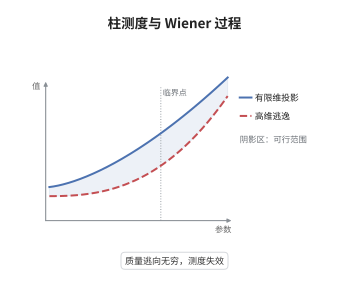

# 无穷维 Brown 运动与柱测度

> **一句话大白话**：无限维空间里的"标准高斯分布"只是一个只在小块坐标上说得通的名义测度，布朗运动只好搬到比原空间更大的空间里去住。
>
> **小例子**：取 $H=\ell^2$、$Q=\mathrm{diag}(k^{-2})$，则 $\mathrm{tr}\,Q=\pi^2/6<\infty$，于是 $W(t)=\sum_k k^{-1}\beta_k(t)e_k$ 是 $H$ 值的 $Q$-Wiener 过程，且 $\mathbb E\|W(t)\|_H^2=t\pi^2/6$。

## 介绍

随机偏微分方程里的噪声几乎总写成"$Q$-Wiener 过程"，而状态空间往往是无限维 Hilbert 空间。在有限维，协方差矩阵立刻给出一个 Gauss 测度；在无限维，同一套配方只在有限个坐标上给出一族相容的柱测度，它一般不是可数可加的测度。要让 $W$ 真正拥有轨道，必须对协方差 $Q$ 加迹类条件，或者把状态空间换成更大的空间。这一节把"为什么必须加条件、加到什么程度"讲清楚，它是后面温和解、随机卷积与不变测度讨论的地基。

## 几何直观

图意在说明：在有限维投影上质量始终是标准的 Gauss 质量，维数增大时单位球内的质量却趋于零。全部质量逃向无穷远处，这正是柱测度不是可数可加的几何表现。

## 分析

**前置依赖**：概率论、Hilbert 空间、Gaussian 测度；补充：迹类算子与 Hilbert-Schmidt 算子、Kolmogorov 连续性定理。

**数学内涵**：
- 柱测度由有限维投影的相容族给出：对任意有限个正交向量 $e_1,\dots,e_n$，柱集 $\{x:(\langle x,e_1\rangle,\dots,\langle x,e_n\rangle)\in A\}$ 赋予协方差矩阵 $(\langle Qe_i,e_j\rangle)$ 的 Gauss 质量。
- 可数可加性判据来自二阶矩：$\mathbb E\|W(t)\|_H^2=t\,\mathrm{tr}\,Q$，因此 $W$ 能在 $H$ 中取值当且仅当 $Q$ 迹类；$Q=I$ 时右端发散。
- 若 $Q$ 不是迹类，取更大的 Hilbert 空间 $U\supset H$ 使嵌入 $H\hookrightarrow U$ 为 Hilbert-Schmidt，则 $\sum_k\|e_k\|_U^2<\infty$，级数在 $U$ 中收敛，$W$ 成为 $U$ 值的柱 Wiener 过程。
- 常见误区：把 Cameron-Martin 空间 $Q^{1/2}H$ 当作轨道的取值空间。它只是漂移允许的方向集，无限维时轨道几乎必然不落在其中。

**结构**：
1. 由有限维投影定义柱测度，并验证相容性。
2. 用级数 $\sum_k\sqrt{\lambda_k}\beta_k e_k$ 在 $L^2(\Omega;H)$ 中收敛证明迹类判据。
3. 用增量矩估计与 Kolmogorov 连续性定理得到轨道连续性；非迹类情形改用 Hilbert-Schmidt 嵌入。

## 思考过程

有限维 Gaussian 测度由协方差矩阵完全决定，这个事实让人误以为无限维可以照搬。真正的障碍是质量守恒：维数越高，单位球装的概率越少，极限时所有质量都跑到无穷远，柱测度在 $H$ 上不再可数可加。Segal 与 Gross 在二十世纪六十年代把这件事抽象成"柱测度在哪些拓扑下可延拓"的问题，答案落在嵌入算子的 Hilbert-Schmidt 性上。关键工具是迹：$\mathbb E\|W(t)\|^2$ 恰好等于 $t\,\mathrm{tr}\,Q$，一个数就判定了一切。这也是为什么随机偏微分方程里总要先声明噪声的协方差是迹类的，或者干脆承认解取值于更粗糙的分布空间。

## 证明过程

**定理**：设 $H$ 可分，$Q$ 为迹类自伴非负算子，$(\lambda_k,e_k)$ 为其特征对，$(\beta_k)$ 为独立标准 Brown 运动。则级数 $\sum_k\sqrt{\lambda_k}\beta_k(t)e_k$ 在 $L^2(\Omega;C([0,T];H))$ 中收敛，其极限 $W$ 满足 $\mathrm{Cov}(W(t),W(s))=(t\wedge s)Q$。反之，若 $Q=I$ 且 $\dim H=\infty$，则不存在 $H$ 值的柱 Wiener 过程。

**证明**：

### 1. 平方可积性

对部分和 $W_n(t)=\sum_{k\le n}\sqrt{\lambda_k}\beta_k(t)e_k$，由特征向量的正交性，

$$
\mathbb E\|W_n(t)\|_H^2=t\sum_{k\le n}\lambda_k\le t\,\mathrm{tr}\,Q .
$$

右端与 $n$ 无关，故 $(W_n(t))$ 是 $L^2(\Omega;H)$ 中的 Cauchy 列，极限记为 $W(t)$；协方差由各分量独立直接算出为 $(t\wedge s)Q$。

### 2. 轨道连续性

对 $0\le s<t$，增量 $W(t)-W(s)$ 是中心 Gauss 向量，协方差为 $(t-s)Q$。Gauss 向量的高阶矩由二阶矩控制，存在常数 $C_p$ 使

$$
\mathbb E\|W(t)-W(s)\|_H^{2p}\le C_p\big((t-s)\,\mathrm{tr}\,Q\big)^{p}.
$$

取 $p>2$，指数 $p>1$，由 Kolmogorov 连续性定理，$W$ 有局部 Hölder 连续版本，指数可任意接近 $1/2$。于是 $W$ 是 $C([0,T];H)$ 值的 Gauss 过程。

### 3. 非迹类情形

若 $Q=I$，则 $\mathbb E\|W_n(t)\|_H^2=nt\to\infty$，任何 $H$ 值版本都不存在，柱测度在 $H$ 上不是可数可加的。取 $U$ 使 $H\hookrightarrow U$ 为 Hilbert-Schmidt 嵌入，则 $\sum_k\|e_k\|_U^2<\infty$，级数在 $L^2(\Omega;U)$ 中收敛，且仍以 $tQ$ 为协方差。此时 $W$ 是 $U$ 值的柱 Wiener 过程，$H$ 只作为 Cameron-Martin 空间出现。

### 4. 结论

迹类条件等价于 $W$ 能在 $H$ 中取值；去掉它只能在更大的空间中构造。$\square$

## 课堂问答

**老师**：为什么无限维的"标准 Gauss 测度"不能直接当作 $H$ 上的测度？

**学生**：因为它的质量不集中在任何有界集上。取 $Q=I$，单位球上的柱测度质量为 $\mu(\|x\|\le1)$，而 $\mathbb E\|x\|^2=\mathrm{tr}\,I=\infty$，Markov 不等式给不出正的下界；维数越高，单位球装的质量越少，极限为零。可数可加测度不可能把所有质量都放到无穷远，矛盾。

**老师（追问）**：既然是级数收敛问题，为什么 $Q$ 迹类就够了，而 $Q$ 紧还不够？

**学生**：紧性只保证 $\lambda_k\to0$，不保证可和。收敛判据是 $\mathbb E\|W(t)\|^2=t\sum_k\lambda_k$，必须 $\sum_k\lambda_k<\infty$，即 $Q$ 迹类。例如 $\lambda_k=1/k$ 时 $Q$ 紧但非迹类，部分和的方差按 $\log n$ 发散，级数在 $H$ 中不收敛。

**老师（拓展）**：如果 $Q$ 不是迹类，方程还能写吗？这时"解"是什么意思？

**学生**：能写，但要把状态空间放宽。取 $U\supset H$ 使嵌入 Hilbert-Schmidt，$W$ 就是 $U$ 值的柱 Wiener 过程；方程在 $U$ 中求解，再用半群的光滑性把解拉回 $H$。这也解释了为什么随机偏微分方程里常出现负指标的 Sobolev 空间或分布空间：它们正是容纳粗糙噪声与粗糙解的"更大空间"。
